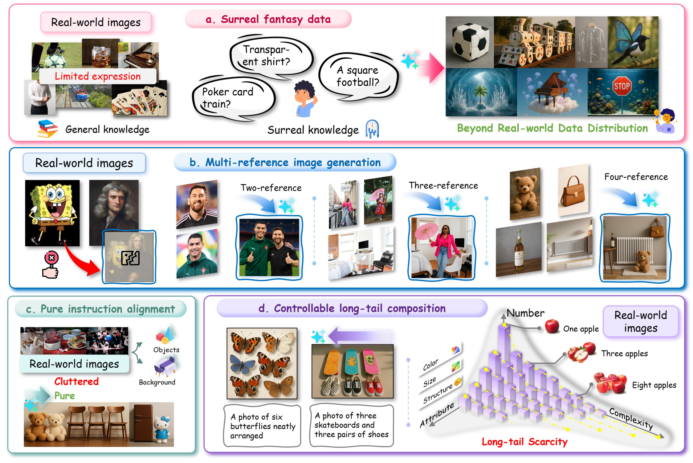
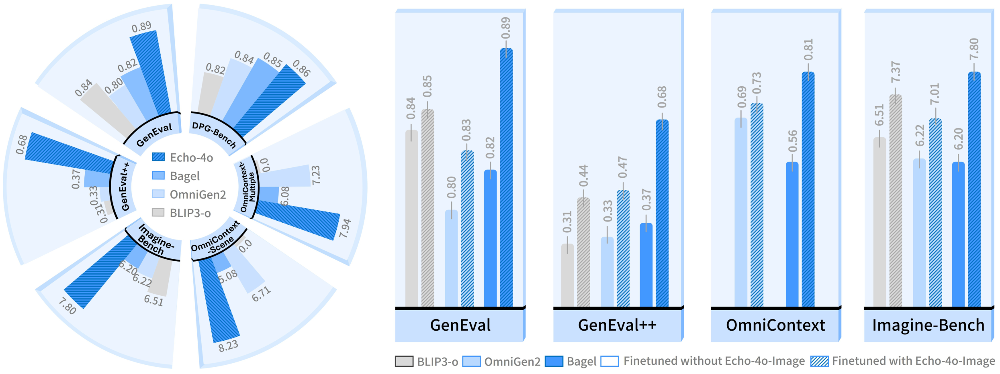
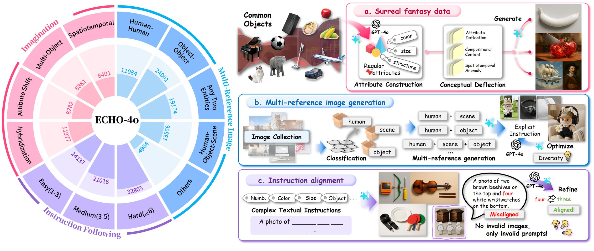
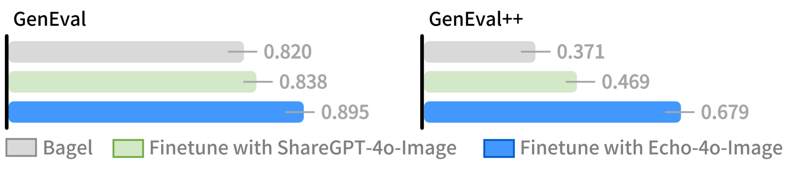
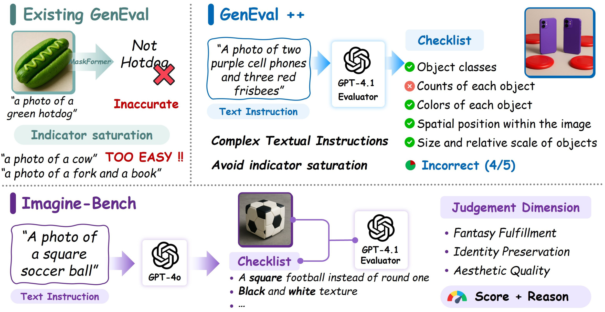

<div align="right">

[← Back to Home](../../README.md)

</div>

<h1 align="center">Echo-4o: Harnessing the Power of GPT-4o Synthetic Images for Improved Image Generation</h1>

---

## Paper Information

| Field | Value |
|---|---|
| Title | Echo-4o: Harnessing the Power of GPT-4o Synthetic Images for Improved Image Generation |
| Authors | Junyan Ye, Dongzhi Jiang, Zihao Wang, Leqi Zhu, Zhenghao Hu, Zilong Huang, Jun He, Zhiyuan Yan, Jinghua Yu, Hongsheng Li, Conghui He, Weijia Li |
| Venue | arXiv (Technical Report) |
| Year | 2025 |
| Topic | GPT-4o synthetic data for unified multimodal image generation and evaluation |
| Paper Link | [arXiv:2508.09987v1](https://arxiv.org/abs/2508.09987v1) |
| PDF | [Version 1, 13 August 2025](https://arxiv.org/pdf/2508.09987v1) |
| Project | [Echo-4o](https://github.com/yejy53/Echo-4o) |
| Dataset | [Echo-4o-Image](https://huggingface.co/datasets/Yejy53/Echo-4o-Image/) |
| Original Asset License | [arXiv non-exclusive distribution license](http://arxiv.org/licenses/nonexclusive-distrib/1.0/), as linked from the arXiv record; not a blanket third-party figure-reuse grant. |
| Asset Type | 3 method figures, 2 result figures, 0 tables |
| Method Figures PPT | [Download all 3 editable figures](method_figures/method_figures_editable.pptx) |

Figures are attributed to the paper authors and original rightsholders. PPTX files and plotting code are ReFigure reconstructions, not author-provided source. Reuse must respect the original artwork's rights.

The PPTX files preserve native text and vector diagram geometry. Photographs, logos and complex local illustrations remain independently movable raster objects. Native arrows are freeform paths, not endpoint-bound connectors; diagram plots are not data-bound charts. Unknown flattened-artwork fonts use Comic Sans MS, Times New Roman or Arial. Freehand strokes, gradients, shadows and 3-D shading are approximate. Each finalized PPTX, including every combined-deck slide, was re-imported, rendered and visually checked with Artifact Tool. PowerPoint application compatibility was not tested.

---

## Asset Preview Gallery

<table>
  <tr>
    <th>Method Figures</th>
    <th>Result Figures</th>
    <th>Table Figures</th>
  </tr>
  <tr>
    <td align="center">
      <br>
      <sub>Synthetic Data Advantages</sub>
    </td>
    <td align="center">
      <br>
      <sub>Performance Gains and Dataset Transferability</sub>
    </td>
    <td align="center"><sub>No table figures selected</sub></td>
  </tr>
  <tr>
    <td align="center">
      <br>
      <sub>Dataset Construction Pipeline</sub>
    </td>
    <td align="center">
      <br>
      <sub>GenEval and GenEval++ Dataset Comparison</sub>
    </td>
    <td></td>
  </tr>
  <tr>
    <td align="center">
      <br>
      <sub>GenEval++ and Imagine-Bench Evaluation</sub>
    </td>
    <td></td>
    <td></td>
  </tr>
</table>

---

# 1. Method Figures

## Figure 2: Synthetic Data Advantages

<p align="center">
  
</p>

| Asset | Link |
|---|---|
| Preview Image | [fig2_synthetic_data_advantages.png](method_figures/fig2_synthetic_data_advantages.png) |
| Source | Figure 2, PDF page 2; complete approved artwork from arXiv v1. |
| PPT Source | [fig2_synthetic_data_advantages.pptx](method_figures/fig2_synthetic_data_advantages.pptx) |

### Color Palette

Representative colors estimated from the approved image.

| Role | Swatch | Color | Hex |
|---|---|---|---|
| Surreal fantasy generation |  | Pink | `#FF5790` |
| Multi-reference synthesis |  | Blue | `#0877BE` |
| Pure instruction alignment |  | Teal | `#76A6A7` |
| Controllable long-tail composition |  | Purple | `#9561CF` |
| Long-tail guide markers |  | Yellow | `#E7F300` |

Four conceptual panels, native labels/arrows/frames and editable 3-D histogram prisms. Panel d's native long-tail prism array is an approximate visual schematic, not new numerical data inferred from the picture. Photographs and small illustrations remain 55 independent raster objects; prism geometry, hand-drawn curved arrows/bubbles, gradients, shadows and label curvature are approximate.

---

## Figure 3: Dataset Construction Pipeline

<p align="center">
  
</p>

| Asset | Link |
|---|---|
| Preview Image | [fig3_dataset_construction_pipeline.png](method_figures/fig3_dataset_construction_pipeline.png) |
| Source | Figure 3, PDF page 5; complete approved artwork from arXiv v1. |
| PPT Source | [fig3_dataset_construction_pipeline.pptx](method_figures/fig3_dataset_construction_pipeline.pptx) |

### Color Palette

Representative colors estimated from the approved image.

| Role | Swatch | Color | Hex |
|---|---|---|---|
| Imagination data and attribute deflection |  | Pink | `#FF4F91` |
| Multi-reference data and synthesis |  | Cyan | `#00A8E7` |
| Instruction-following data and refinement |  | Purple | `#7B46CE` |
| Multi-reference taxonomy sectors |  | Blue | `#83B8FF` |

All 12 taxonomy labels/counts and all three construction flows are native editable text and geometry. Curved group headings use individual native character textboxes. Photos, logos, folder art and tiny icons remain 45 independent raster objects.

---

## Figure 4: GenEval++ and Imagine-Bench Evaluation

<p align="center">
  
</p>

| Asset | Link |
|---|---|
| Preview Image | [fig4_geneval_and_imagine_bench_evaluation.png](method_figures/fig4_geneval_and_imagine_bench_evaluation.png) |
| Source | Figure 4, PDF page 7; complete approved artwork from arXiv v1. |
| PPT Source | [fig4_geneval_and_imagine_bench_evaluation.pptx](method_figures/fig4_geneval_and_imagine_bench_evaluation.pptx) |

### Color Palette

Representative colors estimated from the approved image.

| Role | Swatch | Color | Hex |
|---|---|---|---|
| Existing GenEval and indicator saturation |  | Teal | `#4A8585` |
| GenEval++ evaluation and checklist |  | Blue | `#006DA7` |
| Imagine-Bench evaluation |  | Purple | `#6F3395` |
| Satisfied checklist condition |  | Green | `#00CB00` |
| Unsatisfied checklist condition |  | Red | `#F36F69` |

Both evaluation flows, the five-condition checklist, status symbols and scoring labels are native objects. Three example images, three model logos and the small score-gauge illustration remain seven independent raster objects.

---

# 2. Result Analysis Figures

## Figure 1: Performance Gains and Dataset Transferability

<p align="center">
  
</p>

| Asset | Link |
|---|---|
| Preview Image | [fig1_performance_gains_and_transferability.png](result_figures/fig1_performance_gains_and_transferability.png) |
| Source | Figure 1, PDF page 1, arXiv v1; complete figure. |

Complete Figure 1: six-sector benchmark comparison and four aligned transferability panels. Scores are transcribed from the printed annotations, not experimental raw data. Gray leader strokes are not error bars. Radial geometry, hatch density and typography are reconstructed.

### Color Palette

Representative colors estimated from the approved image.

| Role | Swatch | Color | Hex |
|---|---|---|---|
| BLIP3-o baseline |  | Gray | `#D9D9D9` |
| OmniGen2 baseline |  | Blue | `#C7DFFF` |
| Bagel baseline |  | Blue | `#80B9FF` |
| Echo-4o and fine-tuned models |  | Blue | `#148AE8` |

### Plotting Code

```python
import numpy as np
import matplotlib.pyplot as plt
from matplotlib.patches import Patch, Rectangle, Polygon

# Values below are transcribed from the printed score annotations in Figure 1.
# Zeros in OmniContext sectors are the paper's printed 0.0, not missing-data
# imputation. Small grey strokes are label leaders, not uncertainty bars.
names = ['GenEval', 'DPG-Bench', 'OmniContext-\nMultiple',
         'OmniContext-\nScene', 'Imagine-\nBench', 'GenEval++']
# Order within each sector: BLIP3-o, OmniGen2, Bagel, Echo-4o.
scores = [[.84, .80, .82, .89], [.82, .84, .85, .86],
          [0., 7.23, 6.08, 7.94], [0., 6.71, 5.08, 8.23],
          [6.51, 6.22, 6.20, 7.80], [.31, .33, .37, .68]]
colors = ['#D9D9D9', '#C7DFFF', '#80B9FF', '#148AE8']
plt.rcParams.update({'font.family': 'DejaVu Sans', 'font.size': 11})
fig = plt.figure(figsize=(16, 6), dpi=180, facecolor='white')
ax = fig.add_axes([.006, .027, .373, .95], projection='polar')
ax.set_theta_zero_location('N'); ax.set_theta_direction(-1)
ax.set_ylim(0, 1.35); ax.set_axis_off()
centres = np.deg2rad(np.arange(6)*60-30)
for j,(centre,label,values) in enumerate(zip(centres,names,scores)):
    ax.bar(centre, 1.31-.33, width=np.deg2rad(54), bottom=.33,
           color='#EAF3FF', edgecolor='#D6EAFF', linewidth=4, zorder=0)
    ax.bar(centre, .16, width=np.deg2rad(54), bottom=.32,
           color='#BDD9FF', edgecolor='none', zorder=2)
    rotation = 30-j*60
    if rotation < -90: rotation += 180
    # Label anchors/font sizes are visual style estimates. Spread the bottom
    # two multiline labels inside their sectors so their words do not overlap.
    label_angle = centre + np.deg2rad(2 if j==3 else 3 if j==4 else 0)
    label_radius = .405 if j in (3,4) else .39
    label_size = 8.2 if j==3 else 9.4 if j==4 else 10
    label_rotation = rotation + (-7 if j==3 else -3 if j==4 else 0)
    ax.text(label_angle,label_radius,label,ha='center',va='center',rotation=label_rotation,
            rotation_mode='anchor',fontsize=label_size,fontweight='bold',zorder=7)
    scale = 1.0 if max(values)<1 else 10.
    angles = centre+np.deg2rad(np.array([-16.5,-5.5,5.5,16.5]))
    for k,(angle,v,c) in enumerate(zip(angles,values,colors)):
        height = .86*v/scale
        ax.bar(angle,height,width=np.deg2rad(10.3),bottom=.48,
               color=c,edgecolor='#0271BE' if k==3 else c,
               hatch='////////' if k==3 else None,linewidth=.5,zorder=3)
        text = f'{v:.2f}' if v else '0.0'
        rotation = -np.rad2deg(angle)
        if rotation < -90: rotation += 180
        ax.text(angle,.48+height+.035,text,ha='center',va='center',
                rotation=rotation,rotation_mode='anchor',color='#858585',fontsize=10)
ax.legend(handles=[Patch(facecolor=c,edgecolor='#1683D5' if i==3 else '#A5A5A5',
                         hatch='////////' if i==3 else None,label=label)
                   for i,(c,label) in enumerate(zip(colors,['BLIP3-o','OmniGen2','Bagel','Echo-4o']))][::-1],
          loc='center',bbox_to_anchor=(.505,.505),frameon=False,fontsize=11,
          handlelength=1.1,handletextpad=.5,labelcolor='#737373')

# Right panels preserve their original independent y scales. OmniContext has
# only OmniGen2 and Bagel bars. The other three panels have all three models.
panels = [('GenEval', [.84,.85,.80,.83,.82,.89], 1.03),
          ('GenEval++', [.31,.44,.33,.47,.37,.68], 1.03),
          ('OmniContext', [.69,.73,.56,.81], 1.03),
          ('Imagine-Bench', [6.51,7.37,6.22,7.01,6.20,7.80], 10.)]
for j,(title,values,ymax) in enumerate(panels):
    ax = fig.add_axes([.396+j*.151,.18,.128,.78])
    ax.set_facecolor('#EAF3FF'); ax.set_xlim(-.8,6.2); ax.set_ylim(0,ymax)
    for spine in ax.spines.values():spine.set_visible(False)
    ax.set_xticks([]);ax.set_yticks([])
    ax.plot([-.8,6.2],[0,0],color='black',lw=3,clip_on=False)
    ax.add_patch(Rectangle((0,-.115),1,.115,transform=ax.transAxes,facecolor='#C7DFFF',clip_on=False))
    ax.add_patch(Polygon([(1,0),(1.02,.01),(1.02,1.01),(1,1)],transform=ax.transAxes,
                         facecolor='#B0D0FF',clip_on=False))
    ax.text(.5,-.065,title,ha='center',va='center',transform=ax.transAxes,fontsize=16)
    base_colors = ['#D9D9D9','#D9D9D9','#B9D8FF','#138BE8','#3E98FB','#138BE8']
    x = np.array([0,.72,2.28,3,4.56,5.28])
    if j==2:
        x=np.array([.82,1.54,3.74,4.46]);base_colors=['#B9D8FF','#138BE8','#3E98FB','#138BE8']
    for k,(xx,v,color) in enumerate(zip(x,values,base_colors)):
        hatch = '///////' if k%2 else None
        ax.bar(xx,v,.66,color=color,edgecolor='#8E8E8E' if (j!=2 and k==1) else '#0873C3',
               linewidth=0 if not hatch else .15,hatch=hatch,zorder=3)
        ax.plot([xx,xx],[v-.032*ymax,v+.026*ymax],lw=1,color='#ADADAD',zorder=4)
        ax.text(xx,v+.045*ymax,f'{v:.2f}',rotation=90,ha='center',va='bottom',
                color='#A2A2A2',fontweight='bold',fontsize=11)
legend=[Patch(facecolor='#D9D9D9',edgecolor='#555555',label='BLIP3-o'),
        Patch(facecolor='#B9D8FF',edgecolor='#3E98FB',label='OmniGen2'),
        Patch(facecolor='#3E98FB',edgecolor='#0873C3',label='Bagel'),
        Patch(facecolor='white',edgecolor='#3E98FB',label='Finetuned without Echo-4o-Image'),
        Patch(facecolor='white',edgecolor='#138BE8',hatch='///////',label='Finetuned with Echo-4o-Image')]
fig.legend(handles=legend,loc='lower left',bbox_to_anchor=(.389,.013),ncol=5,
           frameon=False,handlelength=1.2,handletextpad=.4,columnspacing=.55,
           fontsize=10,labelcolor='#777777')
fig.savefig('fig1_reconstruction.png',dpi=180,facecolor='white')
plt.close(fig)
```

---

## Figure 8: GenEval and GenEval++ Dataset Comparison

<p align="center">
  
</p>

| Asset | Link |
|---|---|
| Preview Image | [fig8_geneval_dataset_comparison_chart_panel.png](result_figures/fig8_geneval_dataset_comparison_chart_panel.png) |
| Source | Figure 8, PDF page 12, arXiv v1; top quantitative panel only. |

Only the top quantitative panel of Figure 8 is included. The lower qualitative comparisons are not part of this asset. All six scores are transcribed exactly from the retained panel; gray strokes are label leaders, not uncertainty estimates.

### Color Palette

Representative colors estimated from the approved image.

| Role | Swatch | Color | Hex |
|---|---|---|---|
| Bagel baseline |  | Gray | `#D8D8D8` |
| Fine-tune with ShareGPT-4o-Image |  | Green | `#D2E6C4` |
| Fine-tune with Echo-4o-Image |  | Blue | `#4097F8` |

### Plotting Code

```python
import matplotlib.pyplot as plt
from matplotlib.patches import FancyBboxPatch, Patch

# Exact scores transcribed from Figure 8's retained TOP QUANTITATIVE PANEL.
# The paper's lower qualitative image comparison is intentionally not included.
# Grey horizontal strokes are value-label leaders, not confidence intervals.
scores = {'GenEval': [.820,.838,.895], 'GenEval++': [.371,.469,.679]}
colors = ['#D8D8D8','#D2E6C4','#4097F8']
labels = ['Bagel','Finetune with ShareGPT-4o-Image','Finetune with Echo-4o-Image']
plt.rcParams.update({'font.family':'DejaVu Sans','font.size':16})
fig,axes = plt.subplots(1,2,figsize=(16,3.38),dpi=160)
fig.subplots_adjust(left=.008,right=.982,top=.79,bottom=.24,wspace=.13)
for ax,(title,values) in zip(axes,scores.items()):
    ax.set_xlim(0,1.13);ax.set_ylim(-.5,2.5);ax.axis('off')
    ax.text(.02,2.88,title,fontsize=29,ha='left',va='center')
    ax.plot([0,0],[-.5,2.5],color='black',lw=5,solid_capstyle='round',clip_on=False)
    for y,v,c in zip([2,1,0],values,colors):
        ax.add_patch(FancyBboxPatch((.008,y-.34),v,.67,
                     boxstyle='round,pad=0,rounding_size=.025',linewidth=0,facecolor=c))
        ax.plot([v-.045,v+.046],[y,y],color='#A8A8A8',lw=2.5,solid_capstyle='round')
        ax.text(v+.066,y,f'{v:.3f}',va='center',ha='left',color='#A8A8A8',fontsize=26,fontweight='bold')
fig.legend([Patch(facecolor=c,edgecolor=e,linewidth=2) for c,e in zip(colors,['#929292','#76AD50','#0063C8'])],
           labels,loc='lower center',ncol=3,bbox_to_anchor=(.5,-.015),frameon=False,
           fontsize=20,labelcolor='#838383',handlelength=1.4,handletextpad=.35,columnspacing=1.3)
fig.savefig('fig8_reconstruction.png',dpi=160,facecolor='white')
plt.close(fig)
```

---

# 3. Paper Tables

No table figures selected.
