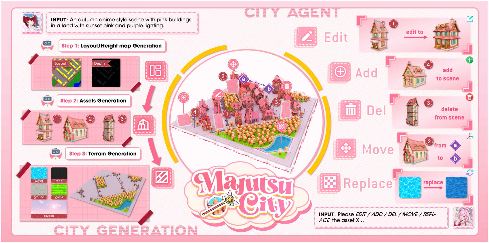
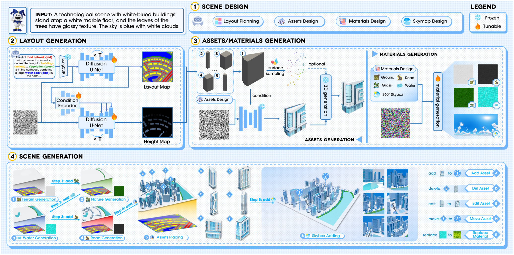
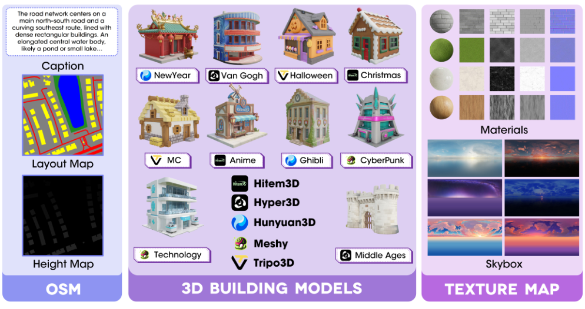

[← Back to Home](../../README.md)

<h1 align="center">MajutsuCity: Language-driven Aesthetic-adaptive City Generation with Controllable 3D Assets and Layouts</h1>

---

## Paper Information

| Field | Value |
|---|---|
| Title | MajutsuCity: Language-driven Aesthetic-adaptive City Generation with Controllable 3D Assets and Layouts |
| Authors | Zilong Huang, Jun He, Xiaobin Huang, Ziyi Xiong, Yang Luo, Junyan Ye, Weijia Li, Yiping Chen, Ting Han |
| Venue | arXiv |
| Year | 2025 |
| Topic | Language-driven controllable 3D city generation and interactive editing |
| Paper Link | [2511.20415v2](https://arxiv.org/abs/2511.20415v2) |
| PDF | [Paper PDF](https://arxiv.org/pdf/2511.20415v2) |
| Project | [Official project](https://longhz140516.github.io/MajutsuCity/) |
| Source Version | v2 |
| Method Figures PPT | [Editable method-figure deck](method_figures/method_figures_editable.pptx) |
| Original Asset License | [arXiv non-exclusive distribution license](https://arxiv.org/licenses/nonexclusive-distrib/1.0/license.html) — this distribution license does not establish general figure-redistribution permission. |

---

## Asset Preview Gallery

<table>
  <tr>
    <th>Method Figures</th>
    <th>Result Figures</th>
    <th>Table Figures</th>
  </tr>
  <tr>
    <td align="center">
       
      Language-driven City Generation and Interactive Editing
    </td>
    <td align="center">—</td>
    <td align="center">—</td>
  </tr>
  <tr>
    <td align="center">
       
      MajutsuCity Generation Framework
    </td>
    <td align="center">—</td>
    <td align="center">—</td>
  </tr>
  <tr>
    <td align="center">
       
      MajutsuDataset Component Overview
    </td>
    <td align="center">—</td>
    <td align="center">—</td>
  </tr>
</table>

---

# 1. Method Figures

## Figure 1: Language-driven City Generation and Interactive Editing

  

| Asset | Link |
|---|---|
| Preview Image | [fig1_language_driven_city_generation_and_editing.png](method_figures/fig1_language_driven_city_generation_and_editing.png) |
| Source | Figure 1, PDF page 1 |
| PPT Source | [fig1_language_driven_city_generation_and_editing.pptx](method_figures/fig1_language_driven_city_generation_and_editing.pptx) — reconstructed, not author source |

### Color Palette

| Role | Swatch | Color | Hex |
|---|---|---|---|
| Pink city-generation panels |  | Pink | `#FFB8C6` |
| Agent edits and workflow arrows |  | Pink | `#FFA4B9` |
| Outer scene backdrop |  | Pink | `#FAD9E4` |
| Atomic-operation markers |  | Red | `#C2424C` |
| Emphasis ring and logo accents |  | Yellow | `#FFC700` |
| Move locations / spatial anchors |  | Purple | `#9756BB` |

> Reconstructed PPTX, not author source. Primary labels, panels, badges, arrows and diagram geometry are native editable objects. Original 3D illustrations, maps, material/skybox/noise samples, logos, small pictograms and embedded illustration annotations remain independently movable images; their pixels are not editable. Arial/Calibri, pattern and shadow details approximate unavailable source fonts/effects. Arrows are freeforms, not bound connectors. Final PPTX roundtrip render visually checked; PowerPoint application compatibility not tested.

---

## Figure 2: MajutsuCity Generation Framework

  

| Asset | Link |
|---|---|
| Preview Image | [fig2_majutsucity_framework.png](method_figures/fig2_majutsucity_framework.png) |
| Source | Figure 2, PDF page 4 |
| PPT Source | [fig2_majutsucity_framework.pptx](method_figures/fig2_majutsucity_framework.pptx) — reconstructed, not author source |

### Color Palette

| Role | Swatch | Color | Hex |
|---|---|---|---|
| Stage frames and generation modules |  | Blue | `#6FB4F9` |
| Condition / module fills |  | Blue | `#DCEDFD` |
| Scene-design group surface |  | Blue | `#EFF8FF` |
| Frozen-component snowflake |  | Cyan | `#75CBE9` |
| Tunable-component flame |  | Orange | `#FF9D00` |
| 3D primitive assets |  | Gray | `#525252` |

> Reconstructed PPTX, not author source. Primary labels, panels, badges, arrows and diagram geometry are native editable objects. Original 3D illustrations, maps, material/skybox/noise samples, logos, small pictograms and embedded illustration annotations remain independently movable images; their pixels are not editable. Arial/Calibri, pattern and shadow details approximate unavailable source fonts/effects. Arrows are freeforms, not bound connectors. Final PPTX roundtrip render visually checked; PowerPoint application compatibility not tested.

---

## Figure 3: MajutsuDataset Component Overview

  

| Asset | Link |
|---|---|
| Preview Image | [fig3_majutsudataset_component_overview.png](method_figures/fig3_majutsudataset_component_overview.png) |
| Source | Figure 3, PDF page 6 |
| PPT Source | [fig3_majutsudataset_component_overview.pptx](method_figures/fig3_majutsudataset_component_overview.pptx) — reconstructed, not author source |

### Color Palette

| Role | Swatch | Color | Hex |
|---|---|---|---|
| OSM layout/height column |  | Indigo | `#E0E2FB` |
| OSM footer |  | Indigo | `#8E94F2` |
| 3D building library panel |  | Purple | `#DDCFF2` |
| 3D library footer |  | Purple | `#9F77D7` |
| Texture and skybox panel |  | Purple | `#EDD8F7` |
| Texture-library footer |  | Purple | `#B769E0` |

> Reconstructed PPTX, not author source. Primary labels, panels, badges, arrows and diagram geometry are native editable objects. Original 3D illustrations, maps, material/skybox/noise samples, logos, small pictograms and embedded illustration annotations remain independently movable images; their pixels are not editable. Arial/Calibri, pattern and shadow details approximate unavailable source fonts/effects. Arrows are freeforms, not bound connectors. Final PPTX roundtrip render visually checked; PowerPoint application compatibility not tested.

---

# 2. Result Analysis Figures

# 3. Paper Tables
