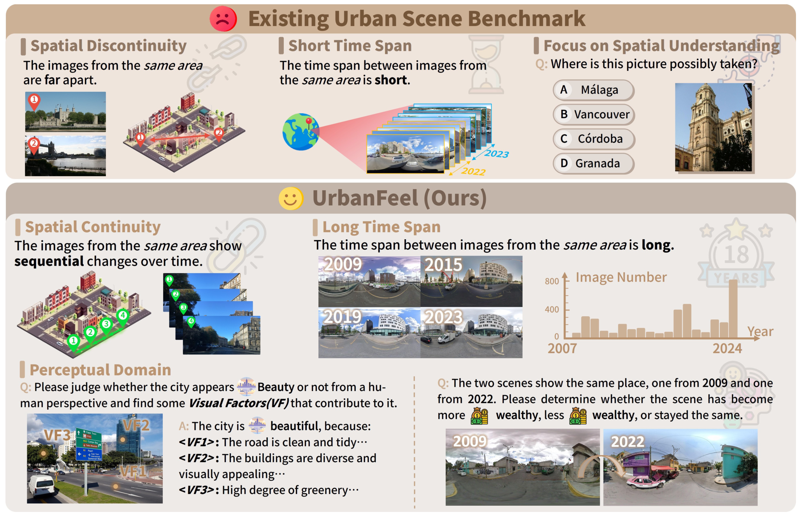
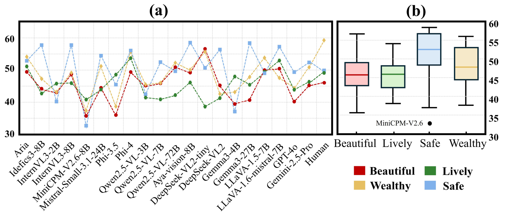
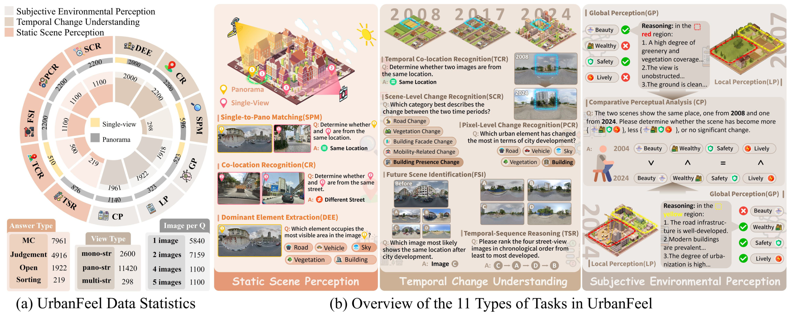
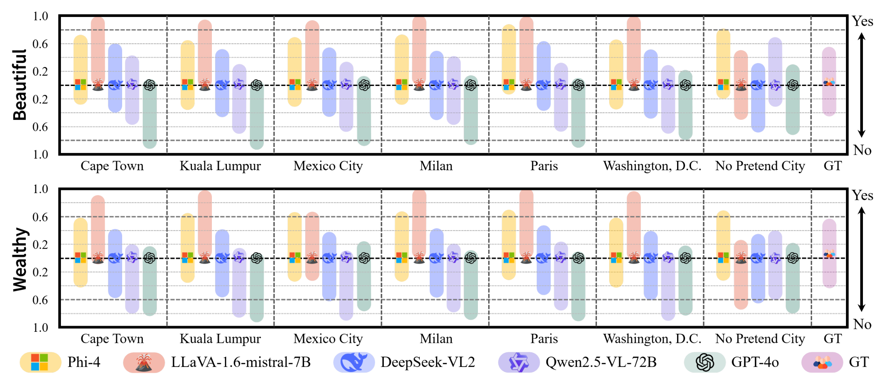
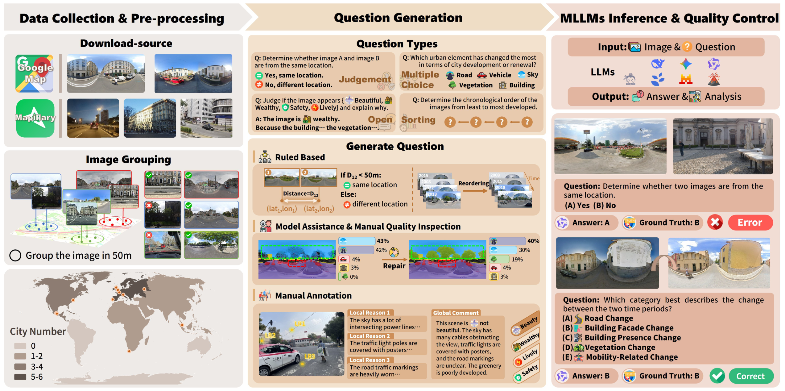
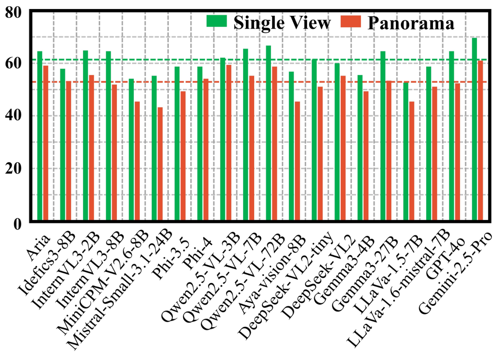

<div align="right">

[← Back to Home](../../README.md)

</div>

<h1 align="center">UrbanFeel: A Comprehensive Benchmark for Temporal and Perceptual Understanding of City Scenes through Human Perspective</h1>

---

## Paper Information

| Field | Value |
|---|---|
| Title | UrbanFeel: A Comprehensive Benchmark for Temporal and Perceptual Understanding of City Scenes through Human Perspective |
| Authors | Jun He, Yi Lin, Zilong Huang, Jiacong Yin, Junyan Ye, Yuchuan Zhou, Weijia Li, Xiang Zhang |
| Venue | arXiv |
| Year | 2025 |
| Topic | Human-centered temporal and perceptual urban-scene understanding with multimodal language models |
| Paper Link | [2509.22228v1](https://arxiv.org/abs/2509.22228v1) |
| PDF | [Paper PDF](https://arxiv.org/pdf/2509.22228v1) |
| Source Version | v1, 13 pages |
| Method Figures PPT | [Editable method-figure deck](method_figures/method_figures_editable.pptx) |
| Original Asset License | [arXiv non-exclusive distribution license](https://arxiv.org/licenses/nonexclusive-distrib/1.0/) — a grant to arXiv, not general downstream figure-redistribution permission. Street-view photos and logos may have separate rights. |

---

## Asset Preview Gallery

<table>
  <tr>
    <th>Method Figures</th>
    <th>Result Figures</th>
    <th>Table Figures</th>
  </tr>
  <tr>
    <td align="center">
      <br>
      <sub>Urban Benchmark Comparison</sub>
    </td>
    <td align="center">
      <br>
      <sub>Subjective Perception Accuracy and Variability</sub>
    </td>
    <td align="center">—</td>
  </tr>
  <tr>
    <td align="center">
      <br>
      <sub>UrbanFeel Task Taxonomy and Data Statistics</sub>
    </td>
    <td align="center">
      <br>
      <sub>City Identity Intervention Comparison</sub>
    </td>
    <td align="center">—</td>
  </tr>
  <tr>
    <td align="center">
      <br>
      <sub>Benchmark Construction Pipeline</sub>
    </td>
    <td align="center">
      <br>
      <sub>Single-view and Panorama Accuracy</sub>
    </td>
    <td align="center">—</td>
  </tr>
</table>

---

# 1. Method Figures

## Figure 1: Urban Benchmark Comparison

<p align="center">
  
</p>

| Asset | Link |
|---|---|
| Preview Image | [fig1_urban_benchmark_comparison.png](method_figures/fig1_urban_benchmark_comparison.png) |
| Source | Figure 1, PDF page 2 |
| PPT Source | [fig1_urban_benchmark_comparison.pptx](method_figures/fig1_urban_benchmark_comparison.pptx) — reconstructed, not author source |

### Color Palette

| Role | Swatch | Color | Hex |
|---|---|---|---|
| Benchmark comparison headers |  | Brown | `#CBB094` |
| Conceptual overview panels |  | Brown | `#EFE6DD` |
| Temporal coverage and annotations |  | Brown | `#B99671` |
| Panorama frame and temporal arrows |  | Cyan | `#00A6DB` |
| Single-view frames and time labels |  | Yellow | `#FDC300` |
| Spatial continuity pins |  | Green | `#00D52D` |

> Reconstructed PPTX, not author source. Primary text, panels, diagram geometry, statistical sectors/bars and arrows are native editable objects. Street-view photographs, 3D city artwork, maps, original logos/pictograms and photograph-embedded annotations remain independently movable raster components. Arrow paths are freeforms, not bound connectors; sectors/bars are not data-bound charts. Unavailable source fonts use installed Arial/Times New Roman/Comic Sans MS/Segoe UI Symbol substitutes. Fine typography, small pictograms and decorative details are approximate. Final-file PPTX roundtrip renders checked; PowerPoint application compatibility not tested.

---

## Figure 2: UrbanFeel Task Taxonomy and Data Statistics

<p align="center">
  
</p>

| Asset | Link |
|---|---|
| Preview Image | [fig2_urbanfeel_task_taxonomy_and_statistics.png](method_figures/fig2_urbanfeel_task_taxonomy_and_statistics.png) |
| Source | Figure 2, PDF page 4 |
| PPT Source | [fig2_urbanfeel_task_taxonomy_and_statistics.pptx](method_figures/fig2_urbanfeel_task_taxonomy_and_statistics.pptx) — reconstructed, not author source |

### Color Palette

| Role | Swatch | Color | Hex |
|---|---|---|---|
| Static scene perception |  | Orange | `#E39973` |
| Temporal change understanding |  | Brown | `#C9B093` |
| Subjective environmental perception |  | Gray | `#BFB4A9` |
| Single-view counts |  | Yellow | `#FFE7A3` |
| Panorama counts |  | Gray | `#A6A6A6` |
| Positive / correct indicators |  | Green | `#00C92A` |
| Negative / incorrect indicators |  | Red | `#FA5146` |

> Reconstructed PPTX, not author source. Primary text, panels, diagram geometry, statistical sectors/bars and arrows are native editable objects. Street-view photographs, 3D city artwork, maps, original logos/pictograms and photograph-embedded annotations remain independently movable raster components. Arrow paths are freeforms, not bound connectors; sectors/bars are not data-bound charts. Unavailable source fonts use installed Arial/Times New Roman/Comic Sans MS/Segoe UI Symbol substitutes. Fine typography, small pictograms and decorative details are approximate. Final-file PPTX roundtrip renders checked; PowerPoint application compatibility not tested.

---

## Figure 3: Benchmark Construction Pipeline

<p align="center">
  
</p>

| Asset | Link |
|---|---|
| Preview Image | [fig3_benchmark_construction_pipeline.png](method_figures/fig3_benchmark_construction_pipeline.png) |
| Source | Figure 3, PDF page 5 |
| PPT Source | [fig3_benchmark_construction_pipeline.pptx](method_figures/fig3_benchmark_construction_pipeline.pptx) — reconstructed, not author source |

### Color Palette

| Role | Swatch | Color | Hex |
|---|---|---|---|
| Collection and preprocessing |  | Gray | `#ECE9E5` |
| Question generation |  | Brown | `#F3E3CC` |
| Inference and quality control |  | Pink | `#F1DDD3` |
| Question and answer containers |  | Orange | `#E1B198` |
| Rule and manual annotation accents |  | Orange | `#C98E53` |
| Error outcome |  | Red | `#FF5955` |
| Correct outcome |  | Green | `#2FB680` |

> Reconstructed PPTX, not author source. Primary text, panels, diagram geometry, statistical sectors/bars and arrows are native editable objects. Street-view photographs, 3D city artwork, maps, original logos/pictograms and photograph-embedded annotations remain independently movable raster components. Arrow paths are freeforms, not bound connectors; sectors/bars are not data-bound charts. Unavailable source fonts use installed Arial/Times New Roman/Comic Sans MS/Segoe UI Symbol substitutes. Fine typography, small pictograms and decorative details are approximate. Final-file PPTX roundtrip renders checked; PowerPoint application compatibility not tested.

---

# 2. Result Analysis Figures

## Figure 4: Subjective Perception Accuracy and Variability

<p align="center">
  
</p>

| Asset | Link |
|---|---|
| Preview Image | [fig4_subjective_perception_accuracy_and_variance.png](result_figures/fig4_subjective_perception_accuracy_and_variance.png) |
| Source | Figure 4, PDF page 8 |

### Color Palette

| Role | Swatch | Color | Hex |
|---|---|---|---|
| Beautiful |  | Red | `#BE0000` |
| Lively |  | Green | `#2F8530` |
| Wealthy |  | Yellow | `#EBC157` |
| Safe |  | Blue | `#80B3E9` |

### Plotting Code

Note: The following code is an approximate visual reconstruction based on the provided figure. Numeric values are digitized/estimated from the raster chart, not experimental raw data. The code was executed and its output visually reviewed.

The box plot uses explicitly estimated quartiles, whiskers and the Safe-dimension outlier via `bxp`; it does not synthesize sample observations.

```python
import numpy as np
import matplotlib.pyplot as plt
from matplotlib.patches import Patch

# Approximate values digitized from Figure 4, not raw experimental data.
# Box summaries are visual estimates. bxp avoids inventing sample observations.
models = ['Aria', 'Idefics3-8B', 'InternVL3-2B', 'InternVL3-8B', 'MiniCPM-V2.6-8B', 'Mistral-Small3.1-24B', 'Phi-3.5', 'Phi-4', 'Qwen2.5-VL-3B', 'Qwen2.5-VL-7B', 'Qwen2.5-VL-72B', 'Aya-Vision-8B', 'DeepSeek-VL2-tiny', 'DeepSeek-VL2', 'Gemma3-4B', 'Gemma3-27B', 'LLaVA-1.5-7B', 'LLaVA-1.6-mistral-7B', 'GPT-4o', 'Gemini-2.5-Pro', 'Human']
data = {'Beautiful': [49.4, 44.3, 42.8, 48.4, 35.9, 44.7, 36.2, 49.3, 44.9, 45.6, 50.9, 49.2, 56.6, 45.2, 39.5, 40.8, 50.2, 50.4, 40.3, 45.3, 46.1], 'Lively': [51.1, 42.8, 45.8, 45.9, 40.9, 43.9, 48.5, 53.6, 41.5, 40.9, 42.2, 46.1, 38.7, 41.3, 47.9, 45.4, 49.7, 52.9, 43.9, 46.4, 49.1], 'Wealthy': [54.1, 47.3, 43.2, 49.2, 37.6, 51.0, 38.9, 55.1, 45.6, 46.1, 52.2, 50.0, 55.6, 42.6, 43.2, 47.8, 53.7, 47.6, 44.7, 50.9, 59.1], 'Safe': [52.9, 57.6, 40.5, 57.4, 33.0, 54.3, 45.5, 55.9, 42.7, 52.4, 49.6, 58.4, 50.6, 56.2, 37.4, 58.1, 49.0, 57.1, 49.4, 52.3, 50.0]}
colors = {'Beautiful':'#BE0000', 'Lively':'#2F8530',
          'Wealthy':'#EBC157', 'Safe':'#80B3E9'}
plt.rcParams.update({'font.family':'DejaVu Serif', 'font.size':15,
                     'axes.linewidth':2.6, 'xtick.major.size':0,
                     'ytick.major.size':0})
fig = plt.figure(figsize=(14, 6), dpi=160)
ax = fig.add_axes([.04,.375,.62,.525])
x = np.arange(len(models))
for name, marker in [('Beautiful','o'),('Lively','p'),('Wealthy','d'),('Safe','s')]:
    ax.plot(x, data[name], '--', marker=marker, markersize=6,
            linewidth=1.4, color=colors[name])
ax.set(xlim=(-.5,20.5), ylim=(30,65), yticks=[30,40,50,60])
ax.set_xticks(x, models, rotation=48, ha='right', rotation_mode='anchor')
ax.set_yticks(np.arange(30,66,5), minor=True)
ax.grid(which='both', color='#D8D8D8', linestyle='--', linewidth=.7)
ax.set_axisbelow(True)
ax.set_title('(a)', fontsize=29, fontweight='bold', pad=11)
bx = fig.add_axes([.67,.375,.295,.525])
stats = [
 {'label':'Beautiful','whislo':36.4,'q1':43.6,'med':46.5,'q3':49.8,'whishi':57.4,'fliers':[]},
 {'label':'Lively','whislo':38.8,'q1':43.1,'med':46.6,'q3':49.0,'whishi':54.8,'fliers':[]},
 {'label':'Safe','whislo':37.7,'q1':49.1,'med':53.1,'q3':57.5,'whishi':59.1,'fliers':[33.6]},
 {'label':'Wealthy','whislo':38.4,'q1':45.2,'med':48.5,'q3':53.8,'whishi':56.7,'fliers':[]},
]
boxes=bx.bxp(stats,patch_artist=True,widths=.64,showfliers=True,
 boxprops={'linewidth':2.1,'edgecolor':'#12343E'},
 whiskerprops={'linewidth':2.1,'color':'black'},
 capprops={'linewidth':2.1,'color':'black'},
 medianprops={'linewidth':2.1},
 flierprops={'marker':'o','markersize':7,'markerfacecolor':'black','markeredgecolor':'black'})
for patch,median,name in zip(boxes['boxes'],boxes['medians'],['Beautiful','Lively','Safe','Wealthy']):
    from matplotlib.colors import to_rgba
    patch.set_facecolor(to_rgba(colors[name],.25));patch.set_edgecolor('#12343E')
    median.set_color(colors[name])
bx.set(ylim=(30,60.8),yticks=np.arange(30,61,5),xlim=(.5,4.5))
bx.yaxis.tick_right();bx.grid(axis='y',color='#D8D8D8',ls='--',lw=.7)
bx.set_axisbelow(True)
bx.tick_params(axis='x',labelsize=17,pad=10)
bx.text(2.85,33.4,'MiniCPM-V2.6',ha='right',va='center',fontsize=12)
bx.set_title('(b)', fontsize=29,fontweight='bold',pad=11)
fig.legend(handles=[Patch(facecolor=colors[n],label=n) for n in ['Beautiful','Wealthy','Lively','Safe']],
 loc='lower right',bbox_to_anchor=(.966,.06),ncol=2,frameon=False,
 fontsize=20,handlelength=.9,columnspacing=1.1,handletextpad=.4)
fig.savefig('urbanfeel_subjective_perception.png',dpi=200,facecolor='white')
plt.show()
```

---

## Figure 5: City Identity Intervention Comparison

<p align="center">
  
</p>

| Asset | Link |
|---|---|
| Preview Image | [fig5_city_identity_intervention_comparison.png](result_figures/fig5_city_identity_intervention_comparison.png) |
| Source | Figure 5, PDF page 9 |

### Color Palette

| Role | Swatch | Color | Hex |
|---|---|---|---|
| Phi-4 |  | Yellow | `#F6CF61` |
| LLaVA-1.6-mistral-7B |  | Red | `#E98D7A` |
| DeepSeek-VL2 |  | Blue | `#7F87F7` |
| Qwen2.5-VL-72B |  | Purple | `#A998E5` |
| GPT-4o |  | Teal | `#7FAEA3` |
| Ground truth |  | Purple | `#C789C6` |

### Plotting Code

Note: The following code is an approximate visual reconstruction based on the provided figure. Numeric values are digitized/estimated from the raster chart, not experimental raw data. The code was executed and its output visually reviewed.

Model/ground-truth icon crops are embedded as small base64 PNGs so the code has no external-image dependency. Upper and lower endpoints follow the reference independently and should not be used as calibrated probabilities. Original icon rights remain with their owners.

```python
import base64, io
import numpy as np
import matplotlib.pyplot as plt
from PIL import Image
from matplotlib.offsetbox import AnnotationBbox, OffsetImage

# Approximate bar endpoints digitized from Figure 5, not experimental raw data.
# Upper and lower endpoints are independent visual estimates of Yes and No.
# Do not infer that every pair sums to one: the reference itself does not.
cities = ['Cape Town','Kuala Lumpur','Mexico City','Milan','Paris',
          'Washington, D.C.','No Pretend City','GT']
names = ['Phi-4','LLaVA-1.6-mistral-7B','DeepSeek-VL2',
         'Qwen2.5-VL-72B','GPT-4o','GT']
colors = ['#F6CF61','#E98D7A','#7F87F7','#A998E5','#7FAEA3','#C789C6']
yes = [[0.64, 0.91, 0.51, 0.34, 0.03], [0.56, 0.88, 0.44, 0.21, 0.02], [0.6, 0.87, 0.47, 0.25, 0.08], [0.65, 0.92, 0.42, 0.33, 0.09], [0.8, 0.92, 0.55, 0.24, 0.04], [0.58, 0.92, 0.43, 0.2, 0.17], [0.7, 0.41, 0.24, 0.61, 0.26]]
no = [[0.18, 0.0, 0.28, 0.47, 0.82], [0.26, 0.02, 0.35, 0.6, 0.84], [0.2, 0.02, 0.35, 0.57, 0.78], [0.18, 0.0, 0.4, 0.47, 0.77], [0.03, 0.0, 0.26, 0.57, 0.81], [0.25, 0.0, 0.37, 0.6, 0.68], [0.08, 0.4, 0.58, 0.21, 0.62]]
wealthy_yes = [[0.49, 0.83, 0.33, 0.11, 0.08], [0.56, 0.91, 0.32, 0.02, 0.02], [0.57, 0.57, 0.28, 0.02, 0.15], [0.58, 0.92, 0.34, 0.12, 0.04], [0.6, 0.92, 0.38, 0.14, 0.01], [0.5, 0.9, 0.29, 0.04, 0.09], [0.59, 0.17, 0.26, 0.31, 0.12]]
wealthy_no = [[0.32, 0.02, 0.48, 0.7, 0.74], [0.25, 0.0, 0.47, 0.76, 0.82], [0.23, 0.22, 0.52, 0.8, 0.67], [0.23, 0.0, 0.48, 0.69, 0.78], [0.21, 0.0, 0.42, 0.66, 0.82], [0.32, 0.0, 0.5, 0.8, 0.73], [0.22, 0.64, 0.55, 0.49, 0.7]]
# Original model/GT icon crops from the approved figure, embedded for portability.
icons_b64 = ['iVBORw0KGgoAAAANSUhEUgAAAB8AAAAdCAIAAADdBCBlAAAC6UlEQVR4nO1WO09UQRT+zszcuw/g7q7yDMtDNCTERo1EK7Wz1FibmFhaGGsbbYy/QEtbW3+BxsJQUIihMVEMEBCQl+6yj7t7Z465swsLe/dR0HK6mXzzzZlzvvlmqLTyPibygAAAZnQOohCFLjBCCCNodWJa2D06hN1eUBcYH2bZYOdAc1DtkBWByY1raG2Czokr6UoiPmQnZqOX1rD4ywQVWyWOLpMEfefWz9Taj9w8mEKeZl4w6T5n8GrvzYzrgRuVYWzumPlF7ZdAonUDpODrNzaSGwu5z8QqmgFBaJQHkjPTySsZeMwhqBGG2YRruGXuxDZhZuh2mHCSTAirRbc2ni7O2NvFWWXahWpINxSyYW3sVeXW8NDAjGFtfYqbbiuBDWCgj66CSrgSUoYzPYnY8IBbLQkhqKUPSgriKqG8/p4JgrR22cQuDCqZ2IgQTjgUgj68e6K40NvnTV28HHMyRpul5a1i0a9tcWIt8YXx2FA2XgwqO7u5ze19OrkDAYExGS89MzaUcGUhn1f3H78FcGlq9OHr2fXsbL4czC3/3s35jhLHy2NPLV6Wvj1Lf08eLBTWd7GyRdYIj/OT8TEwbQYeID70Z3uv7jP7ufLX/Z6PznA+X3FHs2KMqs2nZkPSL63Cn8PfT5OeM3lNhoc7nj0TREXTnq/LtbF6/vSegJ9JpzaGY19M4DtM1bKO2iuYSI0MehCSZJyN5LKJdEaAEDhSKgnD5zIp9erFI4g8Av1mKVletTqoP28RdkFj2X4EBBNqprkqFgOw4xAryWxSaU8d/CvFhW/dt9ujiu7vbq2I9dBGSSlkKI9IJU4fdOYzbaPxrgqwhJG2AxzB2c4Ye33J+nbLf0NtXkTYGT7LAmIBRVWMOoJUwBIIEGqs2oZdg0IF1tnrWiGaiFXuprcD+6K3Eh4LyPOyBDGu+263yYCAqnGzQiZtNkRH/8iikQfarZ28payJkXYqLnzWTTbRhJMk3do/8j+A3EYooYtyUgAAAABJRU5ErkJggg==', 'iVBORw0KGgoAAAANSUhEUgAAAB4AAAAdCAIAAAAyxktbAAAHm0lEQVR4nI2WSWwU2RnHv7fU2qvdbrdtlvZuJgZibDBhywCTSDCHRBNyJDlFGkU5JMcoylxy4ZZo5sApOURK0BARJpmwZWDAGBszmGUMY2yzdHuBBrfd7u7qpaqr6r0XVbcxnkgZ5atDSaWqX/3r//2/9wqVrl8AhOD/KYQBAQhAIABAYAxcVC94h3deX0LQb4YBAoSQ4FwwLljl9UMyOJZ49pC7Dm3bivQAwhhhLMTX6N+IFpwJzF8lcG7J3rLLDcYE5yBRUTDQ8CW8Ms86t4pQVNJ8tFKitkUIhTX6/1KNQLgCLCK7dTGUS6OxU3beFMd+Bv6AqFT40GVccfCxX4gNHUJWGXOxY0vZRV8xh2iN7jlMEcI1q9artYhiRlqY7uec44FDHCuVM3/D8XHp4GH21YSbSCrv/5LXNYCRRUJwVRdUEiyiGisUIQ/tkQUy797gxcJaJxFABeNyczvPLZPbl9DzhKuE2P53naUcFIvyd/aypzOCudjng8tn5fISDupsxyGx6/tSueBbnMOy8toThMEXWG8QIGBUxbYpnfkIP51gTXFRKLA/fUiZKX+7F0orZFOTyCw6f/wQMcZ6B0UgrF77WLpxVsm8xFRadUMI4g9QRwtKNM058z6BEM6YbJWZY4uNXWzLAG/cCEaOn/3YvvKZFg7g+rD77GXl3Hm5dwt69wc42swdB67/Q80u0zhDsiJct0oWKBDGSqSRabr3NkxZqZgfGbGnp7VKWd15WK2PKbZJZEJ37+YF051+hEp5e/QmyJJ88G1EhJh/ShMzUlsv3bbPSs6XZp54NgCiqsbCDVTSfU60BZlFYRUrI/9mr5ZIZwfVfU5qXszNCi7EhiapLohjDc7cAq33u8k5dU8fLiy716448y9Nu8xbor7d+7hjF4c/J0afumMvCzer4TqvpVpjSymXQakkqhih/QekeKs1dbc8PGxVEJZlPDNBt/dIzWE7kXJnn4FE1KgMY0OSSbS+AZAwn5moXP1E/d4xOjjAkg/5tp20OQ6EerlGsqzEu9xiVpI1Eo66rxZg7BJpiEf2HEJUdueeicVpoek2Yiy9TIOStJIi4QblyDs0GAaEnc4OZ+ScWE4p23ax9m7S0asEgqsjgxCSgyG8pd9RNFEuCcukkRjd+w6NNAEIOVJfvMeR+VwOIl4wlaiKdF3uGMCaj5XLAEBCYbT3qJcCWVW6ttOWzdXsIfR68L3csZW0M/uY57Ngm6AHUHXRyY5+kRsagxDWt0aViMJtUX6UA0urP7xH7+4SjNcWJiwreGMbadpEq06sX0O8maH1jdgfLI/dQFZJC0oc4/yjyfyV687ySgCoe8+wNA1bFVoql5bdvCz0lkatLlIbvYJR5nooTKmXvOoA0tnZ2dbWVgCYmJgYHx9vjEQab46kcxneurEOWPOTaVTOAyWYQkC3XKdMNSg7RBCEnicmL19+WRcliqYEgnVzMx1+ne85xBz79vidRCJBh4eHa+jTp0+fOHEiJEsnt2/+KLn0Rcb4dU/k+OZmVaeARdlAQJCiENMQZo7LOi4g98Ho57+5k0i7QAB+N9j60x19fjhklsonT548deoUtm275ohlmQDAbMewMq8yxk/a/cf295mxGARIcsMGy6cKwylmuFUSWEe+ADyWFX+89Vc7WxEAA7jw5MUromMA7qEsz5D+/v4a+uiRo5Ik+xS5PiD9vGBqqSdzfrWbLUw3bkxIDT1sicoUCwQErnJ/m2xvps5fK4Efdcb+0Na2GB9UdZ+/dwADaLp+/Pjxnp6etYR8rcbu3B/59PQRY5w5aEjuOFB4Shkf1+MHSglsmx8UYm8plffDuZO5MJbQbw/G4Icf0Kbu/4K82XWEEJxzIcTk5OS5cxdQaaWo6Q98GwfF86DkXgy9db2iXTSVT5xQBuSnjjwvyUebrSlT/v2d7Pj9B5y/kcg5Z4zhWlBW34PxYnppeHSsVDQWSf0Y2tStZmJ6+aLWNWGwQi4zTpumQm26IqUdfNv2dTbwfQ32xRf007Gv5hfma/pqHEIIXpOMECoYhZHRW8nkHBCqYXZAXmgkpc9Q9wPLRwVrbm6JNLUwDk7FYojcM+RUhR7bUG7Xnbv3H/7r/MVisbRuBmEVjRDinH/5YGJi4kvXK4cwa4np5yvdM069X1ej0ajP5zPy2eWlJS5AQmKhTK6mVV0S3wox23auXhu6MTK6Jnx1GmuSHz9+Mjwyls3ni6VSNrviNLdcQl3efgEME8I5X6oWf/0kAri6qGQqeMGksoQLhcLpM39vb4v39PTUgF4bEULJ2bl/nrvwLJlYXEy/TKUkSfLruoK5jAUhhLksk8ksLy9zzlcNBMAIbI5GM8qLMsYgJElKpVJ//sup56kUAs8WWmtjMjl7+87dYqGAidcDXdUsy2KM8WoVS0Ujb6xx37QdgY6r+ynyynHcW+Pj/f19P37vPe9SzZrsSnZ07Nbn14YeTU8zlymqQggBb4+pJokz73+sevP6Rq01ybYdSabtrW17dg++/d0D8Xgc1ZSv3beYTk9OTo3cvDk1NZM3DOGha2EHIXjt+2p0hDAhGCGQJLkp1rR9W++27Vs729pjsUZPU7X+A/wxKDhLAj8WAAAAAElFTkSuQmCC', 'iVBORw0KGgoAAAANSUhEUgAAACEAAAAdCAIAAACrPpLuAAAGFUlEQVR4nLVWS3MbxxHu7tkF8SIIkiIIkiBIBHwkohi7xCiyq6RKfIjzuPjkclXyC3LMIZV7bjmlKofE99zyD1yVR5VLlq3YMmNKpCSKFN8ESBAP4rnY3elOzQJUhTYd56BM7QGL2elv+pvu7xs8PCpt7CY1W4jwagci+L7/w1uK4P8/6JVEETHPq8GQINBXWbUUWNbXrrp6xgQJAvWi9beIoBAcD1yXwyHq0Sxg/twriAhk0kh4RUJfxkAEYXB8cLvgau4tsC1khuMSvziA2jmQjbdv8FyWzKQYmC+emi/HRlQ0fAkDwaBewmCBSlWOS1w8w8q5dNqgBYggEpauB602MBMLrlzXuSnVy4IIWm1ptrFShwdremEWx0dIqYBPM6vOjy8wTJ1p2NzVz/bgpIyuC2h20B9tp/+DCAjNw2wOgMVs1dfm1XXx8XM4PoWb3+H8DJ1Vpe1A15UH69jHYIa1Z3r1KThdQ/N/K2mB9W0S4aU5TCYMh9EwhAcCXhBLFfj8iRTL+rAIjocg0HWDPBBg60AeboDr/S9lJq6Ha1tSa8j3liB1DUMhnEjJ0amwoFJQrkGljiA9FlApISKoNmT1ibg+IfYL6RthgHH3GO99LoWSOe3FHGbSwYQIERpG+4Ekl2Fi1tv7ulxDEcMv9/L6JigJjrBYxvurclDg0SF88zWcnWAMaGdmS8lgTL41Je/9CK16o10oDWkN14YlFjEwHQdqTfA1XRB3RQeL9FKW4hnd/xe3OnohpyZTsF80pR+PyvwMTKYoGecbC2Sdn7dL5xwKwZ0VSUZJA3QcqbekVOHtfWl0COSKxk7EzU5rDWRNpxX6aFX2C7paN0mIQCIO1/M4kgTPY0SyXM/vtMQOYWpEJWIBV4ACwD4sz8PGDmwdQL1xISNBBpYlN5dwOk0HBXi4Do02trv4dI+BsZd7NKxiMbBtELFtG6xPHqz5nLcBdverhb37pKz/0A7wtfbLTrORHxx5PTgsRBTf0x/89cn0ZCSVOPSq3a7cikRGmPFC/KRR2/74oy1gYOHDzRq+dvsXMyvvR2LxUPfen/9w98oTzi+98+ZP3m+4aa2ZkATc89PVevXF43u/9p3Cjbu/n13+JaLpfAG0Lajt/vHjD37lOF5vObHWkQHyfChV7a+rosLO32au7cxOArMOiAwNT9xOTd/JzP1UqVD56EO/W0c0WQhDIo7DQ/wSwGjiz997e79NRyWgcO5n7/5uONb02Qhjf978lGgs+e2FKZ+gUoNKEwlE+xKOZeZu/mYs89ZAdFrZcSO8gCIylpTbCz8Iq9+y9kRgOu1j8aT0p78MfrYRUhauLMHdFSNKL1W9NzQbGWaGR5vy2QZ2uhdNTGhUi0H7QQ4CkRD/+A7OzxKQiaB9eOsWWFpzZgyfRKDVkfVNf3QQ81mjQi/r1TS/eTGKMD8LpZre3L1Qdc2ubz5Fc0hAKIs5zE5Su80AjIi+7zebRvwoPU7TaUOQ41rr23hWI9tWiOYhUvUmHZ4YaUOAeBSX53E0yWwiBOCkLk5Csml5fdH0E5lhEZnlpBSJwMAALC9SMiE+4/EpfPqIz6qilCFNAI5L8uFDuLfKhVNhDRNjdGsJ41HWQStdNI1kxuH7y5gYvMIH+4aZHsU3liEaZi1q5wj/8U9+cSCeDyELUsNoETzbwb9/yo+2tOPCXJbe+C7EosY+Akk3fj6ZgsSgsZwr3P6lHs1lyfX4wWNuO1gom4j5KZyZQFcDKWDBWpM++UJqdX09T3MzaCl+uAFnNWQxdrm2KQdFns/CwixFI5ey6fsHB6K0kCPb4scvpHgGrRatb8GzHbNZU81ijNvz8dFzKZZ5MgWKcCjOAwPYcdD1TT7nbXi+K1PjEoteqppLfm4pyGdpeEie7sresZRr6LNSxg0EAv8OOkAdncBRka+NwmKWchn0fONaOrgeREMyPHQJ4Kp7CcHYCA7FMTclxydSrEC5IvUWeJ4Qgh3CeBSyEzgxBlMpHE1iyA4qO7idBIWOwl82g69gBLyFbJgex8kx7DjScsD1UNhoiKVMFYQHIBo196uerQVSaRaa0Jcz6I1/A8ITLZkfl6TRAAAAAElFTkSuQmCC', 'iVBORw0KGgoAAAANSUhEUgAAAB8AAAAdCAIAAADdBCBlAAAGWklEQVR4nKVWS3NdRxHu7jmv+9bjEr2uZNmSEsmSbYyduHAoB0IcqrIIBVRY8AtYsGBDQYUFC7YUGzYsoArWsEmgAiEUEGJsUyRxYlkSdiwpsh7XlizpSvdxzpkz000dScEWsWxXMTWbM9Pnm57unu9rvD5VN7ECFDhgIAIiAuwaIPOBlp/+1XmkiY65tmFJISAQcbHoKgcfE/4R6MIwd6N565ZtNT3HI+Xw2BgPHvEF8P9FJ4KlxbBe1/0D2cvvcGLICzxj446yKbW5aYQeFSQ6aAMRohZ/fLMxNFIYHg0OD4s1No7NalVNTyX1holaHEU21lZrMVqYJc3O4/s+P9sstQftZQ8JKv00O22aTeIMTF1VH89rzyPlouuD55PvQTbPw4NUanNFDkDfPVwElMK7q3q7loxOFIkwatnledPcVKJAsxhNYei4HjouKA9T9AwEdR8kmhhjP6D/HrAPPWzarS1rjSDAymLY3unnCg6ArNyKblwTZkc5ez7QbtAZxYJNIEES5ju3/WI+Gh729/kuAISgI776QRSFtlwmkwCilNqVUmCNOJ5MnFJIlkFQUXpDBCRQBKiAFCIhESDR3fV4YMD1/T33d5zZ8Welaq5cMUNH1Oh4TrnUrOutWqy1uC5WBvOVw/LpCtnNImK6oxQsLISE4Ln3IpPWDBKEIU9PJZs1//qMzM1GRBBkXaWc7VqSJkJYbFoVu1M+mZYlMaANWAsb63ZpKTw0mMOdu+2Le33bLC6h56lGHd7/V9Tdq0ptfluHt/BRY/aKIQIBEUyH7MQECBgwV+CeisMirkvzs6HveMWiY63sRxfIZqnrCbu1gcrBxTm6PhmfPusGWdVe9i6/Hm0se6A0kAIHRe38hKQCPPM85/Jpkoiwty+YuxnWtkyxoPZFRgRyeXXsuFsocvplvWvv8u3lGBE+0xscf5Z0S5vY1TElEZiIbQxJjN195ujxTDbjFEpuLq96+/zuHvfGTGOnpnZLSnbQAVw3c+RIcWzMJUJUvL7qT76ndSS+nxl9pjD8OQuxOCmPcppKhkIbn342U+7MI3mNuo4jyyz9Axlme6dqfD/juel0lFIG4K23/qx1tLaqLQ8pOMxibk4lmj/wC5tjEyMnX+iszraipkseiCUAjuHq5ExjbtEH9jfXKv2HCqfPlPyM29PrXHjnSkdZJ0kLgRzf8+Jm8r1XX2m2tonoxOi3Twy/qjBobPmv/ebdSzM//MH3f/ytb35n+Onm9NvMVilHtczCn97+0dJv/wkAg90vfX78pxtrrb4B59Bgm9a1N9781a3l68vVi2ncd5QBmq06ADDzwtJfEruO6BLCSO/L44e/oXWYyzsjp7xse4tjm8Th5emfLa2l0PlM39NHv1sqVBq1wvuX5OLfmjOTVO48VyqM7j2I+RtRq8E//8VPtA7Z2vrmQCBfdWxWklgSpxVPf/GV6IXzX643mhdeX/vwjUKhb1sqv4/smkns1spIEb8uTkod5GL64hX62dDP/T3UU9YyfjRd15HKZjNEUF2xf3iteWvWkGUxQgYpUSfORc99reC4zvpq9MdfNia+4J05/wQRzF1Pfvfr7Y0NRi8tDiRkROXQsVP6+RdLxWIg/AnPNFt1Ybl5I6pWBckBkYER7u5BTjjIsY5ZOeJn1Mmv0KGhIIyb2+v6H28216sKg5Rg8m3oBCiMxQ5z/LOe6/F2vY67urrDSooc6OpxOzqS24tOuRydfdGtDASpJqQihSJQr0Vd/UGm4LLh+Wm98m+lQLGRrkF7+kt+Ie9alkxWdZQdtqBI7VNtAeiteGPjZq3aGDvh9vR6xuy8OQHL0qprAMjlUyWprSXTl0y47QqBn5OJZ9ToRAApRaTG9zcN96EzuC49Oe6vrUZxFE++Z02csguwpAyuzdCxvOcra+XaxUZ1GkmBYRl8Sp6cyDCjPFz5EMEYaWt3njtfWl816YqA2D2mvbsSry7orv7s3Wo49VcriccibV3m5DmvUHTiSOhBCv2/umot5PJOsc29f5EUdg14U5c356a2Zi5wbdlDQkX26FkaGMnrA6AfgI4IzMB6n1IIixeoylO5qcvbtVWne4gEpLMCE2ezwntq/MCxV+8P6fTunQGweSfRoaT8DpDJUrHspKsHoj9Gp3fPFqDc66U6t+vJbnk8tCf7D8zXV0iz57EFAAAAAElFTkSuQmCC', 'iVBORw0KGgoAAAANSUhEUgAAACEAAAAdCAIAAACrPpLuAAAIf0lEQVR4nI1WeVRU5xV/31uYjZmRfRsc1gEEEQQRAWUTUEQjiktrG5dWW9fYWk2Ttsk/PW1NtWmOxsblkGo9SawWEVB0EJBFlmHfBWVRNoFZYNb35i1fz4Al1Zjo/eud9+53f+93v3t/9wIIIfIme40PAAB5W8N/OPRcdDAX8eWw85/eiAG+jwdEkPnTLOQYlqOtVspKQY7DMVzA5/N4vO96vi2PF2cgYrCYJnTats7OJ319MwY9n88PWBTk4+eHoxiBERKBQMoXOkqkKIr+MMzreRjN5lG9rryi/F8Xc3u7uo16A8uyGI65uLvFpyRt/Ml2Zxc3ABAehksEQrmDs1QkRt4ew2QyjejUE2ZDcUHhP/7yV5pmImKiFSEhQrFIPTHV0dTU39O3eFnUui3ZLMsRdoSnt7eXt5ePq4ePo6tQIHwTBoQGs2lAM6khTS2qhlMffgQh3PPeoeiV8SKRCMUwlmHqK6svnDw9NjwiEAkBguAE4ejsErYsMj37nejw8CB3mYNYClD0e+9j2mR8rH6upyw6jUaZf2tGN33kDx8krUlHMQxg6MTYeH1FlTK/0GAwRK2MCwlfLJKIrSTZ29FdVlj8qK1jz68Pg+QUPw66Oji+HsNgNAzqpkbVk03VNVXKUlVlVVjU0tjEVShBmIzG5oe1hddutKsaZb6+u44cjE1e5ermzrIMTdMkST68X577t8/++dnnCxwcQUSkkM+3fzlpNgySJIc0k48G+6+eu1Byq4ChGQhh6NIlAnvR89Gxry5cKiu4Y8fjZW3LWb99q19QoJWiRp4+kzpK7cUSFMPWbd1MU9Sl03+vUpZ6LPQmMCzMU04QOAJfdA8OIZw2Gfufj3555vOSm4XJmRkOzk73bhYK+EIcx/u6esqLiqPjV6zZkh2TEAch0t3WXl5U3NrQKPf3Xbc1xz84CMOwpMyMB8XK9sbGjE0bpgSCEd2Un6vHfC3hJEVNmPQVJferlaVpG7P2HTva095ZVlQ8VwsMbQ0MXfTz47+S+/oMP31aU/qgtU5F8Hm+isDGqoe9Hd0Jaanxq5P9gxURsdEP7tzVTk15yGSjOq2jULzAXgwRCBCA62my79lQXXmFk7NT9o4fObm6khaS4+AsTRuOWCxGMfRefkHxjbyhxwMZGzdk7/yxQChqq1fdzSso/PrfdRWVWVs3T2t0NMVYaQaB0ExbJ2Z09nwBjtvuAlcb9OOjo88eD4RGRfoGKSiSRDF0rmshRHAMG3rSf/L4hyajITRiKURgs6reO8A3bX1mXGpycPhiVWXV1xdzz588jeGEl49cIpXaDgJkalrnKXEQi8UQQtzMWUmr1Ww2O7o4C0RChqYxArM1DorOyd20RusfrDj4+/eDFi3SarS3r+ddPXu+6t79Hb/cqwgNWbs5Oyo+7ptLucq8W5zNIMGzYxgG5QsQHjEnmnhRfkH/oz4rZR3s7XtQfJdhuO6WVitJaSYnbJkCwGuhd1RCnHpicnx0DAVAHugn8/NpqKzu7eham5O9KiPNJ8DvwG+PmwyGssLiaxe/TFybBhFoZ2fXJhCLcbv/9TqCYLjt3+cNw3EPb69Tly99fPZTJzcXAF5tXRTDMBwHAPEPCfrjF2fudjbFrU7GZrP/XbO9hQjCMqwtNIaxrO2BZRitWnP5zDkUxVCAYhjKMNy3+gMAN+uGIEh/T29LnSoyLtakN7AM83qMnJ+9y7Ozs1jIllrVUN9jd5ksJjFeumCBk7sLY2VKbhWpJya95PLY5JX2EglN092t7e31Klcvr6TMNTq1tuqukqIoBIHrt+dInRzqy6tkvj7xq5MsFosQI1wlDjiO4/tOHBPw+YYZ/bk/fzLY22cyGqbV2tSszJCIcAIjliXE3csvaK5RWczkipTk3o4OymLhCUU+gQGHfvd+e0NT88NaCFkUoBmbsgViSWtdY1RC7JGPPtTqdG6EMNwnwMbDbDRxVmZGox0fHnVydVkSu7y9XtWyX5WSlZm2cX1AsGLXoQPuXrKLpz6tVt4PDAtJz97Q1dw6o5s26Q2UxTI3cwEA01ptT1sHx7H+CoVOrbVYLEaMM5tMPD4fR1Fbzm2qZSEdXZx/un/f2Pq1RddulNws6GhoTM5a5y7z7Gxqkfv7RcYtT8xI9w9SjI2MTmu0AAVgdgJiKIrj2MCjoZqSUk9vWVj0Uo7lMNwWGZu1F5XAFwldPd07G1uMhpmYhHi/wMDm2rrCa9e/On/RzcMzMi7mFyeOBYaGQI5rqq1vqq6VSCXo3JyANiJdLW2Xz34xNTm59zfvOTo7c5D7/1Vitq44TigShUVGlBfeqSuvVISGOjo7paxbE7o0sqOhycXDPSwqgi8QjA+PFl27oczLN5vMm97dgaKYlbLyhYJqZVlNeQVpMufs3pmQmgLA3NwDL2FwEGIoGh2/IjQy4vb1PB9FYFxKEkEQMvlCuZ8vx7JataaiWHk998qzwcGQxYuztm9ZmZ5KUdS0Vmc06CmKDAgISX9nQ2LGajuBAHLcK/sDPofHsqyHt2zHgb3n/vTJ+ZOnB/seR8YulyyQWilqbHikrryipvSBm5fH7qOHE9NXu3nadNtsMrbU1SEQ7D56eFV6qpOLC8txkGVfWcNs/VTQWmeHExzH2YQWwlZVw3+uXH3S3YvjuEAkZBl2WqMlzea0TRu27dnludAbxwkEICa9Xnnr9pWz51akJB384IRAKLTSVtQmcbPLHoKwCOIIiEh/ha2u5lsXQggQZEnMMplc3tPW3tXSplNrMAIfHhh40t1r1hvHhkdICwlQoJmYqiuvKLtdLPNdmLVtsx2PR9M0ZivO1y9ZL3jMbyc2KcZtw5G2WhmaBgCMD49+cym3WlnKF4nEEjEAQD8zYzGZI2Jjdh7eH7AoeH6mfhv0ZR7/Bcu7IJx0tJx8AAAAAElFTkSuQmCC', 'iVBORw0KGgoAAAANSUhEUgAAACIAAAAdCAIAAABACSntAAAFEUlEQVR4nO1WS2xUVRj+//+c+5phZvqS2lJawEqkCGKUyKLFBImYqDEmiDuXuhTjThJpQlzq2o0LF+DCGDZGDSYEIygBTRtIIYK0tBbbzkAf05k793HO+c29TB+UNnXBxsR/bubO3Dn3fOd8j/8OMjMsK210+c5cXAyWX0cdZWXJc0NUNZ6Z5EBVqDPId4NlQX1UMpyi+Zw37bgxViswOxUar+pujzNtiEywXrExjpnOej4axtiQYkGc4zFRHkswEAERhYTAzzn3PFeTRowVGHTJz0U3ZDQHyc/rFJIOXdsHAwgMmF4zjASeLs2Xm9EiVDWtLSejHJfBGABMXmyAhQ2+jErKLqwLA6BjshESDnEJnNHJMHozxJqCKRUo4eRQZ4EW6MGESCAmXUOj/wWMEKwBxCICAhtwPZkvSEeD0RDEtq5CLQCMoNAEsEwIZrRcwEXwNYvR8lRogyUWbudkyZk8WDYYSA7G9GCoVSCO6ntmADLaOMpqAilXwmC63KWviErj0JQYGK7EjCAIBPlKa2GvXE+yS1XVzAmCAeQJzg7I7TPUINg8TFrinMWPvh+eGxj7+vIwU+3AzqaOgopKY1dGJt873PzkFg+UWbZtEwN+wZvQZDohY6B1kB+/BW27Zv1DGX9tbRB0rE9f+PPkxZsztZCAh4tFimfnS9fuzUxv6tz8/rZ2wiixFjMbQAFDVstJ6hg1+S5ubwWIQYA2P8nCtL+GNgZAIF7+Y+Kr327N1kJboBSIBIE2sTYorC/PXLl+7SY4DkiXpQRHBhq/oc4RtxEAQqAUV4tUoKsyt9puOFmfjeLbwdulOd+zhEk7AibYEBnszkXv5K82/HoTopegpRvLFZgswo3bL5qB4X2Hz/b0MgrkWGOdfWRekzQEnvdjk8St7mUEjgzuyVc+6ho52FqGSsznxyC7EabyOBW7/vxBFe4aHfrslXd/2H3YJBALUWOzGmlJikEBP7vlMceSsUnbG0PI2G6HR7dOHNw4a5Ke4oCJYXocin9D1QdLGi/XOjPx4fefHxo6F0mL0kgzgqKHDF0HQowZ3ti77bU9XZ4lUvcRAe4vTO5vuAuGklQkARIg7SRAUgIwsWHb3Vguvnn5dEM0ryyXSICwuiBaSRoR2ZZtRBxr1dSYOfr6c2/37Zjzo6TpKO4cG8+Na9ZpSFLSk1PyvtDPmRmpJygd1RNxTqCOBZoWjuSpU6dSARZggKxZanGanujp9jyPdeCPjwZzZSLS2twrzoUGMyL1Yj1d9flxKd5UKlfvXvpZFJqNihuamws7tyMirnjkOGC/+vyh/uP9HV2dIzeHT3xyYvDKoCWFYtxSoA/26pe3KidhgZk1xAh3CljdAFb99tEafzoSfDdVE4hhFPTt6/u4/7hcgZG6PvJ9X2udssI1v+YrX6pk4utF7v9RnWnXbVktiPb3Hdjx9DP21uyFs79cvHTecRxfmd/LeiC4n1cRQK1W9Q2zPHbsWDrjkvhU4c785mxug9aq0Fg48taR3slewoXGyYkwBIxEam+v3/NUJC1o3C069jCRC/yCgX1pYhBRa9XR1uG4zkrGkhYwq8p/zYVhcN8Rju0s5GxBA6zjRXGolWJg1/GklMaY+w2xLnUaG6VUFEeolHoAg01lshxNhovaLjfIw77H9MTGcJIQ5FXHIEohxANXGQWJ5b6g9Z9JgET1vrLGgPWneCRF/8P8h0jDxKWrOPMRwzz41+YR1T/tJ5uJESMQXwAAAABJRU5ErkJggg==']
icons = [np.asarray(Image.open(io.BytesIO(base64.b64decode(x)))) for x in icons_b64]
plt.rcParams.update({'font.family':'DejaVu Serif','font.size':14,'axes.linewidth':2.3})
fig, axes = plt.subplots(2,1,figsize=(14,6),dpi=160,sharex=True)
for ax, upper, lower, label, gt in zip(axes,[yes,wealthy_yes],[no,wealthy_no],
                                      ['Beautiful','Wealthy'],[(.46,.36),(.47,.34)]):
    ax.set(xlim=(-.05,7.3),ylim=(-1,1),yticks=[-1,-.6,-.2,.2,.6,1])
    ax.set_yticklabels(['1.0','0.6','0.2','0.2','0.6','1.0'])
    ax.set_yticks(np.arange(-1,1.01,.2),minor=True)
    ax.grid(axis='y',which='both',ls='--',color='#B8B8B8',lw=.7)
    for border in np.arange(.95,7,1): ax.axvline(border,color='#666666',ls='--',lw=1.1)
    ax.axhline(0,color='black',ls='--',lw=1.5,zorder=5)
    ax.axhline(.8,color='#777777',ls='--',lw=1.1)
    ax.axhline(-.8,color='#777777',ls='--',lw=1.1)
    for j in range(7):
        for k in range(5):
            x=j+.15+k*.16
            ax.plot([x,x],[-lower[j][k],upper[j][k]],color=colors[k],alpha=.53,
                    lw=14,solid_capstyle='round',zorder=2)
            ax.add_artist(AnnotationBbox(OffsetImage(icons[k],zoom=.52),
                          (x,0),frameon=False,pad=0,zorder=8))
    ax.plot([7.13,7.13],[-gt[1],gt[0]],color=colors[5],alpha=.53,lw=14,
            solid_capstyle='round',zorder=2)
    ax.add_artist(AnnotationBbox(OffsetImage(icons[5],zoom=.52),(7.13,0),frameon=False,pad=0,zorder=8))
    ax.set_ylabel(label,fontsize=22,fontfamily='DejaVu Sans',fontweight='bold')
    ax.tick_params(which='both',length=0,pad=8)
    ax.set_xticks([.47,1.47,2.47,3.47,4.47,5.47,6.47,7.13],cities)
    ax.tick_params(labelbottom=True)
    ax.text(7.43,.90,'Yes',ha='center',fontsize=17,clip_on=False)
    ax.text(7.43,-.94,'No',ha='center',fontsize=17,clip_on=False)
    ax.annotate('',xy=(7.43,.77),xytext=(7.43,-.78),
                arrowprops={'arrowstyle':'<->','linewidth':1.7},annotation_clip=False)
fig.subplots_adjust(left=.073,right=.944,top=.96,bottom=.16,hspace=.25)
for j,(name,color,icon) in enumerate(zip(names,colors,icons)):
    x=[.07,.205,.438,.625,.817,.923][j]
    fig.text(x,.055,'  '+name,fontsize=15,ha='left',va='center',
             bbox={'boxstyle':'round,pad=.22','facecolor':color,'alpha':.40,'edgecolor':'none'})
    a=fig.add_axes([x-.025,.034,.027,.045]);a.imshow(icon);a.axis('off')
fig.savefig('urbanfeel_city_identity.png',dpi=200,facecolor='white')
plt.show()
```

---

## Figure 6: Single-view and Panorama Accuracy

<p align="center">
  
</p>

| Asset | Link |
|---|---|
| Preview Image | [fig6_single_view_and_panorama_accuracy.png](result_figures/fig6_single_view_and_panorama_accuracy.png) |
| Source | Figure 6, PDF page 9 |

### Color Palette

| Role | Swatch | Color | Hex |
|---|---|---|---|
| Single view |  | Green | `#00B250` |
| Panorama |  | Red | `#E74C2E` |
| Reference grid |  | Gray | `#ADADAD` |

### Plotting Code

Note: The following code is an approximate visual reconstruction based on the provided figure. Numeric values are digitized/estimated from the raster chart, not experimental raw data. The code was executed and its output visually reviewed.

```python
import numpy as np
import matplotlib.pyplot as plt

# Approximate heights digitized from Figure 6, not raw experimental data.
models = ['Aria', 'Idefics3-8B', 'InternVL3-2B', 'InternVL3-8B', 'MiniCPM-V2.6-8B', 'Mistral-Small3.1-24B', 'Phi-3.5', 'Phi-4', 'Qwen2.5-VL-3B', 'Qwen2.5-VL-7B', 'Qwen2.5-VL-72B', 'Aya-Vision-8B', 'DeepSeek-VL2-tiny', 'DeepSeek-VL2', 'Gemma3-4B', 'Gemma3-27B', 'LLaVA-1.5-7B', 'LLaVA-1.6-mistral-7B', 'GPT-4o', 'Gemini-2.5-Pro']
single_view = [64.7, 58.0, 65.0, 64.7, 54.1, 55.2, 58.8, 58.8, 62.1, 65.6, 66.9, 57.1, 61.5, 60.3, 55.6, 64.7, 53.1, 58.8, 64.7, 69.8]
panorama = [59.1, 53.2, 55.6, 52.1, 45.3, 43.0, 49.4, 54.1, 59.4, 55.3, 58.8, 45.3, 51.0, 55.3, 49.3, 53.2, 45.3, 51.0, 52.4, 61.2]
plt.rcParams.update({'font.family':'DejaVu Serif','font.size':15,
 'axes.linewidth':2.8,'xtick.major.size':0,'ytick.major.size':0})
fig, ax = plt.subplots(figsize=(8.5,6.1),dpi=160)
x=np.arange(len(models));w=.22
ax.bar(x-w/2,single_view,w,color='#00B250',label='Single View',zorder=3)
ax.bar(x+w/2,panorama,w,color='#E74C2E',label='Panorama',zorder=3)
ax.set(xlim=(-.5,19.5),ylim=(0,80),yticks=np.arange(0,81,20))
ax.set_yticks(np.arange(0,81,10),minor=True)
ax.set_xticks(x,models,rotation=49,ha='right',rotation_mode='anchor')
ax.grid(which='both',axis='both',color='#ADADAD',linestyle='--',linewidth=1)
ax.set_axisbelow(True)
ax.axhline(61.7,color='#00B250',ls='--',lw=1.7,zorder=4)
ax.axhline(53.3,color='#E74C2E',ls='--',lw=1.7,zorder=4)
ax.legend(loc='upper right',bbox_to_anchor=(.98,1.025),ncol=2,
          frameon=False,fontsize=21,handlelength=1,handletextpad=.4,columnspacing=.7)
fig.subplots_adjust(left=.07,right=.985,top=.98,bottom=.38)
fig.savefig('urbanfeel_viewpoint_accuracy.png',dpi=200,facecolor='white')
plt.show()
```

---

# 3. Paper Tables

No table images were retained in the approved selection.
