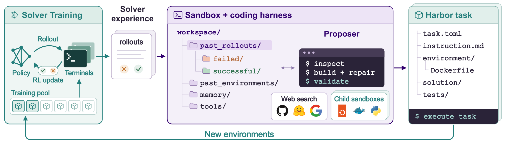
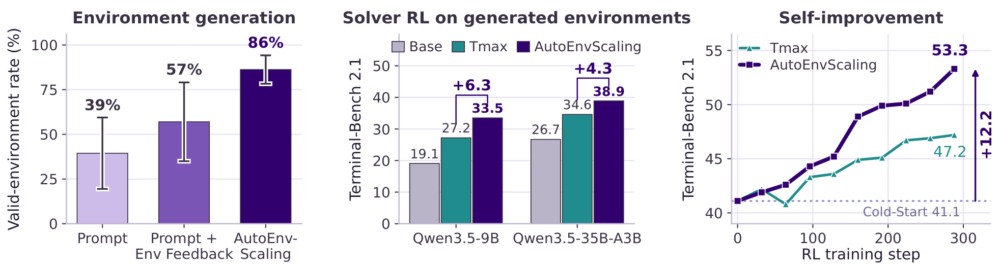
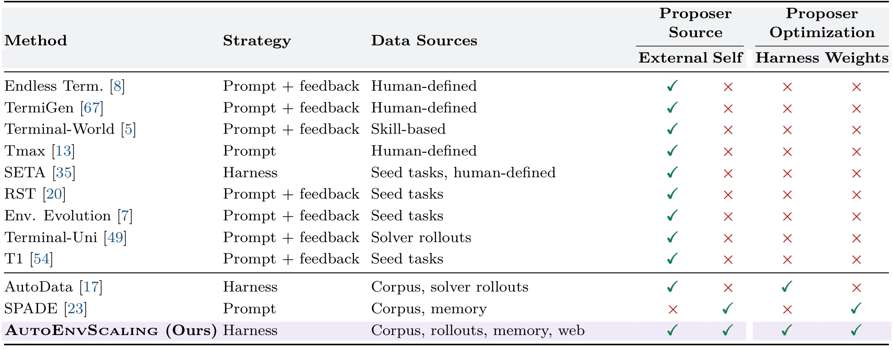
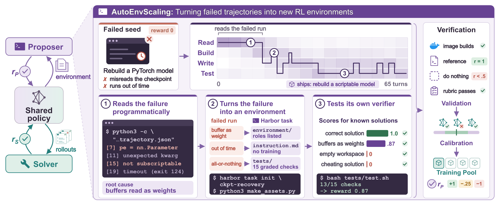
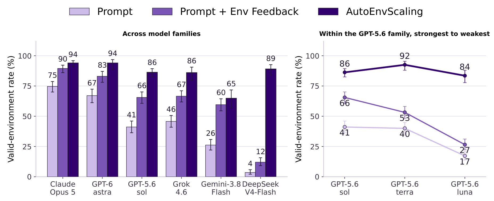
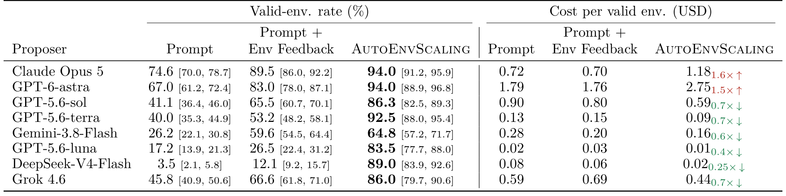
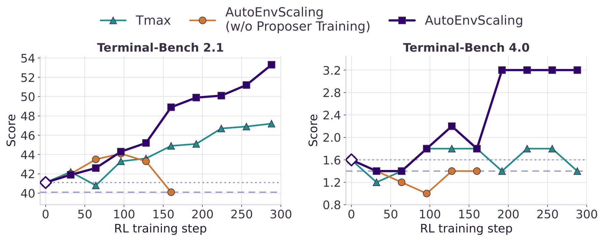

<div align="right">

[← Back to Home](../../README.md)

</div>

<h1 align="center">AutoEnvScaling: Automating the Data Flywheel with Terminal Agents</h1>

---

## Paper Information

| Field | Value |
|---|---|
| Title | AutoEnvScaling: Automating the Data Flywheel with Terminal Agents |
| Venue | arXiv |
| Year | 2026 |
| LaTeX Validation | 2/2 tables compiled with pdfLaTeX via LaTeX-on-HTTP and visually checked against the approved images on 2026-10-14. |
| Authors | Simon Yu, Baolin Peng, Bo Liu, Zhengyan Shi, Zhaoyang Wang, Hao Cheng, Qianhui Wu, Wenlin Yao, Natasha Jaques, Weiyan Shi, Jianfeng Gao |
| Original Asset License | [CC BY-NC-ND 4.0](https://creativecommons.org/licenses/by-nc-nd/4.0/) |
| Topic | Terminal agents, automatic environment generation, recursive data-flywheel self-improvement |
| Paper Link | [arXiv paper](https://arxiv.org/abs/2610.14163v1) |
| Code | [Official code](https://aka.ms/autoenvscaling) |
| Project / Blog | [Project page](https://microsoft.github.io/Orchard-Agentic/autoenvscaling/) |
| Assets | 2 method figures, 3 result figures, 2 tables |
| Asset Source | User-reviewed local PNGs extracted from the linked paper PDF; original labels and pages are listed below. |

---

## Asset Preview Gallery

Original figure/table previews are excerpts from [the paper](https://arxiv.org/abs/2610.14163v1) by Simon Yu, Baolin Peng, Bo Liu, Zhengyan Shi, Zhaoyang Wang, Hao Cheng, Qianhui Wu, Wenlin Yao, Natasha Jaques, Weiyan Shi, Jianfeng Gao, distributed here for noncommercial scholarly reference under [CC BY-NC-ND 4.0](https://creativecommons.org/licenses/by-nc-nd/4.0/). The complete selected figure/table regions were rendered from the PDF into PNG; surrounding page text and external captions were excluded, and the artwork itself was not altered. Third-party previews are not covered by this repository's MIT license. Reconstruction code and LaTeX are newly written approximations/transcriptions, not author-provided source; they do not expand the original material's reuse permissions. No endorsement by the original authors is implied.

<table>
  <tr>
    <th>Method Figures</th>
    <th>Result Figures</th>
    <th>Table Figures</th>
  </tr>
  <tr>
    <td align="center">
      <br>
      <sub>Figure 2: Automated Environment Data Flywheel</sub>
    </td>
    <td align="center">
      <br>
      <sub>Figure 1: Generation Quality, Training Gains, and Self-Improvement</sub>
    </td>
    <td align="center">
      <br>
      <sub>Table 1: Environment Generation Method Comparison</sub>
    </td>
  </tr>
  <tr>
    <td align="center">
      <br>
      <sub>Figure 3: Environment Design and Calibrated Self-Play</sub>
    </td>
    <td align="center">
      <br>
      <sub>Figure 4: Valid Environment Rates Across Proposer Models</sub>
    </td>
    <td align="center">
      <br>
      <sub>Table 2: Environment Validity and Generation Cost</sub>
    </td>
  </tr>
  <tr>
    <td></td>
    <td align="center">
      <br>
      <sub>Figure 6: Recursive Self-Improvement of Solvers and Proposers</sub>
    </td>
    <td></td>
  </tr>
</table>

---

# 1. Method Figures

## Figure 2: Automated Environment Data Flywheel

<p align="center">
  
</p>

| Asset | Link |
|---|---|
| Preview Image | [fig2_data_flywheel_framework.png](method_figures/fig2_data_flywheel_framework.png) |
| PPT Source | Not available |
| Source | Figure 2, PDF page 2 of the [paper](https://arxiv.org/abs/2610.14163v1) |

### Color Palette

| Role | Swatch | Color | Hex |
|---|---|---|---|
| Solver training and feedback |  | Teal | `#237E7B` |
| Proposer and agent harness |  | Purple | `#31006E` |
| Harbor task modules |  | Teal | `#77AAA3` |
| Workspace connections |  | Purple | `#9076B1` |
| Valid environments |  | Green | `#31724F` |
| Ubuntu environment |  | Orange | `#E8541F` |

---

## Figure 3: Environment Design and Calibrated Self-Play

<p align="center">
  
</p>

| Asset | Link |
|---|---|
| Preview Image | [fig3_environment_design_and_self_play.png](method_figures/fig3_environment_design_and_self_play.png) |
| PPT Source | Not available |
| Source | Figure 3, PDF page 4 of the [paper](https://arxiv.org/abs/2610.14163v1) |

### Color Palette

| Role | Swatch | Color | Hex |
|---|---|---|---|
| Environment generation pipeline |  | Purple | `#674293` |
| Terminal workspace |  | Purple | `#3F2A5D` |
| Solver calibration |  | Teal | `#237E7B` |
| Verifier success |  | Green | `#31724F` |
| Failure feedback |  | Red | `#BF6959` |
| Failure feedback fill |  | Pink | `#F2B8AE` |

---

# 2. Result Analysis Figures

## Figure 1: Generation Quality, Training Gains, and Self-Improvement

<p align="center">
  
</p>

| Asset | Link |
|---|---|
| Preview Image | [fig1_generation_training_self_improvement.png](result_figures/fig1_generation_training_self_improvement.png) |
| Source | Figure 1, PDF page 1 of the [paper](https://arxiv.org/abs/2610.14163v1) |

### Plotting Code

Note: The following code is an approximate visual reconstruction based on the provided figure.

Printed bar labels are transcribed; aggregate error bars and learning-curve samples are approximate.

Requires Python 3 with NumPy and Matplotlib.

```python
import numpy as np
import matplotlib.pyplot as plt
from matplotlib.lines import Line2D
from matplotlib.patches import Patch, Rectangle

plt.rcParams.update({"font.family": "DejaVu Sans", "font.size": 10,
                     "axes.titlesize": 11, "axes.labelsize": 10,
                     "axes.linewidth": 0.7, "savefig.facecolor": "white"})

def style(ax, axis="y"):
    ax.set_axisbelow(True)
    ax.grid(axis=axis, color="#E4E7EC", linewidth=0.6)
    ax.spines[["top", "right"]].set_visible(False)
    ax.spines[["bottom", "left"]].set_color("#B8BDC5")
    ax.tick_params(length=3, color="#A0A6AF")

purple, teal, light = "#31006E", "#1C9298", "#C9BAE4"
fig, axes = plt.subplots(1, 3, figsize=(13, 3.3), gridspec_kw={"width_ratios": [1, 1.15, 1.05]})
ax = axes[0]
values = [39, 57, 86]
ax.bar(range(3), values, width=0.64, color=[light, "#8057B0", purple],
       edgecolor="#68517E", yerr=[17, 22, 8], capsize=4)
for x, y in enumerate(values):
    ax.text(x, y + [19, 24, 10][x], f"{y}%", ha="center", fontsize=10, weight="bold", color="#30213E")
ax.set(xticks=range(3), xticklabels=["Prompt", "Prompt +\nEnv Feedback", "AutoEnv-\nScaling"],
       ylabel="Valid-environment rate (%)", ylim=(0, 110), title="Environment generation")
ax.set_yticks([0, 25, 50, 75, 100])
style(ax)
ax = axes[1]
x = np.arange(2)
for shift, values, color, label in [(-0.24, [19.1, 26.7], "#B8B4C5", "Base"),
                                  (0, [27.2, 34.6], teal, "Tmax"),
                                  (0.24, [33.5, 38.9], purple, "AutoEnvScaling")]:
    bars = ax.bar(x + shift, values, width=0.24, color=color, edgecolor="#5E5969", lw=0.5, label=label)
    for bar, y in zip(bars, values):
        ax.text(bar.get_x()+bar.get_width()/2, y+0.7, f"{y:.1f}", ha="center", fontsize=8)
for i, (base, ours, gain) in enumerate([(27.2, 33.5, 6.3), (34.6, 38.9, 4.3)]):
    ax.plot([i, i, i+0.24, i+0.24], [base+3, ours+5, ours+5, ours+3], color=purple, lw=1)
    ax.text(i+0.12, ours+5.5, f"+{gain}", ha="center", color=purple, weight="bold", fontsize=9)
ax.set(xticks=x, xticklabels=["Qwen3.5-9B", "Qwen3.5-35B-A3B"], ylabel="Terminal-Bench 2.1",
       ylim=(0, 55), title="Solver RL on generated environments")
ax.legend(ncol=3, fontsize=7, loc="upper center", frameon=False)
style(ax)
ax = axes[2]
steps = [0, 30, 60, 95, 130, 165, 200, 235, 265, 300]
tmax = [41.1, 41.8, 40.7, 43.9, 44.4, 45.0, 45.4, 46.8, 47.0, 47.2]
ours = [41.1, 41.8, 42.5, 44.3, 45.2, 48.9, 50.0, 50.2, 51.5, 53.3]
ax.plot(steps, tmax, "^-", color=teal, ms=4, lw=1.2, label="Tmax")
ax.plot(steps, ours, "s-", color=purple, ms=4, lw=1.8, label="AutoEnvScaling")
ax.axhline(41.1, color="#9E91BD", ls=":", lw=1)
ax.annotate("", xy=(320, 53.3), xytext=(320, 41.1),
            arrowprops={"arrowstyle": "<->", "color": purple})
ax.text(324, 47.2, "+12.2", color=purple, rotation=90, va="center", weight="bold", fontsize=9)
ax.text(300, 54, "53.3", ha="right", color=purple, weight="bold")
ax.text(300, 46.5, "47.2", ha="right", color=teal)
ax.text(300, 40.3, "Cold-Start 41.1", ha="right", color="#807394", fontsize=8)
ax.set(xlim=(-5, 335), ylim=(39, 56), xticks=[0, 100, 200, 300], yticks=[40, 45, 50, 55],
       xlabel="RL training step", ylabel="Terminal-Bench 2.1", title="Self-improvement")
ax.legend(frameon=False, fontsize=8, loc="upper left")
style(ax)
fig.subplots_adjust(left=0.06, right=0.98, bottom=0.21, top=0.86, wspace=0.42)

fig.savefig("fig1_summary_reconstructed.png", dpi=300, bbox_inches="tight")
plt.show()
```

---

## Figure 4: Valid Environment Rates Across Proposer Models

<p align="center">
  
</p>

| Asset | Link |
|---|---|
| Preview Image | [fig4_valid_environment_rate_comparison.png](result_figures/fig4_valid_environment_rate_comparison.png) |
| Source | Figure 4, PDF page 6 of the [paper](https://arxiv.org/abs/2610.14163v1) |

### Plotting Code

Rates and confidence intervals use the numerical values reported in Table 2; minor rounding can differ from the figure labels.

Requires Python 3 with NumPy and Matplotlib.

```python
import numpy as np
import matplotlib.pyplot as plt
from matplotlib.lines import Line2D
from matplotlib.patches import Patch, Rectangle

plt.rcParams.update({"font.family": "DejaVu Sans", "font.size": 10,
                     "axes.titlesize": 11, "axes.labelsize": 10,
                     "axes.linewidth": 0.7, "savefig.facecolor": "white"})

def style(ax, axis="y"):
    ax.set_axisbelow(True)
    ax.grid(axis=axis, color="#E4E7EC", linewidth=0.6)
    ax.spines[["top", "right"]].set_visible(False)
    ax.spines[["bottom", "left"]].set_color("#B8BDC5")
    ax.tick_params(length=3, color="#A0A6AF")

palette = ["#CBBCE6", "#8058B0", "#31006E"]
labels = ["Prompt", "Prompt + Env Feedback", "AutoEnvScaling"]
models = ["Claude\nOpus 5", "GPT-6\nastra", "GPT-5.6\nsol", "Grok\n4.6", "Gemini-3.8\nFlash", "DeepSeek\nV4-Flash"]
rates = np.array([[74.6, 89.5, 94.0], [67.0, 83.0, 94.0], [41.1, 65.5, 86.3],
                  [45.8, 66.6, 86.0], [26.2, 59.6, 64.8], [3.5, 12.1, 89.0]])
lower = np.array([[70.0,86.0,91.2], [61.2,78.0,88.9], [36.4,60.7,82.5],
                  [40.9,61.8,79.7], [22.1,54.5,57.2], [2.1,9.2,83.9]])
upper = np.array([[78.7,92.2,95.9], [72.4,87.1,96.8], [46.0,70.1,89.3],
                  [50.6,71.0,90.6], [30.8,64.4,71.7], [5.8,15.7,92.6]])
fig, axes = plt.subplots(1, 2, figsize=(12.5, 4), gridspec_kw={"width_ratios": [1.7, 1]})
x = np.arange(len(models))
for j, (color, label) in enumerate(zip(palette, labels)):
    axes[0].bar(x+(j-1)*0.24, rates[:,j], width=0.24, color=color, edgecolor="#644778", lw=0.5,
                yerr=np.vstack([rates[:,j]-lower[:,j], upper[:,j]-rates[:,j]]), capsize=2, label=label)
    for xi, value, top in zip(x+(j-1)*0.24, rates[:,j], upper[:,j]):
        axes[0].text(xi, top+1.5, f"{value:.0f}", ha="center", fontsize=8, color="#35253D")
axes[0].set(xticks=x, xticklabels=models, title="Across model families")
family = np.array([[41.1,65.5,86.3], [40.0,53.2,92.5], [17.2,26.5,83.5]])
family_lower = np.array([[36.4,60.7,82.5], [35.3,48.2,88.0], [13.9,22.4,77.7]])
family_upper = np.array([[46.0,70.1,89.3], [44.9,58.1,95.4], [21.3,31.2,88.0]])
for j, color in enumerate(palette):
    axes[1].errorbar(range(3), family[:,j], yerr=np.vstack([family[:,j]-family_lower[:,j], family_upper[:,j]-family[:,j]]),
                     fmt="o-", color=color, lw=1.5, ms=5, capsize=2)
    for xi, yi in enumerate(family[:,j]):
        axes[1].text(xi, yi+(3 if j==2 else -7), f"{yi:.0f}", ha="center", fontsize=9)
axes[1].set(xticks=range(3), xticklabels=["GPT-5.6\nsol", "GPT-5.6\nterra", "GPT-5.6\nluna"],
            xlim=(-0.35,2.35), title="Within the GPT-5.6 family, strongest to weakest")
for ax in axes:
    ax.set(ylim=(0,112), yticks=[0,25,50,75,100], ylabel="Valid-environment rate (%)")
    style(ax)
fig.legend([Patch(facecolor=c) for c in palette], labels, loc="upper center", ncol=3, frameon=False)
fig.subplots_adjust(left=0.07, right=0.99, top=0.80, bottom=0.19, wspace=0.27)

fig.savefig("fig4_validity_reconstructed.png", dpi=300, bbox_inches="tight")
plt.show()
```

---

## Figure 6: Recursive Self-Improvement of Solvers and Proposers

<p align="center">
  
</p>

| Asset | Link |
|---|---|
| Preview Image | [fig6_recursive_self_improvement.png](result_figures/fig6_recursive_self_improvement.png) |
| Source | Figure 6, PDF page 8 of the [paper](https://arxiv.org/abs/2610.14163v1) |

### Plotting Code

Note: The following code is an approximate visual reconstruction based on the provided figure.

Intermediate samples and the collapsed proposer curve are visually estimated; annotated endpoint values are preserved.

Requires Python 3 with NumPy and Matplotlib.

```python
import numpy as np
import matplotlib.pyplot as plt
from matplotlib.lines import Line2D
from matplotlib.patches import Patch, Rectangle

plt.rcParams.update({"font.family": "DejaVu Sans", "font.size": 10,
                     "axes.titlesize": 11, "axes.labelsize": 10,
                     "axes.linewidth": 0.7, "savefig.facecolor": "white"})

def style(ax, axis="y"):
    ax.set_axisbelow(True)
    ax.grid(axis=axis, color="#E4E7EC", linewidth=0.6)
    ax.spines[["top", "right"]].set_visible(False)
    ax.spines[["bottom", "left"]].set_color("#B8BDC5")
    ax.tick_params(length=3, color="#A0A6AF")

steps = np.array([0,30,60,95,130,165,200,235,265,300])
series = [
    ([41.1,41.8,40.7,43.9,44.4,45.0,45.4,46.8,47.0,47.2],
     [1.6,1.2,1.4,1.8,1.8,1.8,1.4,1.8,1.8,1.4]),
    ([41.1,41.8,43.3,44.1,43.5,40.0], [1.6,1.4,1.2,1.0,1.4,1.4]),
    ([41.1,41.8,42.5,44.3,45.2,48.9,50.0,50.2,51.5,53.3],
     [1.6,1.4,1.4,1.8,2.2,1.8,3.2,3.2,3.2,3.2]),
]
colors = ["#1A9399", "#D57C30", "#31006E"]
markers = ["^", "o", "s"]
labels = ["Tmax", "AutoEnvScaling\n(w/o Proposer Training)", "AutoEnvScaling"]
fig, axes = plt.subplots(1, 2, figsize=(12, 4))
for j, ax in enumerate(axes):
    for pair, color, marker, label in zip(series, colors, markers, labels):
        values = pair[j]
        ax.plot(steps[:len(values)], values, marker+"-", color=color, lw=1.7, ms=5,
                markeredgecolor="#3A3447", markeredgewidth=0.5, label=label)
    ax.plot(0, [41.1,1.6][j], marker="D", color="#31006E", mfc="white", ms=7, zorder=5)
    ax.axhline([41.1,1.6][j], color="#9E91BD", ls=":", lw=1.3)
    ax.axhline([40,1.4][j], color="#9E91BD", ls=(0,(5,5)), lw=1)
    ax.set(title=["Terminal-Bench 2.1","Terminal-Bench 4.0"][j], xlabel="RL training step",
           ylabel="Score", xlim=(-10,310), xticks=np.arange(0,301,50))
    ax.set_ylim((39.5,54.5) if j==0 else (0.8,3.45))
    ax.set_yticks(np.arange(40,55,2) if j==0 else np.arange(0.8,3.3,0.4))
    style(ax, "both")
fig.legend(*axes[0].get_legend_handles_labels(), loc="upper center", ncol=3, frameon=False)
fig.subplots_adjust(left=0.07, right=0.99, top=0.78, bottom=0.16, wspace=0.23)

fig.savefig("fig6_self_improvement_reconstructed.png", dpi=300, bbox_inches="tight")
plt.show()
```

---

# 3. Paper Tables

## Table 1: Environment Generation Method Comparison

<p align="center">
  
</p>

| Asset | Link |
|---|---|
| Preview Image | [table1_environment_generation_methods.png](tables/table1_environment_generation_methods.png) |
| Source | Table 1, PDF page 3 of the [paper](https://arxiv.org/abs/2610.14163v1) |

### LaTeX Source

```latex
\begin{table}[t]
\centering
\caption{Comparison of terminal-environment generation methods: proposer strategy, data sources, and optimization.}
\label{tab:autoenvscaling-methods}
\small
\setlength{\tabcolsep}{4pt}
\renewcommand{\arraystretch}{1.12}

\resizebox{\textwidth}{!}{%
\begin{tabular}{lllcccc}
\toprule
\rowcolor{black!5}
& & & \multicolumn{2}{c}{\textbf{Proposer Source}} & \multicolumn{2}{c}{\textbf{Proposer Optimization}} \\
\cmidrule(lr){4-5}\cmidrule(lr){6-7}
\rowcolor{black!5}
\multirow{-2}{*}{\textbf{Method}} & \multirow{-2}{*}{\textbf{Strategy}} & \multirow{-2}{*}{\textbf{Data Sources}} & \textbf{External} & \textbf{Self} & \textbf{Harness} & \textbf{Weights} \\
\midrule
Endless Term. [8] & Prompt + feedback & Human-defined & \textcolor{green!50!black}{$\checkmark$} & \textcolor{red!80!black}{$\times$} & \textcolor{red!80!black}{$\times$} & \textcolor{red!80!black}{$\times$} \\
TermiGen [67] & Prompt + feedback & Human-defined & \textcolor{green!50!black}{$\checkmark$} & \textcolor{red!80!black}{$\times$} & \textcolor{red!80!black}{$\times$} & \textcolor{red!80!black}{$\times$} \\
Terminal-World [5] & Prompt + feedback & Skill-based & \textcolor{green!50!black}{$\checkmark$} & \textcolor{red!80!black}{$\times$} & \textcolor{red!80!black}{$\times$} & \textcolor{red!80!black}{$\times$} \\
Tmax [13] & Prompt & Human-defined & \textcolor{green!50!black}{$\checkmark$} & \textcolor{red!80!black}{$\times$} & \textcolor{red!80!black}{$\times$} & \textcolor{red!80!black}{$\times$} \\
SETA [35] & Harness & Seed tasks, human-defined & \textcolor{green!50!black}{$\checkmark$} & \textcolor{red!80!black}{$\times$} & \textcolor{red!80!black}{$\times$} & \textcolor{red!80!black}{$\times$} \\
RST [20] & Prompt + feedback & Seed tasks & \textcolor{green!50!black}{$\checkmark$} & \textcolor{red!80!black}{$\times$} & \textcolor{red!80!black}{$\times$} & \textcolor{red!80!black}{$\times$} \\
Env. Evolution [7] & Prompt + feedback & Seed tasks & \textcolor{green!50!black}{$\checkmark$} & \textcolor{red!80!black}{$\times$} & \textcolor{red!80!black}{$\times$} & \textcolor{red!80!black}{$\times$} \\
Terminal-Uni [49] & Prompt + feedback & Solver rollouts & \textcolor{green!50!black}{$\checkmark$} & \textcolor{red!80!black}{$\times$} & \textcolor{red!80!black}{$\times$} & \textcolor{red!80!black}{$\times$} \\
T1 [54] & Prompt + feedback & Seed tasks & \textcolor{green!50!black}{$\checkmark$} & \textcolor{red!80!black}{$\times$} & \textcolor{red!80!black}{$\times$} & \textcolor{red!80!black}{$\times$} \\
\midrule
AutoData [17] & Harness & Corpus, solver rollouts & \textcolor{green!50!black}{$\checkmark$} & \textcolor{red!80!black}{$\times$} & \textcolor{green!50!black}{$\checkmark$} & \textcolor{red!80!black}{$\times$} \\
SPADE [23] & Prompt & Corpus, memory & \textcolor{red!80!black}{$\times$} & \textcolor{green!50!black}{$\checkmark$} & \textcolor{red!80!black}{$\times$} & \textcolor{green!50!black}{$\checkmark$} \\
\rowcolor{violet!10}
\textbf{\textsc{AutoEnvScaling} (Ours)} & Harness & Corpus, rollouts, memory, web & \textcolor{green!50!black}{$\checkmark$} & \textcolor{green!50!black}{$\checkmark$} & \textcolor{green!50!black}{$\checkmark$} & \textcolor{green!50!black}{$\checkmark$} \\
\bottomrule
\end{tabular}%
}
\end{table}
```

### Required Packages

```latex
\usepackage{booktabs}
\usepackage{graphicx}
\usepackage[table]{xcolor}
\usepackage{multirow}
\usepackage{amssymb}
```

---

## Table 2: Environment Validity and Generation Cost

<p align="center">
  
</p>

| Asset | Link |
|---|---|
| Preview Image | [table2_validity_and_cost.png](tables/table2_validity_and_cost.png) |
| Source | Table 2, PDF page 7 of the [paper](https://arxiv.org/abs/2610.14163v1) |

### LaTeX Source

```latex
\begin{table}[t]
\centering
\caption{Valid-environment rates with confidence intervals and cost per valid environment (USD). Cost multipliers reproduce the paper's reported annotations.}
\label{tab:autoenvscaling-validity-cost}
\small
\setlength{\tabcolsep}{4pt}
\renewcommand{\arraystretch}{1.12}

\resizebox{\textwidth}{!}{%
\begin{tabular}{lccc|ccc}
\toprule
& \multicolumn{3}{c}{Valid-env. rate (\%)} & \multicolumn{3}{c}{Cost per valid env. (USD)} \\
\cmidrule(lr){2-4}\cmidrule(lr){5-7}
Proposer & Prompt & \shortstack{Prompt +\\Env Feedback} & \textsc{AutoEnvScaling} & Prompt & \shortstack{Prompt +\\Env Feedback} & \textsc{AutoEnvScaling} \\
\midrule
Claude Opus 5 & 74.6 {\scriptsize [70.0, 78.7]} & 89.5 {\scriptsize [86.0, 92.2]} & \textbf{94.0} {\scriptsize [91.2, 95.9]} & 0.72 & 0.70 & 1.18$_{\textcolor{red!80!black}{1.6\times \uparrow}}$ \\
GPT-6-astra & 67.0 {\scriptsize [61.2, 72.4]} & 83.0 {\scriptsize [78.0, 87.1]} & \textbf{94.0} {\scriptsize [88.9, 96.8]} & 1.79 & 1.76 & 2.75$_{\textcolor{red!80!black}{1.5\times \uparrow}}$ \\
GPT-5.6-sol & 41.1 {\scriptsize [36.4, 46.0]} & 65.5 {\scriptsize [60.7, 70.1]} & \textbf{86.3} {\scriptsize [82.5, 89.3]} & 0.90 & 0.80 & 0.59$_{\textcolor{green!50!black}{0.7\times \downarrow}}$ \\
GPT-5.6-terra & 40.0 {\scriptsize [35.3, 44.9]} & 53.2 {\scriptsize [48.2, 58.1]} & \textbf{92.5} {\scriptsize [88.0, 95.4]} & 0.13 & 0.15 & 0.09$_{\textcolor{green!50!black}{0.7\times \downarrow}}$ \\
Gemini-3.8-Flash & 26.2 {\scriptsize [22.1, 30.8]} & 59.6 {\scriptsize [54.5, 64.4]} & \textbf{64.8} {\scriptsize [57.2, 71.7]} & 0.28 & 0.20 & 0.16$_{\textcolor{green!50!black}{0.6\times \downarrow}}$ \\
GPT-5.6-luna & 17.2 {\scriptsize [13.9, 21.3]} & 26.5 {\scriptsize [22.4, 31.2]} & \textbf{83.5} {\scriptsize [77.7, 88.0]} & 0.02 & 0.03 & 0.01$_{\textcolor{green!50!black}{0.4\times \downarrow}}$ \\
DeepSeek-V4-Flash & 3.5 {\scriptsize [2.1, 5.8]} & 12.1 {\scriptsize [9.2, 15.7]} & \textbf{89.0} {\scriptsize [83.9, 92.6]} & 0.08 & 0.06 & 0.02$_{\textcolor{green!50!black}{0.25\times \downarrow}}$ \\
Grok 4.6 & 45.8 {\scriptsize [40.9, 50.6]} & 66.6 {\scriptsize [61.8, 71.0]} & \textbf{86.0} {\scriptsize [79.7, 90.6]} & 0.59 & 0.69 & 0.44$_{\textcolor{green!50!black}{0.7\times \downarrow}}$ \\
\bottomrule
\end{tabular}%
}
\end{table}
```

### Required Packages

```latex
\usepackage{booktabs}
\usepackage{graphicx}
\usepackage[table]{xcolor}
```

---
