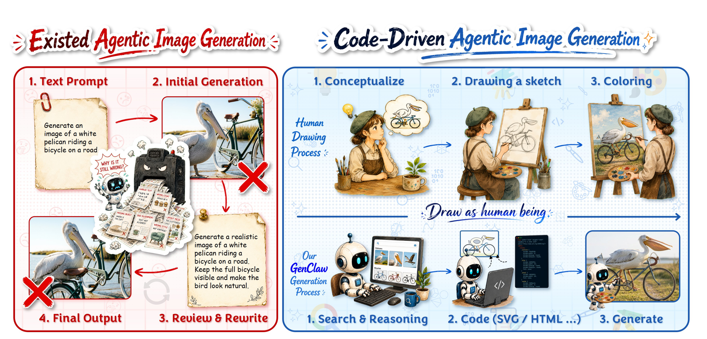
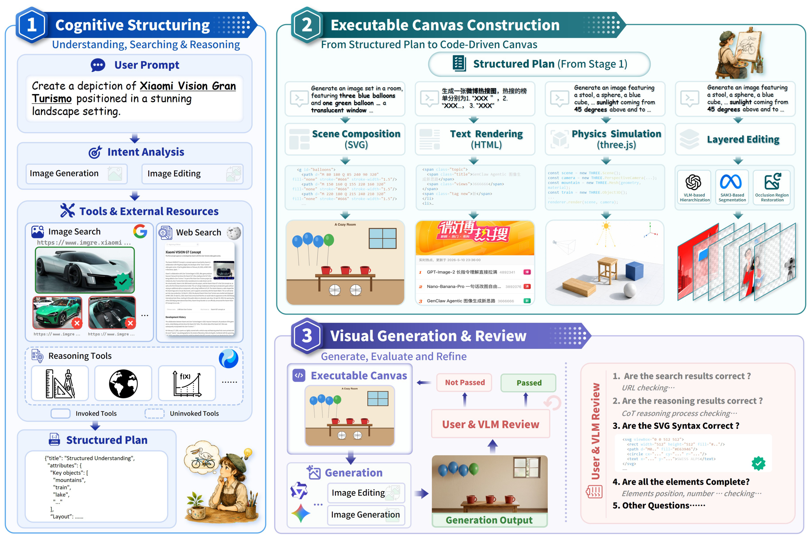

[← Back to Home](../../README.md)

<h1 align="center">GenClaw: Code-Driven Agentic Image Generation</h1>

---

## Paper Information

| Field | Value |
|---|---|
| Title | GenClaw: Code-Driven Agentic Image Generation |
| Authors | Junyan Ye, Jun He, Zilong Huang, Dongzhi Jiang, Xuan Yang, Rui Chen, Weijia Li |
| Venue | arXiv |
| Year | 2026 |
| Topic | Code-driven agentic image generation with cognitive search, executable visual canvases and iterative review |
| Paper Link | [arXiv:2605.30248v2](https://arxiv.org/abs/2605.30248v2) · [PDF](https://arxiv.org/pdf/2605.30248v2) |
| Project | [yejy53/GenClaw](https://github.com/yejy53/GenClaw) |
| Method Figures PPT | [Download the two-figure editable deck](method_figures/method_figures_editable.pptx) |
| Assets | 2 method figures, 0 result figures, 0 tables |
| Figure attribution | Selected original figures from the cited paper. The arXiv non-exclusive distribution license does not establish general permission to redistribute the figures or third-party artwork; consult the rights holders before reuse. |

---

## Asset Preview Gallery

<table>
  <tr>
    <th>Method Figures</th>
    <th>Result Figures</th>
    <th>Table Figures</th>
  </tr>
  <tr>
    <td align="center">
       
      Code-driven generation paradigm
    </td>
    <td align="center">—</td>
    <td align="center">—</td>
  </tr>
  <tr>
    <td align="center">
       
      Cognitive structuring, executable canvas and visual review
    </td>
    <td align="center">—</td>
    <td align="center">—</td>
  </tr>
</table>

---

# 1. Method Figures

## Figure 1: Code-Driven Agentic Image-Generation Paradigm

  

| Asset | Link |
|---|---|
| Preview Image | [fig1_code_driven_generation_paradigm.png](method_figures/fig1_code_driven_generation_paradigm.png) |
| Original Source | Figure 1, PDF page 1, arXiv v2 |
| PPT Source | [fig1_code_driven_generation_paradigm.pptx](method_figures/fig1_code_driven_generation_paradigm.pptx) — reconstructed, not author-provided source |

The overview contrasts repeated prompt rewriting with GenClaw's human-inspired conceptualization, code sketching and image rendering workflow.

### Color Palette

| Role | Swatch | Color | Hex |
|---|---|---|---|
| Existing prompt-rewriting workflow and failure marks |  | Red | `#BF0204` |
| Code-driven workflow and stage connections |  | Blue | `#1A58B2` |
| Code-driven process background |  | Blue | `#E4F5FF` |
| Written prompt notes |  | Yellow | `#FFF7DA` |

> Reconstructed editable PPTX: semantic/process content is complete, but decorative visual coverage is partial. Process labels, group frames, photo borders and arrow geometry are native PowerPoint objects. Brush-lettered headings are editable vector contours rather than typeable text. The original artist/robot illustrations, photographs, code-editor image and small ornaments remain 14 independent raster objects. Native dotted backgrounds and selected faint ornaments are approximate; some tiny source decorations and sticker shadows are not reproduced. Paper textures and font metrics are also approximate, so this is not a complete pixel-level visual reproduction. Arrows are editable paths, not endpoint-bound connectors. The delivered file passed package checks and final-file visual review using Artifact Tool PPTX roundtrip; Microsoft PowerPoint application compatibility has not been tested. The combined deck inherits these decorative limitations.

---

## Figure 3: Cognitive Structuring, Executable Canvas and Visual Review

  

| Asset | Link |
|---|---|
| Preview Image | [fig3_cognitive_canvas_review_framework.png](method_figures/fig3_cognitive_canvas_review_framework.png) |
| Original Source | Figure 3, PDF page 6, arXiv v2 |
| PPT Source | [fig3_cognitive_canvas_review_framework.pptx](method_figures/fig3_cognitive_canvas_review_framework.pptx) — reconstructed, not author-provided source |

The three-stage framework connects intent analysis and external tools to executable SVG/HTML/three.js canvases, layered editing, image generation and a user/VLM review loop.

### Color Palette

| Role | Swatch | Color | Hex |
|---|---|---|---|
| Cognitive structuring stage |  | Blue | `#0A50B0` |
| Executable canvas construction stage |  | Teal | `#1F717D` |
| Visual generation and review stage |  | Purple | `#5E5FB9` |
| Review checklist and feedback |  | Red | `#C75A59` |
| Passed review and generation output |  | Green | `#3F8949` |

> Reconstructed editable PPTX: stage banners, containers, readable labels, prompts, code snippets, review questions and arrows are native text/shapes/paths. The original photos, web/example screenshots, tool logos/icons, painter and layered-image illustration remain 47 independent raster components; their internal pixels are not editable. The tiny snippets reproduce visible diagram content, not executable author source. Fonts use installed Calibri, Comic Sans MS, Microsoft YaHei and Courier New substitutes; shadows, gradients and small decoration are approximate rather than pixel-identical. Arrows are not endpoint-bound connectors. The delivered file and both slides of the combined deck passed package checks and Artifact Tool final-file roundtrip visual review; Microsoft PowerPoint application compatibility has not been tested.

---

# 2. Result Analysis Figures

No result figures in the approved selection.

---

# 3. Paper Tables

No tables in the approved selection.
