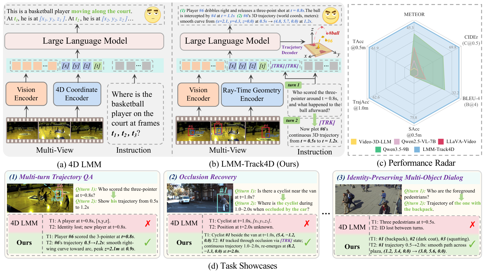
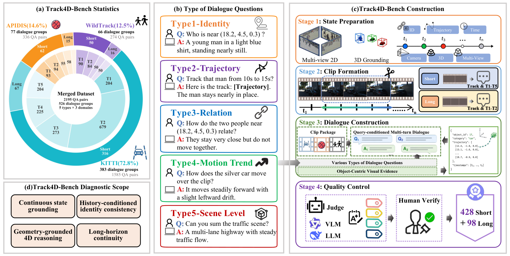
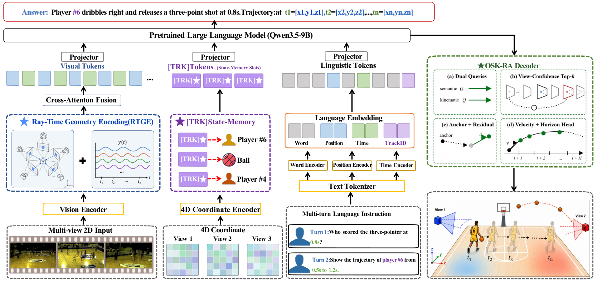

[← Back to Home](../../README.md)

<h1 align="center">LMM-Track4D: Eliciting 4D Dynamic Reasoning in LMMs via Trajectory-Grounded Dialogue</h1>

---

## Paper Information

| Field | Value |
|---|---|
| Title | LMM-Track4D: Eliciting 4D Dynamic Reasoning in LMMs via Trajectory-Grounded Dialogue |
| Authors | Chaoyue Li, Yongxue Xu, Jie Feng, Jiayu Ding |
| Venue | arXiv |
| Year | 2026 |
| Topic | Geometry-grounded multi-turn dialogue and 4D trajectory reasoning |
| Paper Link | [2605.19390v1](https://arxiv.org/abs/2605.19390v1) |
| PDF | [Paper PDF](https://arxiv.org/pdf/2605.19390v1) |
| Project | [Official project](https://github.com/mikubaka88/LMM-Track4D) |
| Source Version | v1 |
| Method Figures PPT | [Editable method-figure deck](method_figures/method_figures_editable.pptx) |
| Original Asset License | [CC BY 4.0](https://creativecommons.org/licenses/by/4.0/) |

---

## Asset Preview Gallery

<table>
  <tr>
    <th>Method Figures</th>
    <th>Result Figures</th>
    <th>Table Figures</th>
  </tr>
  <tr>
    <td align="center">
       
      Trajectory-grounded Dialogue Task and Model Overview
    </td>
    <td align="center">—</td>
    <td align="center">—</td>
  </tr>
  <tr>
    <td align="center">
       
      Track4D-Bench Construction and Diagnostic Scope
    </td>
    <td align="center">—</td>
    <td align="center">—</td>
  </tr>
  <tr>
    <td align="center">
       
      LMM-Track4D Geometry and State-memory Architecture
    </td>
    <td align="center">—</td>
    <td align="center">—</td>
  </tr>
</table>

---

# 1. Method Figures

## Figure 1: Trajectory-grounded Dialogue Task and Model Overview

  

| Asset | Link |
|---|---|
| Preview Image | [fig1_task_and_model_overview.png](method_figures/fig1_task_and_model_overview.png) |
| Source | Figure 1, PDF page 2 |
| PPT Source | [fig1_task_and_model_overview.pptx](method_figures/fig1_task_and_model_overview.pptx) — reconstructed, not author source |

### Color Palette

| Role | Swatch | Color | Hex |
|---|---|---|---|
| Vision encoder |  | Orange | `#FFD7BE` |
| Coordinate / ray-time geometry encoder |  | Blue | `#C9DEF6` |
| LLM module |  | Pink | `#F8EAE8` |
| Multimodal token strip |  | Cyan | `#D3F4F1` |
| Successful stateful reasoning rows |  | Green | `#E2F1D9` |
| Baseline-failure rows |  | Pink | `#F9DBDF` |
| Ours performance-radar polygon |  | Blue | `#7CB8E1` |

> Reconstructed PPTX, not author source. Primary module/task labels, panels, tokens and flow geometry are native editable objects. Photographs, pictograms and local scientific illustrations remain independently movable images with non-editable pixels; Figure 2 also retains the original donut chart and small JSON illustration as images. Some formula/symbol glyphs are editable vector outlines rather than live equations or typeable text. Source fonts are substituted with installed Times New Roman/Arial; antialiasing and spacing differ. Arrows are freeforms, not bound connectors; plot paths are not data-bound charts. Final PPTX roundtrip render visually checked; PowerPoint application compatibility not tested.

---

## Figure 2: Track4D-Bench Construction and Diagnostic Scope

  

| Asset | Link |
|---|---|
| Preview Image | [fig2_track4d_benchmark_construction.png](method_figures/fig2_track4d_benchmark_construction.png) |
| Source | Figure 2, PDF page 4 |
| PPT Source | [fig2_track4d_benchmark_construction.pptx](method_figures/fig2_track4d_benchmark_construction.pptx) — reconstructed, not author source |

### Color Palette

| Role | Swatch | Color | Hex |
|---|---|---|---|
| KITTI domain and ring sectors |  | Cyan | `#18B7CA` |
| APIDIS domain / state-preparation stage |  | Orange | `#F7941D` |
| WildTrack domain / trajectory questions |  | Purple | `#6F2F9F` |
| Clip formation / state labels |  | Blue | `#8FAADC` |
| Dialogue construction and verification |  | Green | `#538235` |
| Diagnostic-scope blocks |  | Orange | `#FAE9DE` |
| Motion-trend question group |  | Green | `#00B050` |

> Reconstructed PPTX, not author source. Primary module/task labels, panels, tokens and flow geometry are native editable objects. Photographs, pictograms and local scientific illustrations remain independently movable images with non-editable pixels; Figure 2 also retains the original donut chart and small JSON illustration as images. Some formula/symbol glyphs are editable vector outlines rather than live equations or typeable text. Source fonts are substituted with installed Times New Roman/Arial; antialiasing and spacing differ. Arrows are freeforms, not bound connectors; plot paths are not data-bound charts. Final PPTX roundtrip render visually checked; PowerPoint application compatibility not tested.

---

## Figure 3: LMM-Track4D Geometry and State-memory Architecture

  

| Asset | Link |
|---|---|
| Preview Image | [fig3_lmm_track4d_method_overview.png](method_figures/fig3_lmm_track4d_method_overview.png) |
| Source | Figure 3, PDF page 5 |
| PPT Source | [fig3_lmm_track4d_method_overview.pptx](method_figures/fig3_lmm_track4d_method_overview.pptx) — reconstructed, not author source |

### Color Palette

| Role | Swatch | Color | Hex |
|---|---|---|---|
| RTGE geometry branch frames |  | Blue | `#2E528F` |
| Visual / position tokens |  | Blue | `#BCD6ED` |
| TRK state-memory tokens |  | Purple | `#B994F1` |
| TRK semantic group and track identities |  | Purple | `#6F2F9F` |
| OSK-RA decoder and motion curve |  | Green | `#538235` |
| Time / visual feature tokens |  | Green | `#C5DFB4` |
| Encoder / tokenizer outlines |  | Yellow | `#FFC000` |
| Word tokens |  | Gray | `#D0CECE` |

> Reconstructed PPTX, not author source. Primary module/task labels, panels, tokens and flow geometry are native editable objects. Photographs, pictograms and local scientific illustrations remain independently movable images with non-editable pixels; Figure 2 also retains the original donut chart and small JSON illustration as images. Some formula/symbol glyphs are editable vector outlines rather than live equations or typeable text. Source fonts are substituted with installed Times New Roman/Arial; antialiasing and spacing differ. Arrows are freeforms, not bound connectors; plot paths are not data-bound charts. Final PPTX roundtrip render visually checked; PowerPoint application compatibility not tested.

---

# 2. Result Analysis Figures

# 3. Paper Tables
