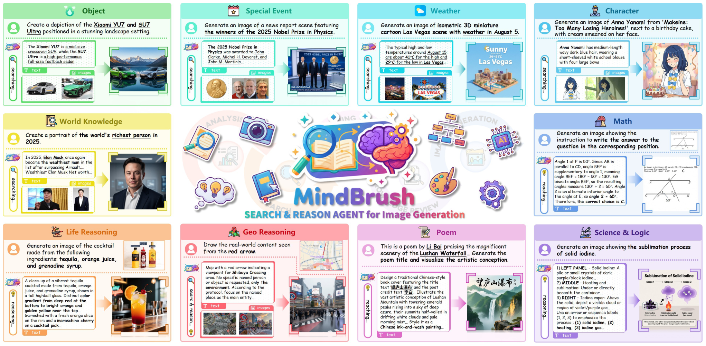
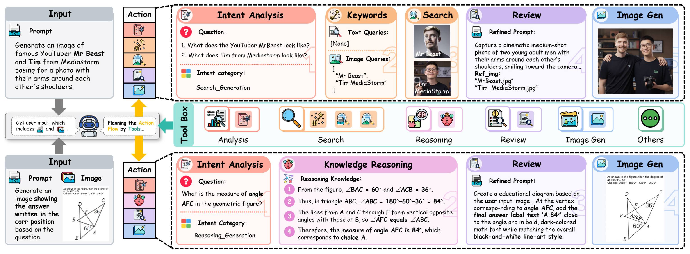
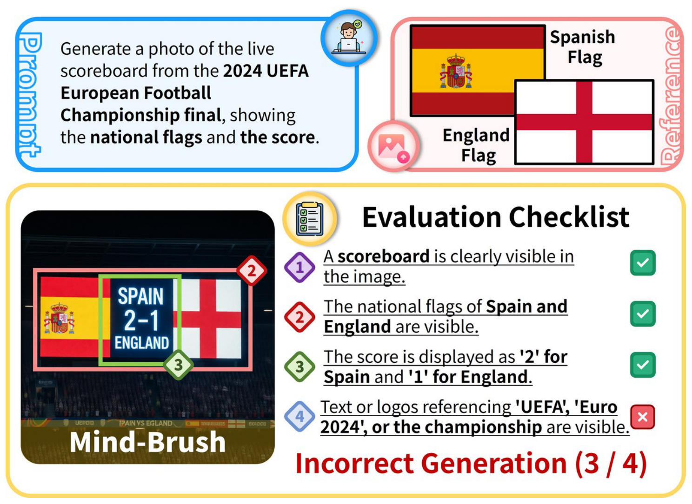

[← Back to Home](../../README.md)

<h1 align="center">Mind-Brush: Integrating Agentic Cognitive Search and Reasoning into Image Generation</h1>

---

## Paper Information

| Field | Value |
|---|---|
| Title | Mind-Brush: Integrating Agentic Cognitive Search and Reasoning into Image Generation |
| Authors | Jun He, Junyan Ye, Zilong Huang, Dongzhi Jiang, Chenjue Zhang, Leqi Zhu, Renrui Zhang, Xiang Zhang, Weijia Li |
| Venue | arXiv |
| Year | 2026 |
| Topic | Agentic cognitive search and explicit reasoning for knowledge-grounded image generation |
| Paper Link | [arXiv:2602.01756v1](https://arxiv.org/abs/2602.01756v1) |
| Project | [Mind-Brush](https://github.com/PicoTrex/Mind-Brush) |
| Dataset | [Mind-Brush on Hugging Face](https://huggingface.co/datasets/PicoTrex/Mind-Brush) |
| Original Asset License | [CC BY 4.0](https://creativecommons.org/licenses/by/4.0/), as linked from the arXiv record; third-party reference imagery may carry separate terms. |
| Asset Type | 3 method figures, 0 result figures, 0 tables |
| Method Figures PPT | [Download all 3 editable figures](method_figures/method_figures_editable.pptx) |

Figures are attributed to the authors above. The previews reproduce the approved paper artwork; the PPT files are ReFigure reconstructions, not author-provided source. Figure 1 is a concept/capability overview, not an implementation architecture or a quantitative chart. Ordinary qualitative comparisons and tables were not selected.

Text, containers, arrows, numbered steps, checklist marks and flag geometry are native PowerPoint objects. Photos, generated examples, maps, retrieved-image strips, logos and complex icons are independently movable images; their internal pixels and embedded example labels are not editable. Comic Sans MS and Arial approximate the source lettering, with platform fallback for Chinese text. Gradients, shadows, dotted fill texture, mixed-weight details and dash spacing have minor approximations. Pale oversized step numbers are editable vector outlines rather than typeable text. Arrows are editable freeform paths, not endpoint-bound connectors. The actual final PPTX files were rendered and visually checked through Artifact Tool; PowerPoint application compatibility was not tested.

Appendix B.3 identifies third-party sources including Wikipedia CC BY-SA 3.0 material, weather and recipe websites, and MathVerse. The paper license does not override those sources' separate conditions.

---

## Asset Preview Gallery

<table>
  <tr><th>Method Figures</th><th>Result Figures</th><th>Table Figures</th></tr>
  <tr>
    <td align="center"> Cognitive Generation Capability Overview</td>
    <td align="center">No result figures selected</td>
    <td align="center">No table figures selected</td>
  </tr>
  <tr>
    <td align="center"> Search and Reasoning Framework</td><td></td><td></td>
  </tr>
  <tr>
    <td align="center"> Checklist-based Strict Accuracy Evaluation</td><td></td><td></td>
  </tr>
</table>

---

# 1. Method Figures

## Figure 1: Cognitive Generation Capability Overview

  

| Asset | Link |
|---|---|
| Preview Image | [fig1_cognitive_generation_capability_overview.png](method_figures/fig1_cognitive_generation_capability_overview.png) |
| Source | Figure 1, PDF page 1; complete ten-task capability overview from arXiv v1. |
| PPT Source | [fig1_cognitive_generation_capability_overview.pptx](method_figures/fig1_cognitive_generation_capability_overview.pptx) |

The ten task cards retain their prompts, evidence descriptions, task labels and search/reasoning-to-generation organization. Card geometry and narrative labels are editable; example imagery and the central illustrated MindBrush logo remain local image objects. The overview contains no quantitative measurements, so no numerical plotting code is invented.

### Color Palette

| Role | Swatch | Color | Hex |
|---|---|---|---|
| Object tasks |  | Green | `#A6ECAE` |
| Special events |  | Teal | `#98F5E2` |
| Weather |  | Cyan | `#8EECF4` |
| Character knowledge |  | Blue | `#8FDBF3` |
| World knowledge |  | Yellow | `#F6F092` |
| Mathematics |  | Blue | `#A3C3F2` |
| Life reasoning |  | Orange | `#FBC394` |
| Geographic reasoning |  | Pink | `#FFA7AD` |
| Poetry |  | Pink | `#F0C0E8` |
| Science and logic |  | Purple | `#CEBAEF` |

---

## Figure 2: Search and Reasoning Framework

  

| Asset | Link |
|---|---|
| Preview Image | [fig2_mind_brush_framework.png](method_figures/fig2_mind_brush_framework.png) |
| Source | Figure 2, PDF page 4; complete framework including both routes and the shared toolbox, arXiv v1. |
| PPT Source | [fig2_mind_brush_framework.pptx](method_figures/fig2_mind_brush_framework.pptx) |

Both intent-to-generation routes, action bars and toolbox groups are reconstructed as native text and geometry. Retrieved portraits, generated examples and tool pictograms remain independent images. Geometry and labels inside the original generated geometry examples remain raster evidence; the separate reasoning equations are editable text.

### Color Palette

| Role | Swatch | Color | Hex |
|---|---|---|---|
| Intent analysis |  | Red | `#FFA99C` |
| Query construction and search |  | Orange | `#F8BD8B` |
| Knowledge reasoning |  | Pink | `#EEB6E3` |
| Concept review |  | Purple | `#CEB9F1` |
| Image generation |  | Blue | `#AEC8EF` |
| Shared toolbox |  | Teal | `#9AE3DA` |

---

## Figure 3: Checklist-based Strict Accuracy Evaluation

  

| Asset | Link |
|---|---|
| Preview Image | [fig3_checklist_based_strict_accuracy_evaluation.png](method_figures/fig3_checklist_based_strict_accuracy_evaluation.png) |
| Source | Figure 3, PDF page 5; complete CSA evaluation schematic from arXiv v1. |
| PPT Source | [fig3_checklist_based_strict_accuracy_evaluation.pptx](method_figures/fig3_checklist_based_strict_accuracy_evaluation.pptx) |

The prompt, reference flag geometry, four criteria, numbered diamonds, underlines and pass/fail indicators are native editable objects. The generated scoreboard example with its internal annotations, the Spanish coat of arms and circular pictograms remain independent original image crops. The displayed 3/4 verdict is preserved as an example of the evaluation rule, not introduced as a new experimental measurement.

### Color Palette

| Role | Swatch | Color | Hex |
|---|---|---|---|
| Prompt |  | Blue | `#3399E2` |
| Visual references |  | Pink | `#F48B8B` |
| Evaluation grouping |  | Yellow | `#FBDA65` |
| Satisfied checks |  | Green | `#10915D` |
| Failed check |  | Red | `#F25B5F` |

---

# 2. Result Analysis Figures

No result figures selected.

---

# 3. Paper Tables

No table figures selected.
