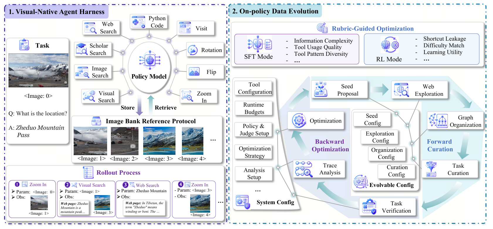
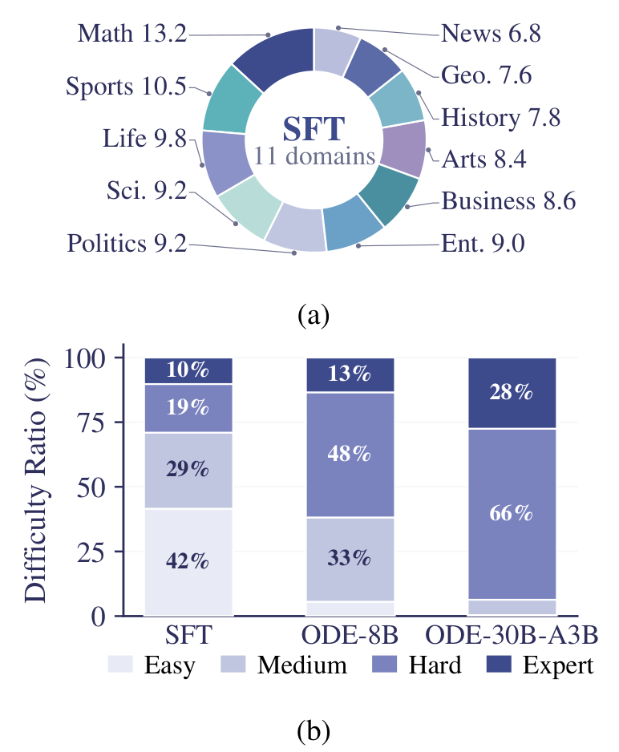
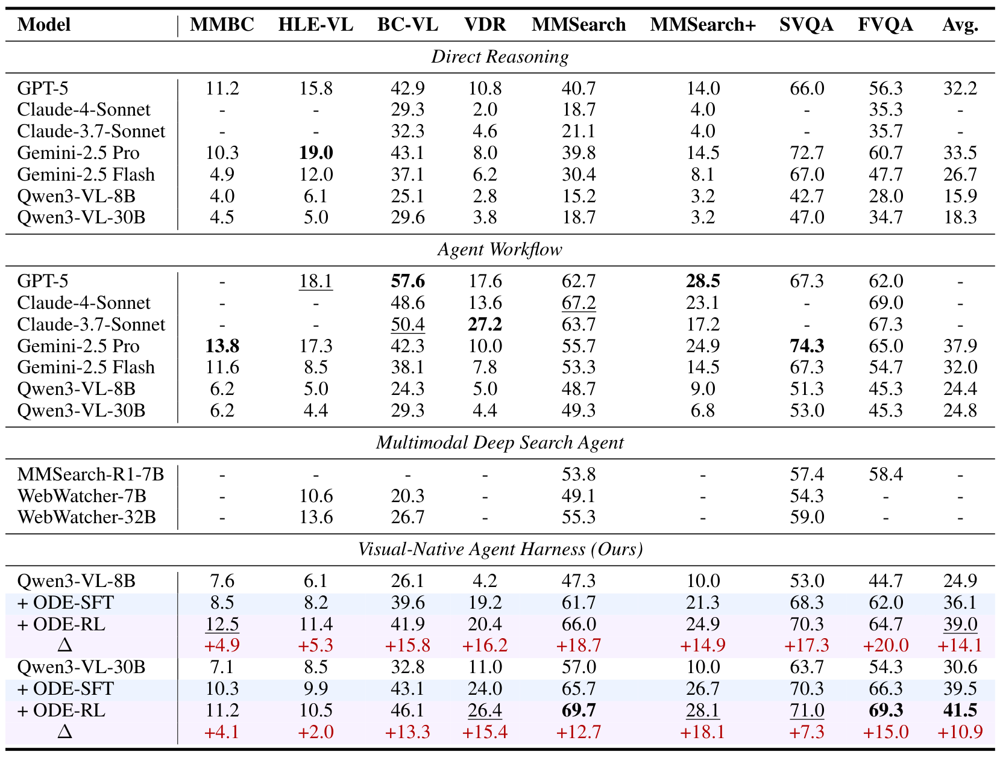
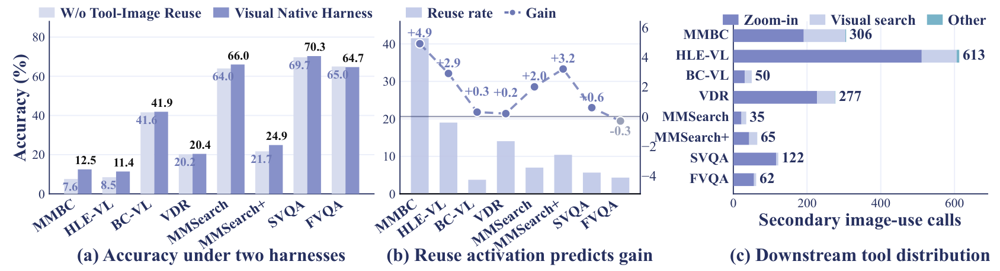
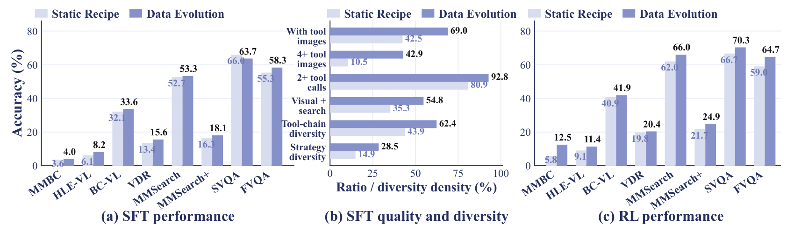
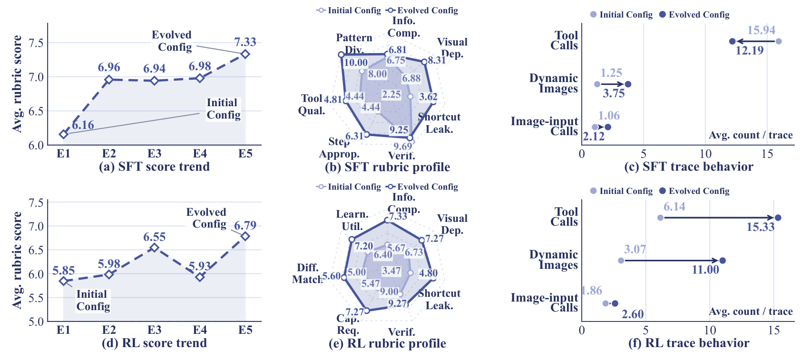

<div align="right">

[← Back to Home](../../README.md)

</div>

<h1 align="center">Towards On-Policy Data Evolution for Visual-Native Multimodal Deep Search Agents</h1>

---

## Paper Information

| Field | Value |
|---|---|
| Title | Towards On-Policy Data Evolution for Visual-Native Multimodal Deep Search Agents |
| Venue | arXiv |
| Year | 2026 |
| LaTeX Validation | 1/1 tables compiled with pdfLaTeX via LaTeX-on-HTTP and visually checked against the approved images on 2026-10-14. |
| Authors | Shijue Huang, Hangyu Guo, Guanting Dong, Chenxin Li, Junting Lu, Xinyu Geng, Zhaochen Su, Zhenyu Li, Shuang Chen, Hongru Wang, Yi R. Fung |
| Original Asset License | [arXiv non-exclusive distribution license](https://arxiv.org/licenses/nonexclusive-distrib/1.0/license.html) (not a public reuse license) |
| Topic | Visual-native multimodal deep search, on-policy data evolution, agent SFT and reinforcement learning |
| Paper Link | [arXiv paper](https://arxiv.org/abs/2605.10832v2) |
| Code | [Official code](https://github.com/JoeYing1019/ODE) |
| Project / Blog | [Project page](https://on-policy-data-evolution.github.io/) |
| Assets | 1 method figures, 4 result figures, 1 tables |
| Asset Source | User-reviewed local PNGs extracted from the linked paper PDF; original labels and pages are listed below. |
| Method Figures PPT | [All method figures — editable reconstruction](method_figures/method_figures_editable.pptx) |
| Method PPT Notes | Newly reconstructed, not author-provided source. Native text and vector paths; some equations/tiny glyphs are editable outlines, not typeable text. Arrows are not endpoint-bound; charts are not data-bound. Photos, illustrations, and local effects remain independent raster objects. Fonts/shadows/gradients may differ. Final PPTX roundtrip-rendered and visually checked; PowerPoint desktop not tested. |

---

## Asset Preview Gallery

Original figure/table previews are excerpts from [the cited paper](https://arxiv.org/abs/2605.10832v2) for scholarly reference. Copyright remains with the original rightsholders. The [arXiv distribution license](https://arxiv.org/licenses/nonexclusive-distrib/1.0/license.html) does not itself grant third-party reuse rights, and these previews are not covered by this repository's MIT license. Check with the original rightsholders before redistribution or reuse. Reconstruction code and LaTeX are newly written approximations/transcriptions, not author-provided source, and no broader permission or author endorsement is asserted.

<table>
  <tr>
    <th>Method Figures</th>
    <th>Result Figures</th>
    <th>Table Figures</th>
  </tr>
  <tr>
    <td align="center">
      <br>
      <sub>Figure 1: Visual-Native Agent Harness and On-Policy Data Evolution</sub>
    </td>
    <td align="center">
      <br>
      <sub>Figure 2: Domain Coverage and Training Task Difficulty</sub>
    </td>
    <td align="center">
      <br>
      <sub>Table 1: Multimodal Deep Search Main Results</sub>
    </td>
  </tr>
  <tr>
    <td></td>
    <td align="center">
      <br>
      <sub>Figure 3: Visual-Native Harness Ablation and Tool Usage</sub>
    </td>
    <td></td>
  </tr>
  <tr>
    <td></td>
    <td align="center">
      <br>
      <sub>Figure 4: Static Synthesis Versus On-Policy Data Evolution</sub>
    </td>
    <td></td>
  </tr>
  <tr>
    <td></td>
    <td align="center">
      <br>
      <sub>Figure 5: SFT and RL Mechanism Analysis</sub>
    </td>
    <td></td>
  </tr>
</table>

---

# 1. Method Figures

## Figure 1: Visual-Native Agent Harness and On-Policy Data Evolution

<p align="center">
  
</p>

| Asset | Link |
|---|---|
| Preview Image | [fig1_visual_native_harness_and_ode_framework.png](method_figures/fig1_visual_native_harness_and_ode_framework.png) |
| PPT Source | [Editable native/hybrid reconstruction](method_figures/fig1_visual_native_harness_and_ode_framework.pptx) |
| Source | Figure 1, PDF page 3 of the [paper](https://arxiv.org/abs/2605.10832v2) |

### Color Palette

| Role | Swatch | Color | Hex |
|---|---|---|---|
| Visual-native harness boundary |  | Indigo | `#3A3399` |
| ODE framework boundary |  | Teal | `#0B77A4` |
| Backward optimization |  | Purple | `#7030A0` |
| Forward curation |  | Blue | `#4471C4` |
| Configuration and data links |  | Blue | `#B4C6E7` |

---

# 2. Result Analysis Figures

## Figure 2: Domain Coverage and Training Task Difficulty

<p align="center">
  
</p>

| Asset | Link |
|---|---|
| Preview Image | [fig2_domain_coverage_and_task_difficulty.png](result_figures/fig2_domain_coverage_and_task_difficulty.png) |
| Source | Figure 2, PDF page 5 of the [paper](https://arxiv.org/abs/2605.10832v2) |

### Plotting Code

Note: The following code is an approximate visual reconstruction based on the provided figure.

Domain shares and prominent difficulty labels are transcribed. Unlabeled small difficulty segments are visually estimated.

Requires Python 3 with NumPy and Matplotlib.

```python
import numpy as np
import matplotlib.pyplot as plt
from matplotlib.lines import Line2D
from matplotlib.patches import Patch, Rectangle

plt.rcParams.update({"font.family": "DejaVu Serif", "font.size": 10,
                     "axes.titlesize": 11, "axes.labelsize": 10,
                     "axes.linewidth": 0.7, "savefig.facecolor": "white"})

def style(ax, axis="y"):
    ax.set_axisbelow(True)
    ax.grid(axis=axis, color="#E4E7EC", linewidth=0.6)
    ax.spines[["top", "right"]].set_visible(False)
    ax.spines[["bottom", "left"]].set_color("#B8BDC5")
    ax.tick_params(length=3, color="#A0A6AF")

domains=["News","Geo.","History","Arts","Business","Ent.","Politics","Sci.","Life","Sports","Math"]
shares=[6.8,7.6,7.8,8.4,8.6,9.0,9.2,9.2,9.8,10.5,13.2]
colors=["#BCC3E2","#5C6CA7","#75ADC0","#A597C5","#438E9E","#78A8C8","#C0BEDD","#B5DBD2","#929AC5","#52ADB4","#40498D"]
fig,axes=plt.subplots(2,1,figsize=(5.8,7.2),gridspec_kw={"height_ratios":[1,1.15]})
ax=axes[0]
ax.pie(shares,labels=[f"{d} {v:.1f}" for d,v in zip(domains,shares)],startangle=90,counterclock=False,
       colors=colors,wedgeprops={"width":.34,"edgecolor":"white"},textprops={"fontsize":9,"color":"#34386A"},labeldistance=1.20)
ax.text(0,.07,"SFT",ha="center",va="center",fontsize=17,color="#40498D",weight="bold")
ax.text(0,-.15,"11 domains",ha="center",color="#666E9F",fontsize=10)
ax.text(.5,-.10,"(a)",transform=ax.transAxes,ha="center",fontsize=12)
ax=axes[1]
# Rounded percentages read from the bars; residual slivers close each stack to 100%.
difficulty=np.array([[42.0,29.0,19.0,10.0],[5.6,32.6,48.4,13.4],[.4,5.9,65.7,28.0]])
palette=["#E7E9F5","#C1C6E3","#7F87C2","#40498D"]
bottom=np.zeros(3)
for j,(name,color) in enumerate(zip(["Easy","Medium","Hard","Expert"],palette)):
    ax.bar(range(3),difficulty[:,j],bottom=bottom,width=.62,color=color,edgecolor="white",label=name)
    for i,value in enumerate(difficulty[:,j]):
        if value>=9:
            ax.text(i,bottom[i]+value/2,f"{value:.0f}%",ha="center",va="center",fontsize=10,
                    color="white" if j>=2 else "#353B74",weight="bold",style="italic")
    bottom+=difficulty[:,j]
ax.set(ylim=(0,100),yticks=[0,25,50,75,100],xticks=range(3),
       xticklabels=["SFT","ODE-8B","ODE-30B-A3B"],ylabel="Difficulty Ratio (%)")
style(ax)
ax.legend(ncol=4,loc="upper center",bbox_to_anchor=(.5,-.12),frameon=False,fontsize=8,handlelength=1.2,columnspacing=.8)
ax.text(.5,-.34,"(b)",transform=ax.transAxes,ha="center",fontsize=12)
fig.subplots_adjust(left=.13,right=.92,top=.96,bottom=.18,hspace=.42)

fig.savefig("fig2_data_statistics_reconstructed.png", dpi=300, bbox_inches="tight")
plt.show()
```

---

## Figure 3: Visual-Native Harness Ablation and Tool Usage

<p align="center">
  
</p>

| Asset | Link |
|---|---|
| Preview Image | [fig3_visual_native_harness_ablation.png](result_figures/fig3_visual_native_harness_ablation.png) |
| Source | Figure 3, PDF page 7 of the [paper](https://arxiv.org/abs/2605.10832v2) |

### Plotting Code

Note: The following code is an approximate visual reconstruction based on the provided figure.

Accuracy values and total tool-call annotations are transcribed; reuse rates and individual stacked tool-call segments are visually estimated.

Requires Python 3 with NumPy and Matplotlib.

```python
import numpy as np
import matplotlib.pyplot as plt
from matplotlib.lines import Line2D
from matplotlib.patches import Patch, Rectangle

plt.rcParams.update({"font.family": "DejaVu Serif", "font.size": 10,
                     "axes.titlesize": 11, "axes.labelsize": 10,
                     "axes.linewidth": 0.7, "savefig.facecolor": "white"})

def style(ax, axis="y"):
    ax.set_axisbelow(True)
    ax.grid(axis=axis, color="#E7EAF6", linewidth=0.6)
    ax.spines[["top", "right"]].set_visible(False)
    ax.spines[["bottom", "left"]].set_color("#7D85B3")
    ax.tick_params(length=3, colors="#2E376B")

labels=["MMBC","HLE-VL","BC-VL","VDR","MMSearch","MMSearch+","SVQA","FVQA"]
no_reuse=np.array([7.6,8.5,41.6,20.2,64.0,21.7,69.7,65.0])
full=np.array([12.5,11.4,41.9,20.4,66.0,24.9,70.3,64.7])
gains=full-no_reuse
# Unannotated rates and per-tool segments are digitized estimates.
reuse=[41,19,4,14,7,10,5,4]
total=np.array([306,613,50,277,35,65,122,62])
zoom=np.array([190,500,40,180,28,35,60,45])
visual=np.array([116,90,10,97,7,30,40,17])
other=total-zoom-visual
fig,axes=plt.subplots(1,3,figsize=(15,4.1),gridspec_kw={"width_ratios":[1.05,1,1.05]})
x=np.arange(8)
ax=axes[0]
for shift,values,color,label in [(-.18,no_reuse,"#D9DDF2","W/o Tool-Image Reuse"),(.18,full,"#858FC7","Visual Native Harness")]:
    bars=ax.bar(x+shift,values,width=.36,color=color,label=label)
    for bar,value in zip(bars,values):
        ax.text(bar.get_x()+bar.get_width()/2,value+1,f"{value:.1f}",ha="center",fontsize=7,
                color="#7A84BE" if shift<0 else "#222222",weight="bold")
ax.set(ylim=(0,83),yticks=[0,20,40,60,80],ylabel="Accuracy (%)")
ax.legend(ncol=2,loc="upper left",bbox_to_anchor=(0,1.13),frameon=False,fontsize=7,handlelength=1)
ax=axes[1]
ax.bar(x,reuse,color="#C6CEEE",width=.58,label="Reuse rate")
ax.set(ylim=(0,45),yticks=[0,10,20,30,40])
twin=ax.twinx()
twin.plot(x,gains,"o:",color="#737FC3",lw=1.5,ms=4,label="Gain")
for xi,yi in zip(x,gains):
    twin.text(xi,yi+.24,f"{yi:+.1f}",ha="center",color="#737FC3",fontsize=7)
twin.set(ylim=(-5,6.5),yticks=[-4,-2,0,2,4,6])
twin.axhline(0,color="#7D85B3",lw=.7)
twin.spines["top"].set_visible(False)
twin.tick_params(colors="#6974AC",labelsize=8)
ax.legend([Patch(facecolor="#C6CEEE"),Line2D([],[],color="#737FC3",ls=":",marker="o")],
          ["Reuse rate","Gain"],ncol=2,loc="upper left",bbox_to_anchor=(0,1.13),frameon=False,fontsize=8)
ax=axes[2]
left=np.zeros(8)
for values,color,label in [(zoom,"#858FC7","Zoom-in"),(visual,"#C7D0EC","Visual search"),(other,"#7AB4CA","Other")]:
    ax.barh(x,values,left=left,height=.58,color=color,label=label); left+=values
for y,n in enumerate(total): ax.text(n+7,y,str(n),va="center",fontsize=8,weight="bold",color="#30386A")
ax.set(yticks=x,yticklabels=labels,xlim=(0,690),xticks=[0,200,400,600],xlabel="Secondary image-use calls")
ax.invert_yaxis()
ax.legend(ncol=3,loc="upper left",bbox_to_anchor=(0,1.12),frameon=False,fontsize=7,handlelength=1,columnspacing=.7)
for i,ax in enumerate(axes):
    style(ax,"x" if i==2 else "y")
    if i<2: ax.set_xticks(x,labels,rotation=35,ha="right",fontsize=8)
    ax.text(.5,-.42 if i<2 else -.30,
            ["(a) Accuracy under two harnesses","(b) Reuse activation predicts gain","(c) Downstream tool distribution"][i],
            transform=ax.transAxes,ha="center",fontsize=9,color="#30386A",weight="bold")
fig.subplots_adjust(left=.055,right=.98,top=.81,bottom=.31,wspace=.42)

fig.savefig("fig3_harness_ablation_reconstructed.png", dpi=300, bbox_inches="tight")
plt.show()
```

---

## Figure 4: Static Synthesis Versus On-Policy Data Evolution

<p align="center">
  
</p>

| Asset | Link |
|---|---|
| Preview Image | [fig4_static_synthesis_vs_data_evolution.png](result_figures/fig4_static_synthesis_vs_data_evolution.png) |
| Source | Figure 4, PDF page 8 of the [paper](https://arxiv.org/abs/2605.10832v2) |

### Plotting Code

Plotted values reproduce the printed numerical annotations; layout and styling are reconstructed.

Requires Python 3 with NumPy and Matplotlib.

```python
import numpy as np
import matplotlib.pyplot as plt
from matplotlib.lines import Line2D
from matplotlib.patches import Patch, Rectangle

plt.rcParams.update({"font.family": "DejaVu Serif", "font.size": 10,
                     "axes.titlesize": 11, "axes.labelsize": 10,
                     "axes.linewidth": 0.7, "savefig.facecolor": "white"})

def style(ax, axis="y"):
    ax.set_axisbelow(True)
    ax.grid(axis=axis, color="#E7EAF6", linewidth=0.6)
    ax.spines[["top", "right"]].set_visible(False)
    ax.spines[["bottom", "left"]].set_color("#7D85B3")
    ax.tick_params(length=3, colors="#2E376B")

labels=["MMBC","HLE-VL","BC-VL","VDR","MMSearch","MMSearch+","SVQA","FVQA"]
sft_static=[3.6,6.1,32.1,13.4,52.7,16.3,66.0,55.3]
sft_evolved=[4.0,8.2,33.6,15.6,53.3,18.1,63.7,58.3]
rl_static=[5.8,9.1,40.9,19.8,62.0,21.7,66.7,59.0]
rl_evolved=[12.5,11.4,41.9,20.4,66.0,24.9,70.3,64.7]
quality_labels=["With tool\nimages","4+ tool\nimages","2+ tool\ncalls","Visual +\nsearch","Tool-chain\ndiversity","Strategy\ndiversity"]
quality_static=[42.5,10.5,80.9,35.3,43.9,14.9]
quality_evolved=[69.0,42.9,92.8,54.8,62.4,28.5]
fig,axes=plt.subplots(1,3,figsize=(14,4),gridspec_kw={"width_ratios":[1.1,1,1.1]})
for ax,base,evolved in [(axes[0],sft_static,sft_evolved),(axes[2],rl_static,rl_evolved)]:
    x=np.arange(8)
    for shift,values,color,label in [(-.18,base,"#D9DDF2","Static Recipe"),(.18,evolved,"#858FC7","Data Evolution")]:
        bars=ax.bar(x+shift,values,width=.36,color=color,label=label)
        for bar,value in zip(bars,values):
            ax.text(bar.get_x()+bar.get_width()/2,value+1,f"{value:.1f}",ha="center",fontsize=7,
                    color="#7A84BE" if shift<0 else "#222222",weight="bold")
    ax.set(xticks=x,xticklabels=labels,ylim=(0,83),yticks=[0,20,40,60,80])
    plt.setp(ax.get_xticklabels(),rotation=35,ha="right",fontsize=8)
    ax.legend(ncol=2,loc="upper left",bbox_to_anchor=(0,1.12),frameon=False,fontsize=7)
    style(ax)
axes[0].set_ylabel("Accuracy (%)")
ax=axes[1]
y=np.arange(6)
for shift,values,color in [(.18,quality_static,"#D9DDF2"),(-.18,quality_evolved,"#858FC7")]:
    bars=ax.barh(y+shift,values,height=.36,color=color)
    for bar,value in zip(bars,values):
        ax.text(value+1,bar.get_y()+bar.get_height()/2,f"{value:.1f}",va="center",fontsize=7,
                color="#7A84BE" if shift>0 else "#222222",weight="bold")
ax.set(yticks=y,yticklabels=quality_labels,xlim=(0,108),xticks=[0,25,50,75,100],xlabel="Ratio / diversity density (%)")
ax.tick_params(axis="y",labelsize=8)
ax.invert_yaxis()
style(ax,"x")
ax.legend([Patch(facecolor="#D9DDF2"),Patch(facecolor="#858FC7")],
          ["Static Recipe","Data Evolution"],ncol=2,loc="upper left",bbox_to_anchor=(0,1.12),frameon=False,fontsize=7)
for ax,title in zip(axes,["(a) SFT performance","(b) SFT quality and diversity","(c) RL performance"]):
    ax.text(.5,-.43, title, transform=ax.transAxes,ha="center",weight="bold",fontsize=10,color="#30386A")
fig.subplots_adjust(left=.055,right=.99,top=.82,bottom=.32,wspace=.32)

fig.savefig("fig4_data_evolution_reconstructed.png", dpi=300, bbox_inches="tight")
plt.show()
```

---

## Figure 5: SFT and RL Mechanism Analysis

<p align="center">
  
</p>

| Asset | Link |
|---|---|
| Preview Image | [fig5_sft_and_rl_mechanism_analysis.png](result_figures/fig5_sft_and_rl_mechanism_analysis.png) |
| Source | Figure 5, PDF page 9 of the [paper](https://arxiv.org/abs/2605.10832v2) |

### Plotting Code

Values reproduce the annotations in the source figure; radar layouts and behavior arrows are reconstructed.

Requires Python 3 with NumPy and Matplotlib.

```python
import numpy as np
import matplotlib.pyplot as plt
from matplotlib.lines import Line2D
from matplotlib.patches import Patch, Rectangle

plt.rcParams.update({"font.family": "DejaVu Serif", "font.size": 10,
                     "axes.titlesize": 11, "axes.labelsize": 10,
                     "axes.linewidth": 0.7, "savefig.facecolor": "white"})

def style(ax, axis="y"):
    ax.set_axisbelow(True)
    ax.grid(axis=axis, color="#E7EAF6", linewidth=0.6)
    ax.spines[["top", "right"]].set_visible(False)
    ax.spines[["bottom", "left"]].set_color("#7D85B3")
    ax.tick_params(length=3, colors="#2E376B")

light,dark="#A1A9DC","#4756A3"
fig=plt.figure(figsize=(14,6.4))
grid=fig.add_gridspec(2,3,width_ratios=[1.05,.95,1.15],hspace=.58,wspace=.34)
trends=[[6.16,6.96,6.94,6.98,7.33],[5.85,5.98,6.55,5.93,6.79]]
radar_labels=[
    ["Info.\nComp.","Visual\nDep.","Shortcut\nLeak.","Verif.","Step\nApprop.","Tool\nQual.","Pattern\nDiv."],
    ["Info.\nComp.","Visual\nDep.","Shortcut\nLeak.","Verif.","Cap.\nReq.","Diff.\nMatch","Learn.\nUtil."]]
initial=[[6.75,6.88,2.25,9.69,4.44,4.44,8.00],[5.67,6.73,3.47,9.00,5.47,5.00,6.40]]
evolved=[[6.81,8.31,3.62,9.25,6.31,4.81,10.00],[7.33,7.27,4.80,9.27,7.27,5.60,7.20]]
behavior_before=[[15.94,1.25,1.06],[6.14,3.07,1.86]]
behavior_after=[[12.19,3.75,2.12],[15.33,11.00,2.60]]
titles=[["(a) SFT score trend","(b) SFT rubric profile","(c) SFT trace behavior"],
        ["(d) RL score trend","(e) RL rubric profile","(f) RL trace behavior"]]
for row in range(2):
    ax=fig.add_subplot(grid[row,0])
    values=trends[row]; x=np.arange(1,6)
    ax.fill_between(x,values[0],values,color=dark,alpha=.10)
    ax.plot(x,values,"D--",color=dark,lw=1.8,ms=5,mfc="white")
    for xi,yi in zip(x,values): ax.text(xi,yi+.10,f"{yi:.2f}",ha="center",color=dark,fontsize=9)
    ax.set(xticks=x,xticklabels=["E1","E2","E3","E4","E5"],ylabel="Avg. rubric score",xlim=(.8,5.25),
           ylim=(6.0,7.8) if row==0 else (5.0,7.6))
    ax.annotate("Initial\nConfig",xy=(1,values[0]),xytext=(1.3,values[0]-.1),fontsize=8,color=dark)
    ax.text(4.2,values[-1]+.12,"Evolved\nConfig",ha="center",color=dark,fontsize=8)
    style(ax)
    ax.set_title(titles[row][0],y=-.29,fontsize=10,color="#30386A",weight="bold")
    ax=fig.add_subplot(grid[row,1],projection="polar")
    theta=np.linspace(0,2*np.pi,7,endpoint=False); angles=np.r_[theta,theta[0]]
    ax.set_theta_offset(np.pi/2); ax.set_theta_direction(-1)
    for values,color,marker,label in [(initial[row],light,"o","Initial Config"),(evolved[row],dark,"D","Evolved Config")]:
        closed=np.r_[values,values[0]]
        ax.plot(angles,closed,marker+"-",color=color,lw=1.3,ms=3,mfc="white",label=label)
        ax.fill(angles,closed,color=color,alpha=.08)
        for a,v in zip(theta,values):
            ax.text(a,v+(.8 if color==dark else -.6),f"{v:.2f}",ha="center",va="center",fontsize=6,color=color)
    ax.set_xticks(theta,radar_labels[row],fontsize=8,color="#30386A")
    ax.set_ylim(0,10.7); ax.set_yticks([2.5,5,7.5,10],labels=[])
    ax.grid(color="#DCE1F6",ls="--",lw=.7); ax.spines["polar"].set_visible(False)
    ax.legend(loc="upper center",bbox_to_anchor=(.5,1.28),ncol=2,frameon=False,fontsize=6,handlelength=1)
    ax.set_title(titles[row][1],y=-.29,fontsize=10,color="#30386A",weight="bold")
    ax=fig.add_subplot(grid[row,2])
    before,after=behavior_before[row],behavior_after[row]
    for y,(b,a) in enumerate(zip(before,after)):
        ax.annotate("",xy=(a,y),xytext=(b,y),arrowprops={"arrowstyle":"->","color":dark,"lw":1.4})
        ax.scatter([b,a],[y,y],color=[light,dark],s=30,zorder=3)
        ax.text(b,y-.18,f"{b:.2f}",ha="center",fontsize=8,color=light,weight="bold")
        ax.text(a,y+.27,f"{a:.2f}",ha="center",fontsize=8,color=dark,weight="bold")
    ax.set(yticks=range(3),yticklabels=["Tool\nCalls","Dynamic\nImages","Image-input\nCalls"],
           xlim=(0,17.3),ylim=(2.55,-.45),xticks=[0,5,10,15])
    style(ax,"x")
    ax.legend([Line2D([],[],marker="o",ls="",color=light),Line2D([],[],marker="o",ls="",color=dark)],
              ["Initial Config","Evolved Config"],loc="upper center",bbox_to_anchor=(.5,1.12),ncol=2,frameon=False,fontsize=7)
    ax.text(.98,.04,"Avg. count / trace",transform=ax.transAxes,ha="right",fontsize=8,color="#30386A")
    ax.set_title(titles[row][2],y=-.29,fontsize=10,color="#30386A",weight="bold")
fig.subplots_adjust(left=.06,right=.99,top=.91,bottom=.11)

fig.savefig("fig5_mechanism_reconstructed.png", dpi=300, bbox_inches="tight")
plt.show()
```

---

# 3. Paper Tables

## Table 1: Multimodal Deep Search Main Results

<p align="center">
  
</p>

| Asset | Link |
|---|---|
| Preview Image | [table1_multimodal_deep_search_main_results.png](tables/table1_multimodal_deep_search_main_results.png) |
| Source | Table 1, PDF page 6 of the [paper](https://arxiv.org/abs/2605.10832v2) |

### LaTeX Source

```latex
\begin{table}[t]
\centering
\caption{Performance on eight multimodal deep-search benchmarks. ODE-SFT and ODE-RL are applied to visual-native agent harnesses; the delta rows report improvement from each corresponding base model.}
\label{tab:ode-main-results}
\small
\setlength{\tabcolsep}{4pt}
\renewcommand{\arraystretch}{1.12}

\resizebox{\textwidth}{!}{%
\begin{tabular}{l|ccccccccc}
\toprule
\textbf{Model} & \textbf{MMBC} & \textbf{HLE-VL} & \textbf{BC-VL} & \textbf{VDR} & \textbf{MMSearch} & \textbf{MMSearch+} & \textbf{SVQA} & \textbf{FVQA} & \textbf{Avg.} \\
\midrule
\multicolumn{10}{c}{\textit{Direct Reasoning}} \\
\midrule
GPT-5 & 11.2 & 15.8 & 42.9 & 10.8 & 40.7 & 14.0 & 66.0 & 56.3 & 32.2 \\
Claude-4-Sonnet & -- & -- & 29.3 & 2.0 & 18.7 & 4.0 & -- & 35.3 & -- \\
Claude-3.7-Sonnet & -- & -- & 32.3 & 4.6 & 21.1 & 4.0 & -- & 35.7 & -- \\
Gemini-2.5 Pro & 10.3 & \textbf{19.0} & 43.1 & 8.0 & 39.8 & 14.5 & 72.7 & 60.7 & 33.5 \\
Gemini-2.5 Flash & 4.9 & 12.0 & 37.1 & 6.2 & 30.4 & 8.1 & 67.0 & 47.7 & 26.7 \\
Qwen3-VL-8B & 4.0 & 6.1 & 25.1 & 2.8 & 15.2 & 3.2 & 42.7 & 28.0 & 15.9 \\
Qwen3-VL-30B & 4.5 & 5.0 & 29.6 & 3.8 & 18.7 & 3.2 & 47.0 & 34.7 & 18.3 \\
\midrule
\multicolumn{10}{c}{\textit{Agent Workflow}} \\
\midrule
GPT-5 & -- & \underline{18.1} & \textbf{57.6} & 17.6 & 62.7 & \textbf{28.5} & 67.3 & 62.0 & -- \\
Claude-4-Sonnet & -- & -- & 48.6 & 13.6 & \underline{67.2} & 23.1 & -- & 69.0 & -- \\
Claude-3.7-Sonnet & -- & -- & \underline{50.4} & \textbf{27.2} & 63.7 & 17.2 & -- & 67.3 & -- \\
Gemini-2.5 Pro & \textbf{13.8} & 17.3 & 42.3 & 10.0 & 55.7 & 24.9 & \textbf{74.3} & 65.0 & 37.9 \\
Gemini-2.5 Flash & 11.6 & 8.5 & 38.1 & 7.8 & 53.3 & 14.5 & 67.3 & 54.7 & 32.0 \\
Qwen3-VL-8B & 6.2 & 5.0 & 24.3 & 5.0 & 48.7 & 9.0 & 51.3 & 45.3 & 24.4 \\
Qwen3-VL-30B & 6.2 & 4.4 & 29.3 & 4.4 & 49.3 & 6.8 & 53.0 & 45.3 & 24.8 \\
\midrule
\multicolumn{10}{c}{\textit{Multimodal Deep Search Agent}} \\
\midrule
MMSearch-R1-7B & -- & -- & -- & -- & 53.8 & -- & 57.4 & 58.4 & -- \\
WebWatcher-7B & -- & 10.6 & 20.3 & -- & 49.1 & -- & 54.3 & -- & -- \\
WebWatcher-32B & -- & 13.6 & 26.7 & -- & 55.3 & -- & 59.0 & -- & -- \\
\midrule
\multicolumn{10}{c}{\textit{Visual-Native Agent Harness (Ours)}} \\
\midrule
Qwen3-VL-8B & 7.6 & 6.1 & 26.1 & 4.2 & 47.3 & 10.0 & 53.0 & 44.7 & 24.9 \\
\rowcolor{blue!7}
+ ODE-SFT & 8.5 & 8.2 & 39.6 & 19.2 & 61.7 & 21.3 & 68.3 & 62.0 & 36.1 \\
\rowcolor{violet!5}
+ ODE-RL & \underline{12.5} & 11.4 & 41.9 & 20.4 & 66.0 & 24.9 & 70.3 & 64.7 & \underline{39.0} \\
\rowcolor{violet!5}
\hspace{1.5em}$\Delta$ & \textcolor{red!80!black}{+4.9} & \textcolor{red!80!black}{+5.3} & \textcolor{red!80!black}{+15.8} & \textcolor{red!80!black}{+16.2} & \textcolor{red!80!black}{+18.7} & \textcolor{red!80!black}{+14.9} & \textcolor{red!80!black}{+17.3} & \textcolor{red!80!black}{+20.0} & \textcolor{red!80!black}{+14.1} \\
Qwen3-VL-30B & 7.1 & 8.5 & 32.8 & 11.0 & 57.0 & 10.0 & 63.7 & 54.3 & 30.6 \\
\rowcolor{blue!7}
+ ODE-SFT & 10.3 & 9.9 & 43.1 & 24.0 & 65.7 & 26.7 & 70.3 & 66.3 & 39.5 \\
\rowcolor{violet!5}
+ ODE-RL & 11.2 & 10.5 & 46.1 & \underline{26.4} & \textbf{69.7} & \underline{28.1} & 71.0 & \textbf{69.3} & \textbf{41.5} \\
\rowcolor{violet!5}
\hspace{1.5em}$\Delta$ & \textcolor{red!80!black}{+4.1} & \textcolor{red!80!black}{+2.0} & \textcolor{red!80!black}{+13.3} & \textcolor{red!80!black}{+15.4} & \textcolor{red!80!black}{+12.7} & \textcolor{red!80!black}{+18.1} & \textcolor{red!80!black}{+7.3} & \textcolor{red!80!black}{+15.0} & \textcolor{red!80!black}{+10.9} \\
\bottomrule
\end{tabular}%
}
\end{table}
```

### Required Packages

```latex
\usepackage{booktabs}
\usepackage{graphicx}
\usepackage[table]{xcolor}
```

---
