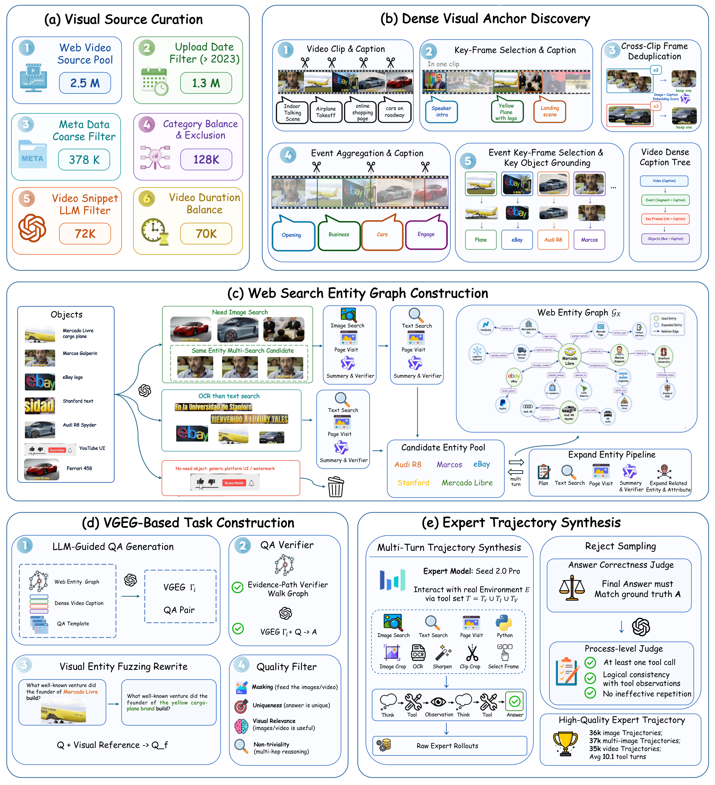
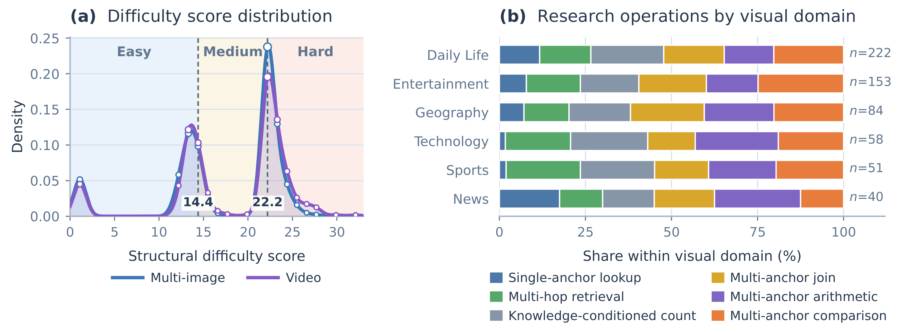
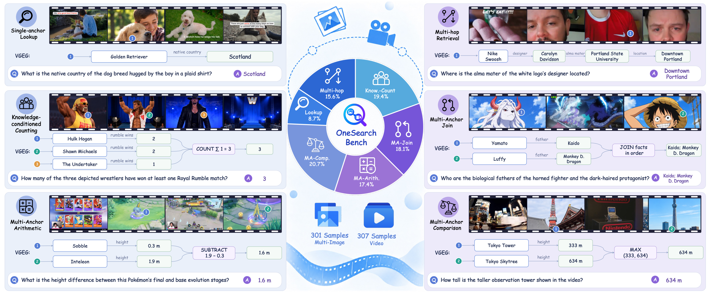
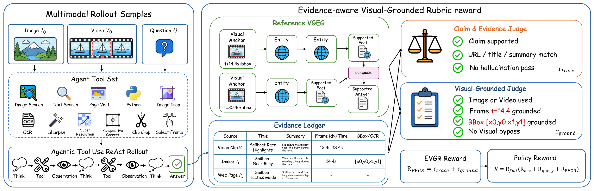

<div align="right">

[← Back to Home](../../README.md)

</div>

<h1 align="center">OneSearch-VL: Unified Multimodal Deep Research Agent for Image and Video</h1>

---

## Paper Information

| Field | Value |
|---|---|
| Title | OneSearch-VL: Unified Multimodal Deep Research Agent for Image and Video |
| Authors | Hongyu Li, Manyuan Zhang, Kaituo Feng, Shu Chen, Dian Zheng, Hao Li, Hao Yu, Zhangquan Chen, Zoey Guo, Ray Zhang, Shaofei Huang, Tianrui Hui, Linjiang Huang, Si Liu |
| Venue | arXiv |
| Year | 2026 |
| Topic | Unified image and video deep research with visually grounded evidence graphs and evidence-aware reinforcement learning |
| Paper Link | [2610.12419v1](https://arxiv.org/abs/2610.12419v1) |
| PDF | [Paper PDF](https://arxiv.org/pdf/2610.12419v1) |
| Project | [appletea233/OneSearch-VL](https://github.com/appletea233/OneSearch-VL) |
| Source Version | v1, 32 pages including appendices |
| Method Figures PPT | [Editable method-figure deck](method_figures/method_figures_editable.pptx) |
| Original Asset License | [arXiv non-exclusive distribution license](https://arxiv.org/licenses/nonexclusive-distrib/1.0/license.html) grants distribution rights to arXiv, not general downstream reuse permission. The code repository's Apache-2.0 license does not automatically license paper figures or embedded photographs, logos, animation and game imagery. Original rights remain with their respective owners. |

The combined deck includes all three approved method/concept figures in natural order, uniformly scaled onto a common 16:9 canvas with white letterboxing and no stretching. Each finalized slide was rendered and visually checked; the individual editability boundaries below also apply to this deck. It is a reconstruction, not the authors' original source, and has not been tested in the PowerPoint application.

---

## Asset Preview Gallery

<table>
  <tr>
    <th>Method Figures</th>
    <th>Result Figures</th>
    <th>Table Figures</th>
  </tr>
  <tr>
    <td align="center">
      <br>
      <sub>VGEG-centered Multimodal Data Engine</sub>
    </td>
    <td align="center">
      <br>
      <sub>Benchmark Difficulty and Research-operation Distributions</sub>
    </td>
    <td align="center">—</td>
  </tr>
  <tr>
    <td align="center">
      <br>
      <sub>Research Operations and Benchmark Overview</sub>
    </td>
    <td align="center">—</td>
    <td align="center">—</td>
  </tr>
  <tr>
    <td align="center">
      <br>
      <sub>Evidence-aware Visual-Grounded Rubric Reward</sub>
    </td>
    <td align="center">—</td>
    <td align="center">—</td>
  </tr>
</table>

---

# 1. Method Figures

## Figure 1: VGEG-centered Multimodal Data Engine

<p align="center">
  
</p>

| Asset | Link |
|---|---|
| Preview Image | [fig1_vgeg_centered_multimodal_data_engine.png](method_figures/fig1_vgeg_centered_multimodal_data_engine.png) |
| Source | Figure 1, PDF page 5; full five-panel figure |
| PPT Source | [fig1_vgeg_centered_multimodal_data_engine.pptx](method_figures/fig1_vgeg_centered_multimodal_data_engine.pptx) — reconstructed, not author-provided source |

### Color Palette

Palette recovered from matching PDF vector colors and checked against the approved crop; photographs and logos are not reduced to these semantic colors.

| Role | Swatch | Color | Hex |
|---|---|---|---|
| Pipeline containers and module outlines |  | Blue | `#1F5FBF` |
| Retained entities and verification |  | Green | `#2F843F` |
| Entity categories and graph relations |  | Purple | `#683AA8` |
| Filtering and generation stages |  | Orange | `#DF6923` |
| Metadata and OCR branch |  | Teal | `#0F8E98` |
| Excluded objects |  | Red | `#EC432D` |

Reconstructed editable PPTX, not author-provided source. Main-pipeline text and vector geometry are native PowerPoint objects; mathematical symbols use original editable vector outlines rather than typeable equations. Photos, logos, pictographic icons, screenshot fragments and the inset Web Entity Graph remain independently movable raster images, with non-editable internal pixels/text/edges. Arrow paths are not endpoint-bound. Source font family aliases map to installed Comic Sans MS and Times New Roman. Actual finalized PPTX was visually reviewed through Artifact Tool roundtrip import; Microsoft PowerPoint application compatibility was not tested. Baselines, dash spacing and antialiasing are approximate.

---

## Figure 2: Research Operations and Benchmark Overview

<p align="center">
  
</p>

| Asset | Link |
|---|---|
| Preview Image | [fig2_research_operations_and_benchmark_overview.png](method_figures/fig2_research_operations_and_benchmark_overview.png) |
| Source | Figure 2, PDF page 6; complete six-operation overview |
| Asset Role | Designed task and capability overview, not an implementation architecture |
| PPT Source | [fig2_research_operations_and_benchmark_overview.pptx](method_figures/fig2_research_operations_and_benchmark_overview.pptx) — reconstructed, not author-provided source |

### Color Palette

Palette recovered from matching PDF vector colors and checked against the approved crop.

| Role | Swatch | Color | Hex |
|---|---|---|---|
| Primary visual anchors and reference markers |  | Blue | `#557DD5` |
| Answer-producing operations and answers |  | Purple | `#8964D8` |
| Second visual anchor |  | Teal | `#23A291` |
| Third visual anchor |  | Orange | `#DF9842` |
| Evidence-link annotations |  | Blue | `#91A3C8` |

Reconstructed editable PPTX, not author-provided source. All six operation cards, their evidence graphs and the central wheel are preserved; explanatory labels and diagram geometry are native PowerPoint objects. Original photos, animation/game frames, icons, logo and central decorative artwork remain independent raster images with non-editable internal pixels. Wheel sectors are editable paths, not a live data-bound chart; arrows are freeform geometry, not endpoint-bound connectors. Installed Comic Sans MS matches the source font family, with minor faux-bold weight, kerning and antialiasing differences. The finalized PPTX passed package/native-object checks and visual comparison of its Artifact Tool roundtrip render. PowerPoint application compatibility was not tested.

---

## Figure 3: Evidence-aware Visual-Grounded Rubric Reward

<p align="center">
  
</p>

| Asset | Link |
|---|---|
| Preview Image | [fig3_evidence_aware_visual_grounded_rubric_reward.png](method_figures/fig3_evidence_aware_visual_grounded_rubric_reward.png) |
| Source | Figure 3, PDF page 7; full rollout, evidence and reward composition |
| PPT Source | [fig3_evidence_aware_visual_grounded_rubric_reward.pptx](method_figures/fig3_evidence_aware_visual_grounded_rubric_reward.pptx) — reconstructed, not author-provided source |

### Color Palette

Palette recovered from matching PDF vector colors and checked against the approved crop.

| Role | Swatch | Color | Hex |
|---|---|---|---|
| Rollout, tool set and module outlines |  | Blue | `#1F5FBF` |
| Reference VGEG and supported facts |  | Green | `#3B7D23` |
| Claim-and-evidence judge |  | Orange | `#DF6923` |
| Answer composition |  | Purple | `#78206E` |
| Evidence ledger and evidence flow |  | Teal | `#156082` |

Reconstructed editable PPTX, not author-provided source. The complete rollout, reference graph, evidence ledger, both judges and reward equations are retained. Labels and ledger cells are native text; containers, grid lines, arrows and source mathematical glyph outlines are editable paths. The ledger is text plus grid geometry, not a native table widget; equation outlines are not typeable equation objects, and arrows are not endpoint-bound connectors. Source landscape/sailboat examples, tool icons and judge illustrations remain independent raster images with non-editable internal pixels. Comic Sans MS uses the matching installed family; text metrics, dash spacing and antialiasing have minor renderer differences. The finalized PPTX passed package/native-object checks and visual comparison of its Artifact Tool roundtrip render. PowerPoint application compatibility was not tested.

---

# 2. Result Analysis Figures

## Figure 4: Benchmark Difficulty and Research-operation Distributions

<p align="center">
  
</p>

| Asset | Link |
|---|---|
| Preview Image | [fig4_benchmark_difficulty_and_operation_distributions.png](result_figures/fig4_benchmark_difficulty_and_operation_distributions.png) |
| Source | Figure 4, PDF page 23; both density and normalized stacked-bar panels |

### Color Palette

| Role | Swatch | Color | Hex |
|---|---|---|---|
| Multi-image density |  | Blue | `#3978B8` |
| Video density |  | Purple | `#8659C6` |
| Single-anchor lookup |  | Blue | `#4C78A8` |
| Multi-hop retrieval |  | Green | `#55A868` |
| Knowledge-conditioned count |  | Gray | `#8795A8` |
| Multi-anchor join |  | Yellow | `#D8A62A` |
| Multi-anchor arithmetic |  | Purple | `#8066C2` |
| Multi-anchor comparison |  | Orange | `#E77C3C` |

### Plotting Code

Note: The following code is an approximate visual reconstruction based on the provided figure.
The density curves and marker positions are digitized from the published PDF vectors, not recovered raw samples. Stacked-bar counts are inferred from rendered segment widths and annotated domain totals (and agree with Table 6 operation totals); they are not independently verified benchmark records. The code preserves the two-panel design without inventing a raw sample distribution.

```python
import matplotlib.pyplot as plt
from matplotlib.lines import Line2D
from matplotlib.patches import Patch
from matplotlib.ticker import FormatStrFormatter
import numpy as np

# Approximate visual reconstruction, not the authors' original data or code.
# Density ordinates and marker positions are digitized from the published PDF
# vector paths. They are plotted geometry, NOT raw question-level samples,
# and this code does not recompute a KDE from invented observations.
# Bar segment counts are inferred from normalized vector widths and annotated n;
# their operation totals agree with Table 6. Treat them as reconstructed counts.
# Difficulty boundaries and domain n labels are transcribed from the paper.
multi_image_curve = np.array([
    [0.0, 0.016044], [0.23605, 0.025091], [0.70815, 0.044448], [0.84979, 0.048523],
    [0.94421, 0.05035], [1.03863, 0.051356], [1.13305, 0.051489], [1.22747, 0.050741],
    [1.32189, 0.049153], [1.46352, 0.045375], [1.65236, 0.038403], [2.21888, 0.015409],
    [2.40773, 0.009904], [2.59657, 0.005943], [2.7382, 0.003873], [2.92704, 0.00206],
    [3.11588, 0.001023], [3.35193, 0.000387], [3.72961, 6.5e-05], [4.86266, 0.0],
    [9.96137, 0.000251], [10.24463, 0.000794], [10.43347, 0.001573], [10.62232, 0.002921],
    [10.76395, 0.004453], [10.90557, 0.006554], [11.09442, 0.010405], [11.28326, 0.015595],
    [11.4721, 0.022165], [11.70815, 0.032197], [11.99141, 0.046504], [12.32188, 0.065588],
    [12.93562, 0.10192], [13.12446, 0.11051], [13.26609, 0.115326], [13.40772, 0.118543],
    [13.50214, 0.119767], [13.59656, 0.120261], [13.69098, 0.120046], [13.7854, 0.119153],
    [13.87982, 0.117609], [14.02146, 0.114126], [14.16309, 0.109296], [14.35193, 0.100842],
    [14.54077, 0.090272], [14.82403, 0.071509], [15.29613, 0.039721], [15.53219, 0.02714],
    [15.72103, 0.019435], [15.90986, 0.013738], [16.09871, 0.009723], [16.28755, 0.006978],
    [16.47639, 0.005114], [16.71244, 0.00356], [16.9957, 0.002327], [17.42059, 0.001129],
    [17.8927, 0.00039], [18.50643, 5.7e-05], [19.40343, 0.000118], [19.68669, 0.0005],
    [19.87553, 0.001206], [20.01716, 0.002232], [20.15879, 0.003975], [20.30042, 0.006812],
    [20.44205, 0.011233], [20.58369, 0.017822], [20.72531, 0.027208], [20.86695, 0.039973],
    [21.00858, 0.056521], [21.19742, 0.084534], [21.43347, 0.127195], [21.81115, 0.197254],
    [21.95278, 0.2176], [22.09442, 0.231818], [22.18883, 0.237313], [22.23604, 0.238799],
    [22.28326, 0.239441], [22.33047, 0.239247], [22.37768, 0.238238], [22.4721, 0.2339],
    [22.56652, 0.226763], [22.70815, 0.211794], [22.9442, 0.179839], [23.36909, 0.120928],
    [23.60515, 0.094936], [23.79399, 0.078477], [23.98283, 0.065383], [24.17167, 0.054957],
    [24.40771, 0.04463], [24.64377, 0.036325], [24.92703, 0.02812], [25.21029, 0.021401],
    [25.44634, 0.016827], [25.68239, 0.013109], [25.91844, 0.010142], [26.1545, 0.007825],
    [26.43776, 0.005784], [26.72102, 0.004427], [27.05149, 0.003489], [27.61801, 0.002605],
    [28.51501, 0.001025], [29.08154, 0.000297], [29.78969, 2.7e-05], [32.71672, 0],
    [32.99999, 0],
], dtype=float)

video_curve = np.array([
    [0.0, 0.014045], [0.23605, 0.021965], [0.70815, 0.03891], [0.84979, 0.042477],
    [0.94421, 0.044077], [1.03863, 0.044957], [1.13305, 0.045074], [1.22747, 0.044419],
    [1.32189, 0.043028], [1.46352, 0.039722], [1.65236, 0.033618], [2.21888, 0.013489],
    [2.40773, 0.00867], [2.59657, 0.005202], [2.78541, 0.002914], [2.97425, 0.001524],
    [3.16309, 0.000744], [3.44635, 0.000223], [3.96566, 1.6e-05], [7.55364, 0],
    [10.19742, 0.000273], [10.52789, 0.00091], [10.76395, 0.001922], [10.95279, 0.00329],
    [11.14163, 0.005361], [11.33047, 0.00837], [11.51931, 0.012597], [11.70815, 0.018374],
    [11.89699, 0.026058], [12.08583, 0.035957], [12.27467, 0.048171], [12.55794, 0.070077],
    [12.98283, 0.103972], [13.17167, 0.115705], [13.3133, 0.122087], [13.45493, 0.126136],
    [13.54935, 0.127528], [13.64377, 0.127916], [13.73819, 0.127364], [13.83261, 0.125946],
    [13.92703, 0.123741], [14.06867, 0.119113], [14.25751, 0.110798], [14.44635, 0.100406],
    [14.72961, 0.081951], [15.29613, 0.04387], [15.53219, 0.031463], [15.72103, 0.023776],
    [15.90986, 0.017979], [16.09871, 0.013774], [16.28755, 0.010793], [16.47639, 0.008687],
    [16.71244, 0.006863], [16.9957, 0.005372], [17.42059, 0.003832], [18.08154, 0.002092],
    [18.55364, 0.0013], [18.93133, 0.001173], [19.40343, 0.001626], [19.78111, 0.002422],
    [19.96995, 0.003241], [20.11158, 0.00432], [20.25321, 0.006092], [20.39484, 0.008925],
    [20.53647, 0.013276], [20.6781, 0.019658], [20.81974, 0.028572], [20.96137, 0.040421],
    [21.15021, 0.06107], [21.38626, 0.093762], [21.90557, 0.170285], [22.0472, 0.185093],
    [22.18883, 0.194975], [22.28326, 0.198568], [22.33047, 0.199459], [22.37768, 0.19976],
    [22.42489, 0.199488], [22.4721, 0.19867], [22.56652, 0.195517], [22.66094, 0.19059],
    [22.80257, 0.180607], [23.03862, 0.159899], [23.51072, 0.117554], [23.79399, 0.096559],
    [24.07725, 0.0793], [24.36051, 0.064935], [24.69098, 0.050676], [24.97424, 0.040228],
    [25.21029, 0.032965], [25.44634, 0.027257], [25.63518, 0.023855], [25.82402, 0.021405],
    [26.01287, 0.019743], [26.24892, 0.018455], [26.57939, 0.017405], [27.14591, 0.015655],
    [27.47638, 0.014022], [27.75965, 0.012054], [28.13733, 0.008716], [28.56222, 0.004992],
    [28.79827, 0.003482], [29.03433, 0.002532], [29.31759, 0.002034], [29.8369, 0.001922],
    [30.40342, 0.001534], [31.01716, 0.001124], [31.48926, 0.001417], [32.1502, 0.001814],
    [32.5751, 0.001454], [32.99999, 0.000826],
], dtype=float)

multi_image_markers = np.array([
    [1.1, 0.05152, 6.4344], [12.2, 0.058314, 6.0626], [13.3, 0.116227, 7.0004], [14.4, 0.098339, 6.7547],
    [15.49999, 0.02868, 5.5534], [16.59999, 0.004222, 5.4768], [22.19999, 0.237664, 8.9593], [23.29999, 0.12969, 6.4672],
    [24.39999, 0.044937, 5.9216], [25.49999, 0.015912, 5.5913], [26.59999, 0.004934, 5.4768], [27.69999, 0.002483, 5.4768],
], dtype=float)

video_markers = np.array([
    [1.1, 0.045101, 6.3352], [12.2, 0.043088, 5.7035], [13.3, 0.121559, 7.2085], [14.4, 0.103126, 6.7859],
    [15.49999, 0.032988, 5.6289], [16.59999, 0.007647, 5.5152], [17.69999, 0.003032, 5.4768], [19.89999, 0.002881, 5.4768],
    [22.19999, 0.195471, 8.3743], [23.29999, 0.135671, 6.7859], [24.39999, 0.063111, 6.1661], [25.49999, 0.02619, 5.6664],
    [26.59999, 0.01735, 5.6663], [27.69999, 0.012513, 5.6289], [29.89999, 0.001906, 5.4768], [32.09999, 0.001822, 5.4768],
], dtype=float)

domains = ['Daily Life', 'Entertainment', 'Geography', 'Technology', 'Sports', 'News']
sample_counts = np.array([222, 153, 84, 58, 51, 40])
counts = np.array([
    [26, 33, 47, 39, 32, 45],
    [12, 24, 26, 30, 23, 38],
    [6, 11, 15, 18, 17, 17],
    [1, 11, 13, 8, 14, 11],
    [1, 11, 11, 8, 10, 10],
    [7, 5, 6, 7, 10, 5],
], dtype=float)
assert np.array_equal(counts.sum(axis=1), sample_counts)
assert np.array_equal(counts.sum(axis=0), [53, 95, 118, 110, 106, 126])
operations = ['Single-anchor lookup', 'Multi-hop retrieval', 'Knowledge-conditioned count',
              'Multi-anchor join', 'Multi-anchor arithmetic', 'Multi-anchor comparison']
bar_colors = ['#4C78A8', '#55A868', '#8795A8', '#D8A62A', '#8066C2', '#E77C3C']
curve_colors = ['#3978B8', '#8659C6']
text_color, tick_color, grid_color = '#25364D', '#5F7693', '#D7E2ED'
plt.rcParams.update({'font.family': 'DejaVu Sans', 'font.size': 15,
                     'text.color': text_color, 'axes.labelcolor': text_color,
                     'xtick.color': tick_color, 'ytick.color': tick_color})
fig = plt.figure(figsize=(14.625, 5.41), dpi=200, facecolor='white')
ax = fig.add_axes([.077966, .348269, .326452, .540249])
right = fig.add_axes([.555482, .348269, .428885, .540249])

ax.set_xlim(0, 33)
ax.set_ylim(0, .251413)
for lo, hi, color, title in [(0,14.4,'#EAF3FB','Easy'),
                              (14.4,22.2,'#FBF5E6','Medium'),
                              (22.2,33,'#FCEDE8','Hard')]:
    ax.axvspan(lo, hi, color=color, zorder=0)
    ax.text((lo+hi)/2, .231, title, ha='center', va='center',
            color=tick_color, fontsize=15.6, fontweight='bold')
ax.grid(axis='y', color=grid_color, linewidth=1.25)
for data, marker_data, color in zip([multi_image_curve, video_curve],
                                   [multi_image_markers, video_markers], curve_colors):
    ax.fill_between(data[:,0], data[:,1], color=color, alpha=.10, zorder=1)
    ax.plot(data[:,0], data[:,1], color=color, linewidth=3.9, zorder=3)
    # The third column preserves published marker diameters in typographic points.
    ax.scatter(marker_data[:,0], marker_data[:,1], s=marker_data[:,2]**2,
               facecolor='white', edgecolor=color, linewidth=1.54, zorder=5)
for boundary in [14.4,22.2]:
    ax.axvline(boundary, color='#586B80', linestyle=(0,(3,2)), linewidth=1.8, zorder=2)
    ax.text(boundary, .013, f'{boundary:.1f}', ha='center', va='bottom',
            fontsize=14.4, fontweight='bold',
            bbox={'facecolor':'white','edgecolor':'none','pad':1.0}, zorder=6)
ax.set_xticks(np.arange(0,31,5))
ax.set_yticks(np.arange(0,.251,.05))
ax.yaxis.set_major_formatter(FormatStrFormatter('%.2f'))
ax.set_xlabel('Structural difficulty score', fontsize=16.44, labelpad=12)
ax.set_ylabel('Density', fontsize=16.44, labelpad=6)
ax.set_title(r'$\mathbf{(a)}$  Difficulty score distribution',
             loc='left', fontsize=19.52, color=text_color, pad=15)
ax.legend([Line2D([0],[0],color=c,lw=3.9) for c in curve_colors],
          ['Multi-image','Video'], loc='upper center', bbox_to_anchor=(.53,-.30),
          ncol=2, frameon=False, fontsize=14.8, handlelength=2.0,
          handletextpad=.5, columnspacing=1.5, borderaxespad=0)

percent = counts / sample_counts[:,None] * 100
left = np.zeros(6)
for j, color in enumerate(bar_colors):
    right.barh(np.arange(6), percent[:,j], left=left, height=.66,
               color=color, edgecolor='white', linewidth=1.54, zorder=3)
    left += percent[:,j]
right.set_xlim(0,112)
right.set_ylim(5.615,-.615)
right.set_yticks(np.arange(6), domains)
right.set_xticks([0,25,50,75,100])
right.grid(axis='x', color=grid_color, linewidth=1.25)
right.tick_params(axis='y',length=0,pad=13)
for row, n in enumerate(sample_counts):
    right.text(101.7,row,rf'$n$={n}',color=tick_color,fontsize=14.6,va='center')
right.set_xlabel('Share within visual domain (%)', fontsize=16.44,labelpad=12)
right.set_title(r'$\mathbf{(b)}$  Research operations by visual domain',
                loc='left',fontsize=19.52,color=text_color,pad=15)
right.legend([Patch(facecolor=c,edgecolor='none') for c in bar_colors], operations,
             ncol=2, loc='upper left', bbox_to_anchor=(-.025,-.30),
             frameon=False,fontsize=14.8,handlelength=.8,handleheight=.8,
             handletextpad=.45,columnspacing=1.3,labelspacing=.55,borderaxespad=0)
for target in [ax,right]:
    target.spines['top'].set_visible(False)
    target.spines['right'].set_visible(False)
    target.spines['bottom'].set_color('#A9B8C9')
    target.spines['bottom'].set_linewidth(1.2)
    target.spines['left'].set_color('#A9B8C9')
    target.spines['left'].set_linewidth(1.2)
    target.tick_params(axis='x',labelsize=15.2,pad=6,length=5,width=1.2)
    target.tick_params(axis='y',labelsize=15.6)
right.spines['left'].set_visible(False)
fig.savefig('fig4_reconstruction.png',dpi=200,facecolor='white')
fig.savefig('fig4_reconstruction.svg',facecolor='white')
plt.close(fig)
```

---

# 3. Paper Tables

No table figures selected.
