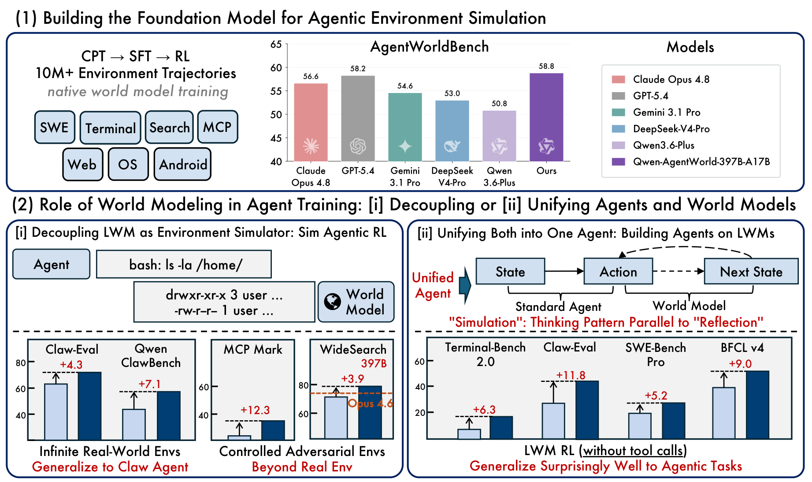
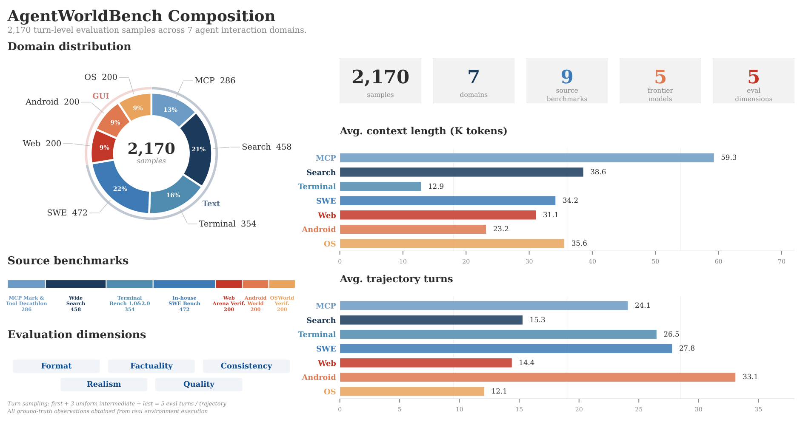
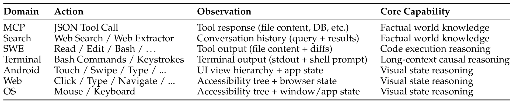
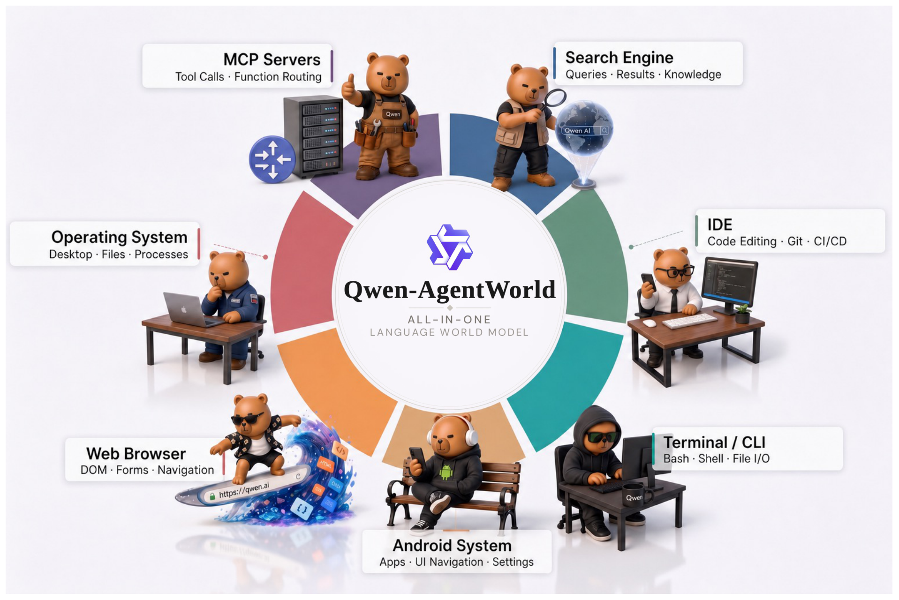
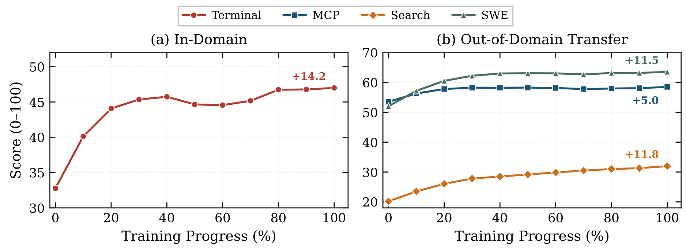
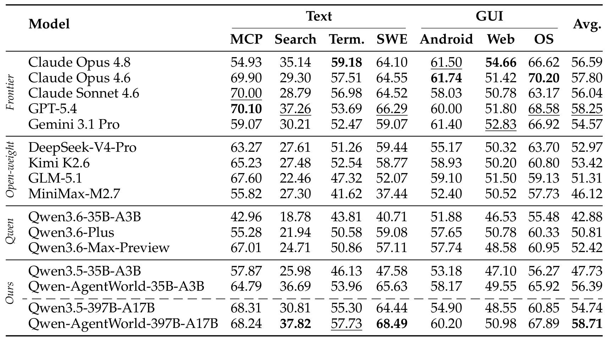
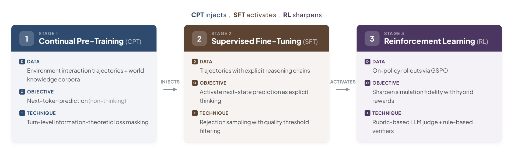
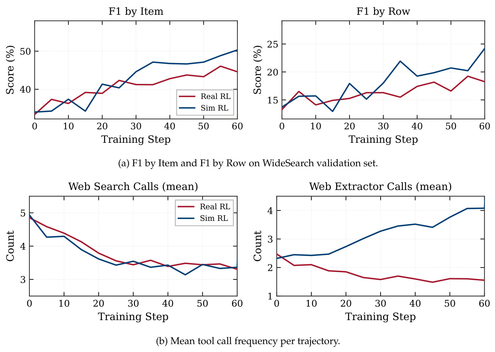

<div align="right">

[← Back to Home](../../README.md)

</div>

<h1 align="center">Qwen-AgentWorld: Language World Models for General Agents</h1>

---

## Paper Information

| Field | Value |
|---|---|
| Title | Qwen-AgentWorld: Language World Models for General Agents |
| Venue | arXiv |
| Year | 2026 |
| LaTeX Validation | 2/2 tables compiled with pdfLaTeX via LaTeX-on-HTTP and visually checked against the approved images on 2026-10-14. |
| Authors | Yuxin Zuo et al. (see the linked paper for the full author list) |
| Original Asset License | [arXiv non-exclusive distribution license](https://arxiv.org/licenses/nonexclusive-distrib/1.0/license.html) (not a public reuse license) |
| Topic | Language world models, seven-domain environment simulation, general-agent training |
| Paper Link | [arXiv paper](https://arxiv.org/abs/2606.24597v1) |
| Code | [Official code](https://github.com/QwenLM/Qwen-AgentWorld) |
| Project / Blog | [Project page](https://qwen.ai/blog?id=qwen-agentworld) |
| Assets | 3 method figures, 3 result figures, 2 tables |
| Asset Source | User-reviewed local PNGs extracted from the linked paper PDF; original labels and pages are listed below. |
| Method Figures PPT | [All method figures — editable reconstruction](method_figures/method_figures_editable.pptx) |
| Method PPT Notes | Newly reconstructed, not author-provided source. Native text and vector paths; some equations/tiny glyphs are editable outlines, not typeable text. Arrows are not endpoint-bound; charts are not data-bound. Photos, illustrations, and local effects remain independent raster objects. Fonts/shadows/gradients may differ. Final PPTX roundtrip-rendered and visually checked; PowerPoint desktop not tested. |

---

## Asset Preview Gallery

Original figure/table previews are excerpts from [the cited paper](https://arxiv.org/abs/2606.24597v1) for scholarly reference. Copyright remains with the original rightsholders. The [arXiv distribution license](https://arxiv.org/licenses/nonexclusive-distrib/1.0/license.html) does not itself grant third-party reuse rights, and these previews are not covered by this repository's MIT license. Check with the original rightsholders before redistribution or reuse. Reconstruction code and LaTeX are newly written approximations/transcriptions, not author-provided source, and no broader permission or author endorsement is asserted.

<table>
  <tr>
    <th>Method Figures</th>
    <th>Result Figures</th>
    <th>Table Figures</th>
  </tr>
  <tr>
    <td align="center">
      <br>
      <sub>Figure 1: Language World Model Overview and Agent Improvements</sub>
    </td>
    <td align="center">
      <br>
      <sub>Figure 6: AgentWorldBench Composition and Trajectory Statistics</sub>
    </td>
    <td align="center">
      <br>
      <sub>Table 1: Domain Interfaces and Core World Model Capabilities</sub>
    </td>
  </tr>
  <tr>
    <td align="center">
      <br>
      <sub>Figure 2: Seven Environment Domains and Their Interfaces</sub>
    </td>
    <td align="center">
      <br>
      <sub>Figure 8: Cross-Domain Generalization During Training</sub>
    </td>
    <td align="center">
      <br>
      <sub>Table 5: AgentWorldBench Main Results</sub>
    </td>
  </tr>
  <tr>
    <td align="center">
      <br>
      <sub>Figure 5: Three-Stage World Model Training Pipeline</sub>
    </td>
    <td align="center">
      <br>
      <sub>Figure 9: Simulated Versus Real Environment Reinforcement Learning</sub>
    </td>
    <td></td>
  </tr>
</table>

---

# 1. Method Figures

## Figure 1: Language World Model Overview and Agent Improvements

<p align="center">
  
</p>

| Asset | Link |
|---|---|
| Preview Image | [fig1_agentworld_overview.png](method_figures/fig1_agentworld_overview.png) |
| PPT Source | [Editable native/hybrid reconstruction](method_figures/fig1_agentworld_overview.pptx) |
| Source | Figure 1, PDF page 1 of the [paper](https://arxiv.org/abs/2606.24597v1) |

### Color Palette

| Role | Swatch | Color | Hex |
|---|---|---|---|
| Qwen-AgentWorld model |  | Purple | `#7A51AA` |
| Agent performance bars |  | Blue | `#003E74` |
| Claude comparison |  | Red | `#E09090` |
| Gemini comparison |  | Teal | `#6BAAA4` |
| Performance gains |  | Red | `#C00000` |
| DeepSeek comparison |  | Blue | `#7DAACA` |

---

## Figure 2: Seven Environment Domains and Their Interfaces

<p align="center">
  
</p>

| Asset | Link |
|---|---|
| Preview Image | [fig2_seven_environment_domains.png](method_figures/fig2_seven_environment_domains.png) |
| PPT Source | [Editable native/hybrid reconstruction](method_figures/fig2_seven_environment_domains.pptx) |
| Source | Figure 2, PDF page 4 of the [paper](https://arxiv.org/abs/2606.24597v1) |

### Color Palette

| Role | Swatch | Color | Hex |
|---|---|---|---|
| OS interaction domain |  | Red | `#CC696E` |
| Web interaction domain |  | Orange | `#EF9757` |
| Terminal domain |  | Teal | `#29A1A2` |
| Search domain |  | Blue | `#486D99` |
| Android domain |  | Brown | `#DBA778` |

---

## Figure 5: Three-Stage World Model Training Pipeline

<p align="center">
  
</p>

| Asset | Link |
|---|---|
| Preview Image | [fig5_three_stage_training_pipeline.png](method_figures/fig5_three_stage_training_pipeline.png) |
| PPT Source | [Editable native/hybrid reconstruction](method_figures/fig5_three_stage_training_pipeline.pptx) |
| Source | Figure 5, PDF page 7 of the [paper](https://arxiv.org/abs/2606.24597v1) |

### Color Palette

| Role | Swatch | Color | Hex |
|---|---|---|---|
| Continued pretraining stage |  | Blue | `#2E4A6F` |
| Supervised fine-tuning stage |  | Brown | `#5E432F` |
| Reinforcement learning stage |  | Purple | `#4B365C` |
| Stage badges and transitions |  | Blue | `#556A89` |

---

# 2. Result Analysis Figures

## Figure 6: AgentWorldBench Composition and Trajectory Statistics

<p align="center">
  
</p>

| Asset | Link |
|---|---|
| Preview Image | [fig6_benchmark_composition.png](result_figures/fig6_benchmark_composition.png) |
| Source | Figure 6, PDF page 13 of the [paper](https://arxiv.org/abs/2606.24597v1) |

### Plotting Code

Counts, average context lengths, and average turns reproduce the figure's printed values; dashboard layout is reconstructed.

Requires Python 3 with NumPy and Matplotlib.

```python
import numpy as np
import matplotlib.pyplot as plt
from matplotlib.lines import Line2D
from matplotlib.patches import Patch, Rectangle

plt.rcParams.update({"font.family": "DejaVu Serif", "font.size": 10,
                     "axes.titlesize": 11, "axes.labelsize": 10,
                     "axes.linewidth": 0.7, "savefig.facecolor": "white"})

def style(ax, axis="y"):
    ax.set_axisbelow(True)
    ax.grid(axis=axis, color="#E4E7EC", linewidth=0.6)
    ax.spines[["top", "right"]].set_visible(False)
    ax.spines[["bottom", "left"]].set_color("#B8BDC5")
    ax.tick_params(length=3, color="#A0A6AF")

domains = ["MCP", "Search", "Terminal", "SWE", "Web", "Android", "OS"]
counts = [286,458,354,472,200,200,200]
context = [59.3,38.6,12.9,34.2,31.1,23.2,35.6]
turns = [24.1,15.3,26.5,27.8,14.4,33.1,12.1]
colors = ["#7FA6C9","#1B3B5D","#659DB7","#3D7DB8","#C73B2A","#E78056","#ECB16F"]
fig = plt.figure(figsize=(14,7.4))
fig.text(0.025,0.96,"AgentWorldBench Composition",weight="bold",fontsize=18)
fig.text(0.025,0.925,"2,170 turn-level evaluation samples across 7 agent interaction domains.",color="#888888",fontsize=10)
ax = fig.add_axes([0.015,0.47,0.37,0.40])
wedges, labels, percentages = ax.pie(counts, labels=[f"{d}  {n}" for d,n in zip(domains,counts)], startangle=90, counterclock=False,
       colors=colors, wedgeprops={"width":0.28,"edgecolor":"white"},
       autopct=lambda p:f"{p:.0f}%", pctdistance=0.84,
       textprops={"fontsize":8}, labeldistance=1.18)
for text in percentages:
    text.set_color("white")
    text.set_fontweight("bold")
ax.pie([1570,600], radius=1.08, startangle=90, counterclock=False,
       colors=["#C7D0DC","#F0D6D0"], wedgeprops={"width":0.045,"edgecolor":"white"})
ax.text(0,0.05,"2,170",ha="center",va="center",fontsize=23,weight="bold")
ax.text(0,-0.20,"samples",ha="center",color="#777777",fontsize=10,style="italic")
ax.text(-1.03,.93,"GUI",color="#CC696E",fontsize=9,weight="bold")
ax.text(.73,-.93,"Text",color="#596F89",fontsize=9,weight="bold")
ax.set_title("Domain distribution",loc="left",fontsize=12,weight="bold")
cards = fig.add_axes([0.43,0.77,0.55,0.14])
cards.set_axis_off()
for i,(value,label,color) in enumerate(zip(["2,170","7","9","5","5"],
        ["samples","domains","source\nbenchmarks","frontier\nmodels","eval\ndimensions"],
        ["#333333","#1B3B5D","#3D7DB8","#E78056","#C73B2A"])):
    left=i/5
    cards.add_patch(Rectangle((left,0),0.19,0.92,facecolor="#F0F1F1",edgecolor="none"))
    cards.text(left+0.095,0.63,value,ha="center",fontsize=22,weight="bold",color=color)
    cards.text(left+0.095,0.18,label,ha="center",fontsize=9,color="#888888")
for rect,values,title,limit in [
    ([0.43,0.42,0.55,0.28],context,"Avg. context length (K tokens)",70),
    ([0.43,0.055,0.55,0.28],turns,"Avg. trajectory turns",36)]:
    ax=fig.add_axes(rect)
    y=np.arange(7)
    ax.barh(y,values,color=colors,height=0.58)
    ax.set_yticks(y,domains,fontsize=9)
    for tick,color in zip(ax.get_yticklabels(),colors):
        tick.set_color(color); tick.set_fontweight("bold")
    for yi,value in zip(y,values):
        ax.text(value+0.5,yi,f"{value:.1f}",va="center",fontsize=9)
    ax.invert_yaxis()
    ax.set_xlim(0,limit)
    ax.set_title(title,loc="left",weight="bold",fontsize=12)
    style(ax,"x")
    ax.spines["left"].set_visible(False)
    ax.tick_params(axis="y",length=0)
ax=fig.add_axes([0.025,0.235,0.35,0.10])
ax.set_title("Source benchmarks",loc="left",weight="bold",fontsize=12)
left=0
benchmarks=["MCP Mark &\nTool Decathlon","Wide\nSearch","Terminal\nBench 1.0&2.0",
            "In-house\nSWE Bench","Web\nArena Verif.","Android\nWorld","OSWorld\nVerif."]
for n,color,label in zip(counts,colors,benchmarks):
    width=n/sum(counts)
    ax.add_patch(Rectangle((left,0.7),width,0.23,facecolor=color,edgecolor="white"))
    ax.text(left+width/2,0.55,label+f"\n{n}",ha="center",va="top",fontsize=6,color=color,weight="bold")
    left+=width
ax.set(xlim=(0,1),ylim=(0,1)); ax.set_axis_off()
ax=fig.add_axes([0.025,0.06,0.35,0.11]); ax.set_axis_off()
ax.set_title("Evaluation dimensions",loc="left",weight="bold",fontsize=12)
for label,x,y,w in [("Format",0,0.47,.31),("Factuality",.34,.47,.31),("Consistency",.68,.47,.31),
                    ("Realism",.18,.05,.31),("Quality",.52,.05,.31)]:
    ax.add_patch(Rectangle((x,y),w,.3,facecolor="#EFF3F9",edgecolor="none"))
    ax.text(x+w/2,y+.15,label,ha="center",va="center",fontsize=9,color="#155389",weight="bold")
fig.text(.025,.012,"Turn sampling: first + 3 uniform intermediate + last = 5 eval turns / trajectory\nAll ground-truth observations obtained from real environment execution",fontsize=7,color="#888888",style="italic")

fig.savefig("fig6_benchmark_composition_reconstructed.png", dpi=300, bbox_inches="tight")
plt.show()
```

---

## Figure 8: Cross-Domain Generalization During Training

<p align="center">
  
</p>

| Asset | Link |
|---|---|
| Preview Image | [fig8_cross_domain_generalization.png](result_figures/fig8_cross_domain_generalization.png) |
| Source | Figure 8, PDF page 16 of the [paper](https://arxiv.org/abs/2606.24597v1) |

### Plotting Code

Note: The following code is an approximate visual reconstruction based on the provided figure.

Intermediate trajectory samples are visually estimated. Endpoint improvements reproduce the annotated values.

Requires Python 3 with NumPy and Matplotlib.

```python
import numpy as np
import matplotlib.pyplot as plt
from matplotlib.lines import Line2D
from matplotlib.patches import Patch, Rectangle

plt.rcParams.update({"font.family": "DejaVu Serif", "font.size": 10,
                     "axes.titlesize": 11, "axes.labelsize": 10,
                     "axes.linewidth": 0.7, "savefig.facecolor": "white"})

def style(ax, axis="y"):
    ax.set_axisbelow(True)
    ax.grid(axis=axis, color="#E4E7EC", linewidth=0.6)
    ax.spines[["top", "right"]].set_visible(False)
    ax.spines[["bottom", "left"]].set_color("#B8BDC5")
    ax.tick_params(length=3, color="#A0A6AF")

progress=np.arange(0,101,10)
terminal=[32.8,40.2,44.3,45.4,45.8,44.7,44.6,45.2,46.8,46.9,47.0]
mcp=[53.3,56.8,57.8,58.2,58.3,58.3,58.1,57.5,57.5,57.6,58.3]
search=[20.2,23.5,26.2,27.7,28.8,29.3,30.3,30.8,31.6,31.8,32.0]
swe=[52.0,57.4,60.6,62.4,63.3,63.4,63.3,62.9,63.1,63.2,63.5]
fig,axes=plt.subplots(1,2,figsize=(11.6,4))
axes[0].plot(progress,terminal,"o-",color="#BA382C",lw=1.8,ms=5,label="Terminal")
for values,color,marker,label in [(mcp,"#19597B","s","MCP"),(search,"#D27516","D","Search"),(swe,"#507362","^","SWE")]:
    axes[1].plot(progress,values,marker+"-",color=color,lw=1.6,ms=4,label=label)
axes[0].set(title="(a) In-Domain",ylabel="Score (0–100)",ylim=(30,52),yticks=np.arange(30,51,5))
axes[1].set(title="(b) Out-of-Domain Transfer",ylim=(20,70),yticks=np.arange(20,71,10))
axes[0].text(97,48.3,"+14.2",ha="right",color="#BA382C",weight="bold")
for y,label,color in [(64.5,"+11.5","#507362"),(55.8,"+5.0","#19597B"),(34.0,"+11.8","#D27516")]:
    axes[1].text(97,y,label,ha="right",color=color,weight="bold")
for ax in axes:
    ax.set(xlim=(-2,103),xlabel="Training Progress (%)",xticks=np.arange(0,101,20))
    ax.grid(color="#E7E7E7",ls="--",lw=0.5); ax.set_axisbelow(True)
    ax.tick_params(direction="in",top=True,right=True)
    for spine in ax.spines.values(): spine.set_color("#555555")
handles=axes[0].get_legend_handles_labels()[0]+axes[1].get_legend_handles_labels()[0]
fig.legend(handles,["Terminal","MCP","Search","SWE"],ncol=4,loc="upper center",frameon=True)
fig.subplots_adjust(left=.07,right=.985,bottom=.17,top=.77,wspace=.15)

fig.savefig("fig8_transfer_reconstructed.png", dpi=300, bbox_inches="tight")
plt.show()
```

---

## Figure 9: Simulated Versus Real Environment Reinforcement Learning

<p align="center">
  
</p>

| Asset | Link |
|---|---|
| Preview Image | [fig9_simulated_vs_real_rl.png](result_figures/fig9_simulated_vs_real_rl.png) |
| Source | Figure 9, PDF page 20 of the [paper](https://arxiv.org/abs/2606.24597v1) |

### Plotting Code

Note: The following code is an approximate visual reconstruction based on the provided figure.

Learning curves are visually estimated from the plotted trajectories; these are not original training logs.

Requires Python 3 with NumPy and Matplotlib.

```python
import numpy as np
import matplotlib.pyplot as plt
from matplotlib.lines import Line2D
from matplotlib.patches import Patch, Rectangle

plt.rcParams.update({"font.family": "DejaVu Serif", "font.size": 10,
                     "axes.titlesize": 11, "axes.labelsize": 10,
                     "axes.linewidth": 0.7, "savefig.facecolor": "white"})

def style(ax, axis="y"):
    ax.set_axisbelow(True)
    ax.grid(axis=axis, color="#E4E7EC", linewidth=0.6)
    ax.spines[["top", "right"]].set_visible(False)
    ax.spines[["bottom", "left"]].set_color("#B8BDC5")
    ax.tick_params(length=3, color="#A0A6AF")

steps=np.arange(0,61,5)
panels=[
    ("F1 by Item",[34,37.5,36.5,39,39,42,41,42,42.5,44,43.5,45.5,44.5],
     [34,34.2,37.5,34.5,41.5,40.5,44.8,47,46.8,46.6,47.3,48.5,50.3],"Score (%)",(32,58),[40,50]),
    ("F1 by Row",[13.7,16.5,15.0,16.4,15.4,16.9,16.4,18.0,16.7,19.2,18.3,20.1,19.2],
     [13.7,15.7,13.0,17.7,15.3,21.8,18.8,19.6,20.4,20.1,21.1,19.9,24.2],"Score (%)",(12,29),[15,20,25]),
    ("Web Search Calls (mean)",[4.9,4.6,4.4,4.1,3.8,3.6,3.4,3.6,3.4,3.5,3.4,3.4,3.3],
     [5.0,4.3,4.3,4.0,3.7,3.4,3.5,3.3,3.4,3.1,3.4,3.3,3.3],"Count",(2.5,5.5),[3,4,5]),
    ("Web Extractor Calls (mean)",[2.5,2.1,2.1,1.9,1.8,1.6,1.6,1.7,1.5,1.45,1.6,1.6,1.5],
     [2.3,2.5,2.45,2.5,2.8,3.1,3.4,3.5,3.4,3.7,4.1,4.1,4.1],"Count",(1,4.5),[1,2,3,4]),
]
fig,axes=plt.subplots(2,2,figsize=(10.5,7.5))
for ax,(title,real,sim,ylabel,limits,ticks) in zip(axes.flat,panels):
    ax.plot(steps,real,color="#B61735",lw=1.7,label="Real RL")
    ax.plot(steps,sim,color="#00518B",lw=1.7,label="Sim RL")
    ax.set(title=title,xlim=(0,60),ylim=limits,yticks=ticks,xticks=np.arange(0,61,10),xlabel="Training Step",ylabel=ylabel)
    ax.grid(color="#EAEAEA",ls="--",lw=.5); ax.set_axisbelow(True)
    ax.tick_params(direction="in")
    for spine in ax.spines.values(): spine.set_color("#555555")
for ax in [axes[0,0],axes[1,0]]:
    ax.legend(loc="lower right" if ax is axes[0,0] else "upper right",fontsize=9,frameon=True)
fig.text(.5,.505,"(a) F1 by Item and F1 by Row on WideSearch validation set.",ha="center",fontsize=10)
fig.text(.5,.015,"(b) Mean tool call frequency per trajectory.",ha="center",fontsize=10)
fig.subplots_adjust(left=.09,right=.985,top=.94,bottom=.10,wspace=.20,hspace=.63)

fig.savefig("fig9_sim_vs_real_reconstructed.png", dpi=300, bbox_inches="tight")
plt.show()
```

---

# 3. Paper Tables

## Table 1: Domain Interfaces and Core World Model Capabilities

<p align="center">
  
</p>

| Asset | Link |
|---|---|
| Preview Image | [table1_domain_capabilities.png](tables/table1_domain_capabilities.png) |
| Source | Table 1, PDF page 7 of the [paper](https://arxiv.org/abs/2606.24597v1) |

### LaTeX Source

```latex
\begin{table}[t]
\centering
\caption{Seven environment domains, their action and observation interfaces, and the core capabilities required of language world models.}
\label{tab:agentworld-domains}
\small
\setlength{\tabcolsep}{4pt}
\renewcommand{\arraystretch}{1.12}

\resizebox{\textwidth}{!}{%
\begin{tabular}{llll}
\toprule
\textbf{Domain} & \textbf{Action} & \textbf{Observation} & \textbf{Core Capability} \\
\midrule
MCP & JSON Tool Call & Tool response (file content, DB, etc.) & Factual world knowledge \\
Search & Web Search / Web Extractor & Conversation history (query + results) & Factual world knowledge \\
SWE & Read / Edit / Bash / \ldots & Tool output (file content + diffs) & Code execution reasoning \\
Terminal & Bash Commands / Keystrokes & Terminal output (stdout + shell prompt) & Long-context causal reasoning \\
Android & Touch / Swipe / Type / \ldots & UI view hierarchy + app state & Visual state reasoning \\
Web & Click / Type / Navigate / \ldots & Accessibility tree + browser state & Visual state reasoning \\
OS & Mouse / Keyboard & Accessibility tree + window/app state & Visual state reasoning \\
\bottomrule
\end{tabular}%
}
\end{table}
```

### Required Packages

```latex
\usepackage{booktabs}
\usepackage{graphicx}
```

---

## Table 5: AgentWorldBench Main Results

<p align="center">
  
</p>

| Asset | Link |
|---|---|
| Preview Image | [table5_agentworldbench_main_results.png](tables/table5_agentworldbench_main_results.png) |
| Source | Table 5, PDF page 16 of the [paper](https://arxiv.org/abs/2606.24597v1) |

### LaTeX Source

```latex
\begin{table}[t]
\centering
\caption{Main results on AgentWorldBench across four text and three GUI environment domains. Bold and underlined values reproduce the original table's highlights.}
\label{tab:agentworldbench}
\small
\setlength{\tabcolsep}{4pt}
\renewcommand{\arraystretch}{1.12}

\resizebox{\textwidth}{!}{%
\begin{tabular}{llcccccccc}
\toprule
\multirow{2}{*}{} & \multirow{2}{*}{\textbf{Model}} & \multicolumn{4}{c}{\textbf{Text}} & \multicolumn{3}{c}{\textbf{GUI}} & \multirow{2}{*}{\textbf{Avg.}} \\
\cmidrule(lr){3-6}\cmidrule(lr){7-9}
& & \textbf{MCP} & \textbf{Search} & \textbf{Term.} & \textbf{SWE} & \textbf{Android} & \textbf{Web} & \textbf{OS} & \\
\midrule
\multirow{5}{*}{\rotatebox{90}{\textit{Frontier}}} & Claude Opus 4.8 & 54.93 & 35.14 & \textbf{59.18} & 64.10 & \underline{61.50} & \textbf{54.66} & 66.62 & 56.59 \\
 & Claude Opus 4.6 & 69.90 & 29.30 & 57.51 & 64.55 & \textbf{61.74} & 51.42 & \textbf{70.20} & 57.80 \\
 & Claude Sonnet 4.6 & \underline{70.00} & 28.79 & 56.98 & 64.52 & 58.03 & 50.78 & 63.17 & 56.04 \\
 & GPT-5.4 & \textbf{70.10} & \underline{37.26} & 53.69 & \underline{66.29} & 60.00 & 51.80 & \underline{68.58} & \underline{58.25} \\
 & Gemini 3.1 Pro & 59.07 & 30.21 & 52.47 & 59.07 & 61.40 & \underline{52.83} & 66.92 & 54.57 \\
\midrule
\multirow{4}{*}{\rotatebox{90}{\textit{Open-weight}}} & DeepSeek-V4-Pro & 63.27 & 27.61 & 51.26 & 59.44 & 55.17 & 50.32 & 63.70 & 52.97 \\
 & Kimi K2.6 & 65.23 & 27.48 & 52.54 & 58.77 & 58.93 & 50.20 & 60.80 & 53.42 \\
 & GLM-5.1 & 67.60 & 22.46 & 47.32 & 52.07 & 59.10 & 51.50 & 59.13 & 51.31 \\
 & MiniMax-M2.7 & 55.82 & 27.30 & 41.62 & 37.44 & 52.40 & 50.52 & 57.73 & 46.12 \\
\midrule
\multirow{3}{*}{\rotatebox{90}{\textit{Qwen}}} & Qwen3.6-35B-A3B & 42.96 & 18.78 & 43.81 & 40.71 & 51.88 & 46.53 & 55.48 & 42.88 \\
 & Qwen3.6-Plus & 55.28 & 21.94 & 50.58 & 59.08 & 57.65 & 50.78 & 60.33 & 50.81 \\
 & Qwen3.6-Max-Preview & 67.01 & 24.71 & 50.86 & 57.11 & 57.74 & 48.58 & 60.95 & 52.42 \\
\midrule
\multirow{4}{*}{\rotatebox{90}{\textit{Ours}}} & Qwen3.5-35B-A3B & 57.87 & 25.98 & 46.13 & 47.58 & 53.18 & 47.10 & 56.27 & 47.73 \\
 & Qwen-AgentWorld-35B-A3B & 64.79 & 36.69 & 53.96 & 65.63 & 58.17 & 49.55 & 65.92 & 56.39 \\
\cdashline{2-10}
 & Qwen3.5-397B-A17B & 68.31 & 30.81 & 55.30 & 64.44 & 54.90 & 48.55 & 60.85 & 54.74 \\
 & Qwen-AgentWorld-397B-A17B & 68.24 & \textbf{37.82} & \underline{57.73} & \textbf{68.49} & 60.20 & 50.98 & 67.89 & \textbf{58.71} \\
\bottomrule
\end{tabular}%
}
\end{table}
```

### Required Packages

```latex
\usepackage{booktabs}
\usepackage{graphicx}
\usepackage{multirow}
\usepackage{arydshln}
```

---
