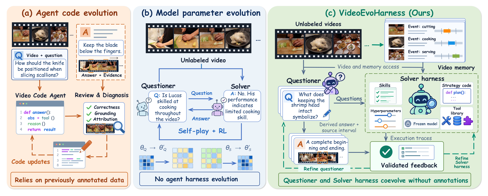
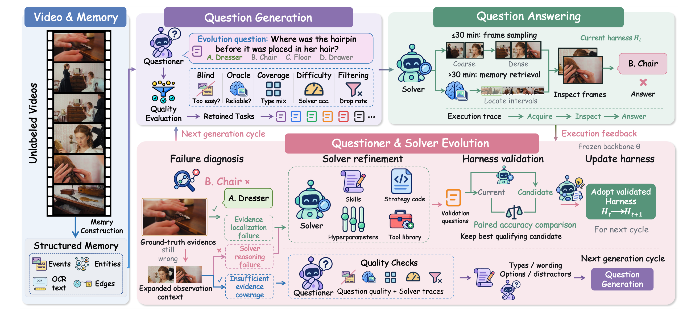

[← Back to Home](../../README.md)

<h1 align="center">VideoEvoHarness: Self Evolving Agent Harness from Unlabeled Videos for Video Understanding</h1>

---

## Paper Information

| Field | Value |
|---|---|
| Title | VideoEvoHarness: Self Evolving Agent Harness from Unlabeled Videos for Video Understanding |
| Authors | Weixin Xu, Yifan Liu, Yi Wang, Mingfei Rong, Zhenyu Yang, Zhisheng Zhong, Shengsheng Qian, Changsheng Xu |
| Venue | arXiv |
| Year | 2026 |
| Topic | Video understanding, self-evolving agent harnesses, Questioner-Solver co-evolution |
| Paper Link | [arXiv:2610.15389v1](https://arxiv.org/abs/2610.15389v1) |
| Code | [Wei-Xin-Xu/VideoEvoHarness](https://github.com/Wei-Xin-Xu/VideoEvoHarness) |
| Original Asset License | [CC BY-NC-SA 4.0](https://creativecommons.org/licenses/by-nc-sa/4.0/), as linked from the arXiv record; third-party video imagery may carry separate rights. |
| Asset Type | 3 method-category figures, including one explicitly retained qualitative case |
| Method Figures PPT | [Download all 3 editable figures](method_figures/method_figures_editable.pptx) |
| Method PPT Notes | Editable text and native vector geometry; photos/complex icons remain independent images. Equations in Fig.2 use native outlines. Arrow paths are not bound connectors. |

Figures are attributed to the authors above. Previews are cropped or user-supplied reproductions of the paper figures; PPTX files are ReFigure reconstructions rather than author-provided source. Adapted figure content is provided under [CC BY-NC-SA 4.0](https://creativecommons.org/licenses/by-nc-sa/4.0/); no additional rights to third-party video stills are asserted.

---

Verification: all four final PPTX files passed package/native-object checks and were re-imported and visually reviewed with Artifact Tool on 2026-10-15. Main lettering uses Comic Sans MS; small fallback labels/symbols use Arial, Times New Roman and Cambria Math. Panel shadows use native effects. Font metrics, thin strokes and shadows can differ from the previews; no PowerPoint-application compatibility test was performed.

## Asset Preview Gallery

<table>
  <tr>
    <th>Method Figures</th>
    <th>Result Figures</th>
    <th>Table Figures</th>
  </tr>
  <tr>
    <td align="center">
       
      Video Agent Evolution Paradigms
    </td>
    <td align="center">No result figures selected</td>
    <td align="center">No table figures selected</td>
  </tr>
  <tr>
    <td align="center">
       
      VideoEvoHarness Framework Overview
    </td>
    <td></td>
    <td></td>
  </tr>
  <tr>
    <td align="center">
       
      Initial and Evolved Solver Evidence Comparison
    </td>
    <td></td>
    <td></td>
  </tr>
</table>

---

# 1. Method Figures

## Figure 1: Video Agent Evolution Paradigms

  

| Asset | Link |
|---|---|
| Preview Image | [fig1_evolution_paradigms.png](method_figures/fig1_evolution_paradigms.png) |
| Source | Figure 1, PDF page 2; complete three-panel crop from arXiv v1. |
| PPT Source | [fig1_evolution_paradigms.pptx](method_figures/fig1_evolution_paradigms.pptx) |

### Color Palette

| Role | Swatch | Color | Hex |
|---|---|---|---|
| Agent-code revision loop |  | Orange | `#C05B1F` |
| Model-parameter evolution flow |  | Blue | `#4471C4` |
| VideoEvoHarness co-evolution |  | Teal | `#087862` |
| Code-evolution panel |  | Orange | `#FFEDDD` |
| Parameter-evolution panel |  | Blue | `#ECF3F9` |
| Proposed harness panel |  | Green | `#E1EFD9` |

Editable reconstruction: 191 text objects, 863 native vector shapes, and 38 independent image objects. All three paradigms and feedback paths retained.

---

## Figure 2: VideoEvoHarness Framework Overview

  

| Asset | Link |
|---|---|
| Preview Image | [fig2_framework_overview.png](method_figures/fig2_framework_overview.png) |
| Source | Figure 2, PDF page 5; complete framework crop from arXiv v1. |
| PPT Source | [fig2_framework_overview.pptx](method_figures/fig2_framework_overview.pptx) |

### Color Palette

| Role | Swatch | Color | Hex |
|---|---|---|---|
| Video and memory construction |  | Blue | `#577DBA` |
| Question generation and refinement |  | Purple | `#8A71AF` |
| Question answering and harness validation |  | Green | `#57947A` |
| Execution feedback and co-evolution |  | Pink | `#D77D94` |
| Evidence retrieval and coverage diagnostics |  | Blue | `#2E74B6` |

Editable reconstruction: 335 text objects, 165 native vector shapes, and 61 independent image objects. The full framework and feedback loops are retained; math glyphs use source-matched editable outlines.

---

## Figure 7: Initial and Evolved Solver Evidence Comparison

  

| Asset | Link |
|---|---|
| Preview Image | [fig7 2026-10-15 152632.png](method_figures/fig7%202026-10-15%20152632.png) |
| Source | Figure 7, PDF page 20; user-supplied screenshot, visually matched to the paper case. This file is not the original automated crop. |
| Selection | Qualitative case retained in `method_figures` as an explicit user-approved exception. |
| PPT Source | [fig7 2026-10-15 152632.pptx](method_figures/fig7%202026-10-15%20152632.pptx) |

### Color Palette

| Role | Swatch | Color | Hex |
|---|---|---|---|
| Solver response panels |  | Blue | `#EBF1F7` |
| Panel outlines |  | Blue | `#2E75B6` |
| Question border |  | Yellow | `#C59C1F` |
| Actions and selected answer E |  | Green | `#02AF4F` |
| Answer markup |  | Purple | `#6F30A0` |
| Outcome icons |  | Yellow | `#FFD869` |

Palette values are representative samples from the approved screenshot; antialiasing creates minor color variation.

Editable reconstruction: 565 text objects, 392 native vector shapes, and 31 independent image objects. Question/options, both response stages, all four video strips, and answer A/E annotations retained.

---

# 2. Result Analysis Figures

---

# 3. Paper Tables
