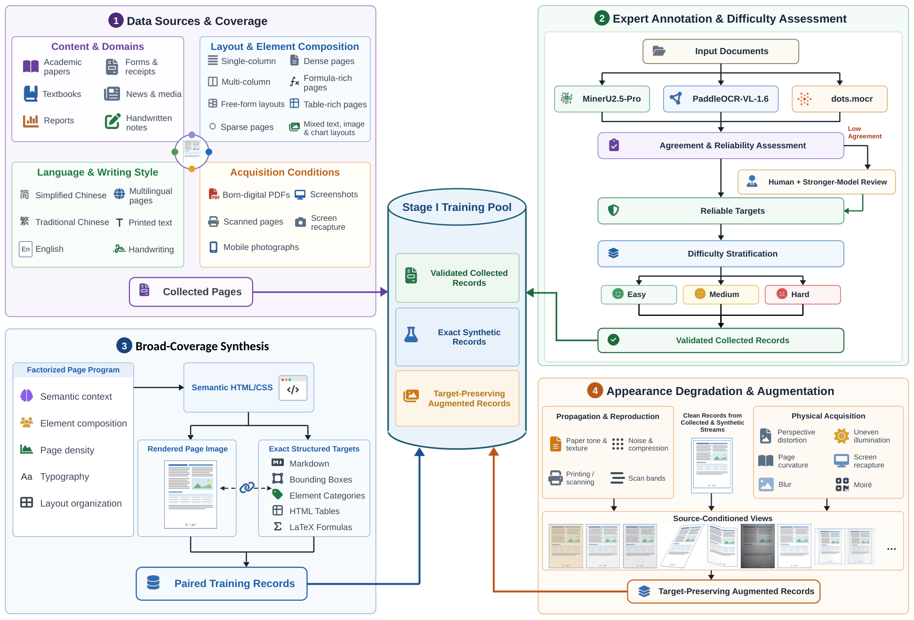
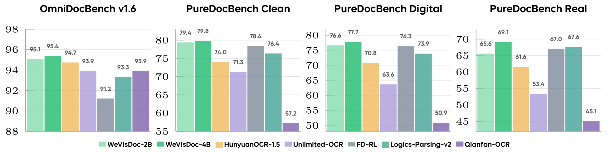
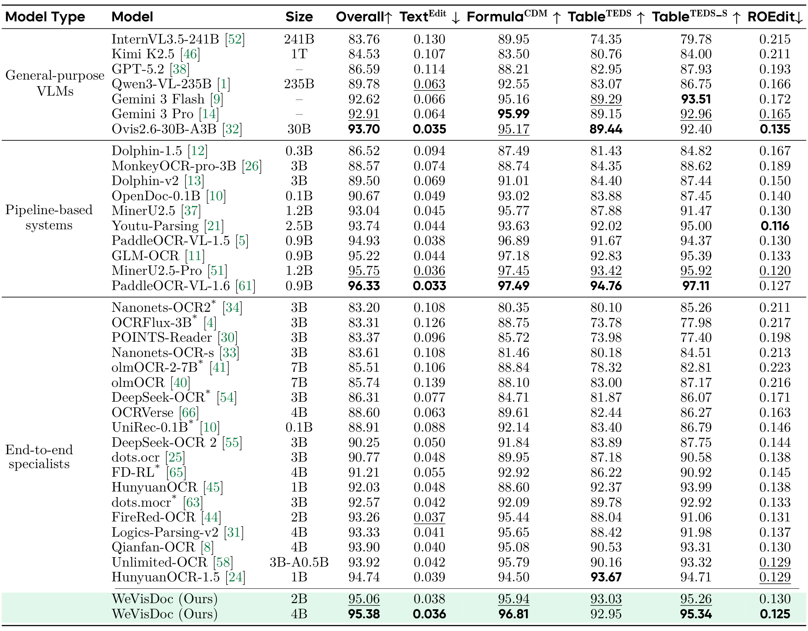
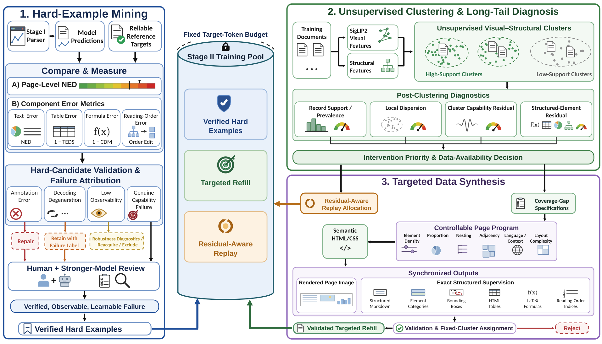
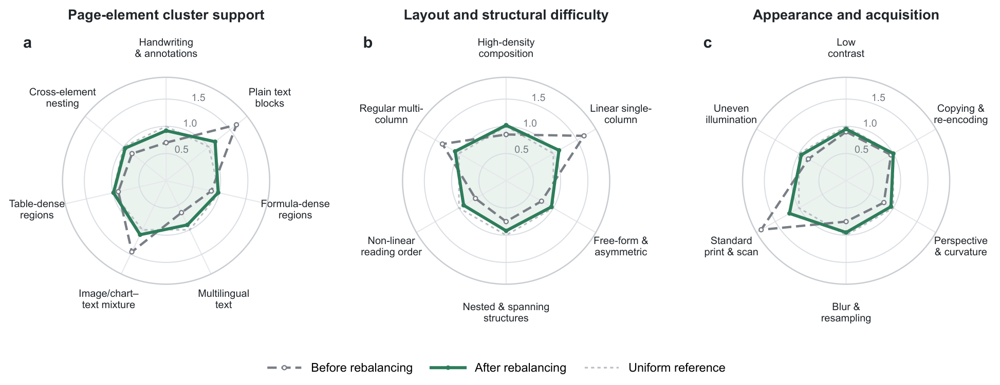
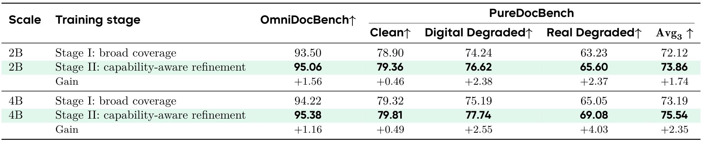

<div align="right">

[← Back to Home](../../README.md)

</div>

<h1 align="center">WeVisDoc: From Coverage to Capability for Robust End-to-End Document Parsing</h1>

---

## Paper Information

| Field | Value |
|---|---|
| Title | WeVisDoc: From Coverage to Capability for Robust End-to-End Document Parsing |
| Venue | arXiv |
| Year | 2026 |
| LaTeX Validation | 2/2 tables compiled with pdfLaTeX via LaTeX-on-HTTP and visually checked against the approved images on 2026-10-14. |
| Authors | Hao Yu, Kang Liu, Linnan Zhao, Jiabo Zhan, Chong Sun, Chen Li, Jing Lyu |
| Original Asset License | [arXiv non-exclusive distribution license](https://arxiv.org/licenses/nonexclusive-distrib/1.0/license.html) (not a public reuse license) |
| Topic | Robust end-to-end document parsing, coverage expansion, capability-aware data refinement |
| Paper Link | [arXiv paper](https://arxiv.org/abs/2609.20423v1) |
| Code | [Official code](https://github.com/Tencent/WeVisDoc) |
| Project / Blog | [Project page](https://tencent.github.io/WeVisDoc) |
| Assets | 2 method figures, 2 result figures, 2 tables |
| Asset Source | User-reviewed local PNGs extracted from the linked paper PDF; original labels and pages are listed below. |

---

## Asset Preview Gallery

Original figure/table previews are excerpts from [the cited paper](https://arxiv.org/abs/2609.20423v1) for scholarly reference. Copyright remains with the original rightsholders. The [arXiv distribution license](https://arxiv.org/licenses/nonexclusive-distrib/1.0/license.html) does not itself grant third-party reuse rights, and these previews are not covered by this repository's MIT license. Check with the original rightsholders before redistribution or reuse. Reconstruction code and LaTeX are newly written approximations/transcriptions, not author-provided source, and no broader permission or author endorsement is asserted.

<table>
  <tr>
    <th>Method Figures</th>
    <th>Result Figures</th>
    <th>Table Figures</th>
  </tr>
  <tr>
    <td align="center">
      <br>
      <sub>Figure 2: Stage I: Coverage-Oriented Data Construction</sub>
    </td>
    <td align="center">
      <br>
      <sub>Figure 1: Document Parsing Benchmark Comparison</sub>
    </td>
    <td align="center">
      <br>
      <sub>Table 2: OmniDocBench v1.6 Main Results</sub>
    </td>
  </tr>
  <tr>
    <td align="center">
      <br>
      <sub>Figure 5: Stage II: Capability-Aware Data Refinement</sub>
    </td>
    <td align="center">
      <br>
      <sub>Figure 8: Equal-Budget Cluster Rebalancing</sub>
    </td>
    <td align="center">
      <br>
      <sub>Table 4: Stage-Wise Ablation at Two Model Scales</sub>
    </td>
  </tr>
</table>

---

# 1. Method Figures

## Figure 2: Stage I: Coverage-Oriented Data Construction

<p align="center">
  
</p>

| Asset | Link |
|---|---|
| Preview Image | [fig2_stage1_coverage_data_construction.png](method_figures/fig2_stage1_coverage_data_construction.png) |
| PPT Source | Not available |
| Source | Figure 2, PDF page 6 of the [paper](https://arxiv.org/abs/2609.20423v1) |

### Color Palette

| Role | Swatch | Color | Hex |
|---|---|---|---|
| Collected data sources |  | Purple | `#6B3FA0` |
| General synthetic data |  | Blue | `#1F5FA8` |
| Multi-model expert annotation |  | Green | `#1B6B3A` |
| Shared clean training pool |  | Teal | `#1B5E70` |
| Appearance augmentation |  | Orange | `#EEBB90` |
| Synthetic record cards |  | Blue | `#9CBEE0` |

### Editable Diagram Code

Note: Editable schematic reconstruction; not author-provided source. Fine-grained layout and icon artwork are simplified.

Save the code below as an `.svg` file. Edit `<text>` labels, `fill` / `stroke` colors, and `<path d="...">` connections to customize the diagram; all shapes and labels remain vector-editable.

```svg
<svg xmlns="http://www.w3.org/2000/svg" viewBox="0 0 1440 930" role="img" aria-labelledby="title desc">
<title id="title">WeVisDoc — Stage I data construction</title>
<desc id="desc">Editable schematic: collected sources are labeled and validated; exact synthetic records join a clean pool; source-conditioned appearance augmentation preserves targets for the Stage I mixture.</desc>
<defs>
  <marker id="arrow" viewBox="0 0 10 10" refX="9" refY="5" markerWidth="8" markerHeight="8" orient="auto-start-reverse">
<path d="M0 0L10 5L0 10Z" fill="#64748B"/>
</marker>
  <marker id="teal-arrow" viewBox="0 0 10 10" refX="9" refY="5" markerWidth="8" markerHeight="8" orient="auto">
<path d="M0 0L10 5L0 10Z" fill="#237E7B"/>
</marker>
  <marker id="purple-arrow" viewBox="0 0 10 10" refX="9" refY="5" markerWidth="8" markerHeight="8" orient="auto">
<path d="M0 0L10 5L0 10Z" fill="#6B3FA0"/>
</marker>
</defs>
<rect width="1440" height="930" fill="#FFFFFF"/>
<g font-family="Arial, Helvetica, sans-serif">
<text x="30" y="44" font-size="30" fill="#253247" font-weight="700" text-anchor="start">WeVisDoc · Stage I data construction</text>
<text x="30" y="73" font-size="17" fill="#253247" font-weight="400" text-anchor="start">Coverage, reliable annotation, exact synthesis, and target-preserving augmentation</text>
<rect x="30" y="105" width="310" height="410" rx="12" fill="#F8F5FC" stroke="#AF96D3" stroke-width="2"/>
<text x="50" y="141" font-size="21" fill="#6B3FA0" font-weight="700" text-anchor="start">1  Sources &amp; coverage</text>
<text x="50" y="185" font-size="17" fill="#6B3FA0" font-weight="700" text-anchor="start">Content &amp; domains</text>
<text x="50" y="212" font-size="16" fill="#526173" font-weight="400" text-anchor="start">Papers, textbooks, reports</text>
<text x="50" y="235" font-size="16" fill="#526173" font-weight="400" text-anchor="start">Forms, news, handwritten notes</text>
<text x="50" y="274" font-size="17" fill="#1F5FA8" font-weight="700" text-anchor="start">Layout &amp; element composition</text>
<text x="50" y="301" font-size="16" fill="#526173" font-weight="400" text-anchor="start">Single / multi-column, free-form</text>
<text x="50" y="324" font-size="16" fill="#526173" font-weight="400" text-anchor="start">Formula-rich, table-rich, mixed</text>
<text x="50" y="363" font-size="17" fill="#1B6B3A" font-weight="700" text-anchor="start">Language &amp; writing</text>
<text x="50" y="390" font-size="16" fill="#526173" font-weight="400" text-anchor="start">Chinese, English, multilingual</text>
<text x="50" y="413" font-size="16" fill="#526173" font-weight="400" text-anchor="start">Printed text and handwriting</text>
<text x="50" y="452" font-size="17" fill="#A56214" font-weight="700" text-anchor="start">Acquisition conditions</text>
<text x="50" y="478" font-size="15" fill="#526173" font-weight="400" text-anchor="start">PDFs, scans, photos, screenshots</text>
<rect x="380" y="105" width="550" height="410" rx="12" fill="#F3FAF6" stroke="#96CEAC" stroke-width="2"/>
<text x="400" y="141" font-size="21" fill="#1B6B3A" font-weight="700" text-anchor="start">2  Expert annotation &amp; assessment</text>
<rect x="400" y="165" width="510" height="39" rx="8" fill="#FFFFFF" stroke="#A8B7A8" stroke-width="2"/>
<text x="655" y="191" font-size="17" fill="#253247" font-weight="700" text-anchor="middle">Input documents</text>
<path d="M655 204V220M477 220H824M477 220V230" fill="none" stroke="#64748B" stroke-width="2.5" stroke-linejoin="round" marker-end="url(#arrow)"/>
<path d="M655 220V230" fill="none" stroke="#64748B" stroke-width="2.5" stroke-linejoin="round" marker-end="url(#arrow)"/>
<path d="M824 220V230" fill="none" stroke="#64748B" stroke-width="2.5" stroke-linejoin="round" marker-end="url(#arrow)"/>
<rect x="400" y="232" width="154" height="45" rx="8" fill="#FFFFFF" stroke="#96CEAC" stroke-width="2"/>
<text x="477" y="261" font-size="15" fill="#253247" font-weight="700" text-anchor="middle">MinerU2.5-Pro</text>
<rect x="571" y="232" width="167" height="45" rx="8" fill="#F1F6FD" stroke="#9CBEE0" stroke-width="2"/>
<text x="654.5" y="261" font-size="14" fill="#253247" font-weight="700" text-anchor="middle">PaddleOCR-VL-1.6</text>
<rect x="756" y="232" width="154" height="45" rx="8" fill="#FFF8F1" stroke="#EEBB90" stroke-width="2"/>
<text x="833" y="261" font-size="16" fill="#253247" font-weight="700" text-anchor="middle">dots.mocr</text>
<path d="M477 277V290H833V277M655 290V302" fill="none" stroke="#64748B" stroke-width="2.5" stroke-linejoin="round" marker-end="url(#arrow)"/>
<rect x="400" y="304" width="510" height="39" rx="8" fill="#F5F0FC" stroke="#AF96D3" stroke-width="2"/>
<text x="655" y="330" font-size="17" fill="#6B3FA0" font-weight="700" text-anchor="middle">Agreement &amp; reliability assessment</text>
<path d="M400 324H390V432H400" fill="none" stroke="#64748B" stroke-width="2.5" stroke-linejoin="round" marker-end="url(#arrow)"/>
<path d="M655 343V357" fill="none" stroke="#64748B" stroke-width="2.5" stroke-linejoin="round" marker-end="url(#arrow)"/>
<rect x="400" y="359" width="510" height="39" rx="8" fill="#FFFBF3" stroke="#DFBE83" stroke-width="2"/>
<text x="655" y="385" font-size="15" fill="#825E25" font-weight="600" text-anchor="middle">Low agreement: human + stronger-model review</text>
<path d="M655 398V412" fill="none" stroke="#64748B" stroke-width="2.5" stroke-linejoin="round" marker-end="url(#arrow)"/>
<rect x="400" y="414" width="510" height="36" rx="8" fill="#FFFFFF" stroke="#96CEAC" stroke-width="2"/>
<text x="655" y="438" font-size="17" fill="#1B6B3A" font-weight="700" text-anchor="middle">Reliable targets</text>
<path d="M655 450V464" fill="none" stroke="#64748B" stroke-width="2.5" stroke-linejoin="round" marker-end="url(#arrow)"/>
<rect x="400" y="466" width="510" height="33" rx="8" fill="#EDF5FC" stroke="#9CBEE0" stroke-width="2"/>
<text x="655" y="488" font-size="15" fill="#1F5FA8" font-weight="600" text-anchor="middle">Difficulty stratification: easy · medium · hard</text>
<path d="M340 184H400" fill="none" stroke="#6B3FA0" stroke-width="2.5" stroke-linejoin="round" marker-end="url(#purple-arrow)"/>
<rect x="1010" y="202" width="390" height="255" rx="12" fill="#EBF4F8" stroke="#1B5E70" stroke-width="2"/>
<text x="1205" y="240" font-size="23" fill="#1B5E70" font-weight="700" text-anchor="middle">Shared clean pool</text>
<rect x="1030" y="269" width="350" height="68" rx="9" fill="#F3FAF6" stroke="#96CEAC" stroke-width="2"/>
<text x="1205" y="296" font-size="17" fill="#1B6B3A" font-weight="600" text-anchor="middle">Validated collected records</text>
<text x="1205" y="320" font-size="17" fill="#1B6B3A" font-weight="600" text-anchor="middle">Reliable targets + difficulty</text>
<rect x="1030" y="352" width="350" height="68" rx="9" fill="#F1F6FD" stroke="#9CBEE0" stroke-width="2"/>
<text x="1205" y="379" font-size="16" fill="#1F5FA8" font-weight="600" text-anchor="middle">Exact synthetic records</text>
<text x="1205" y="403" font-size="16" fill="#1F5FA8" font-weight="600" text-anchor="middle">Rendered image + structured target</text>
<path d="M910 483H965V305H1010" fill="none" stroke="#1B6B3A" stroke-width="2.5" stroke-linejoin="round" marker-end="url(#arrow)"/>
<rect x="30" y="565" width="900" height="290" rx="12" fill="#F5F9FE" stroke="#9CBEE0" stroke-width="2"/>
<text x="50" y="604" font-size="21" fill="#1F5FA8" font-weight="700" text-anchor="start">3  Broad-coverage synthesis</text>
<rect x="50" y="635" width="228" height="173" rx="9" fill="#FFFFFF" stroke="#9CBEE0" stroke-width="2"/>
<text x="68" y="663" font-size="16" fill="#1F5FA8" font-weight="700" text-anchor="start">Factorized page program</text>
<text x="68" y="694" font-size="16" fill="#526173" font-weight="400" text-anchor="start">Semantic content</text>
<text x="68" y="721" font-size="16" fill="#526173" font-weight="400" text-anchor="start">Element composition</text>
<text x="68" y="748" font-size="16" fill="#526173" font-weight="400" text-anchor="start">Density and typography</text>
<text x="68" y="775" font-size="16" fill="#526173" font-weight="400" text-anchor="start">Layout organization</text>
<rect x="318" y="635" width="198" height="75" rx="9" fill="#FFFFFF" stroke="#9CBEE0" stroke-width="2"/>
<text x="417" y="666" font-size="16" fill="#1F5FA8" font-weight="600" text-anchor="middle">Semantic HTML/CSS</text>
<text x="417" y="689" font-size="16" fill="#1F5FA8" font-weight="600" text-anchor="middle">Page rendering</text>
<rect x="556" y="635" width="354" height="173" rx="9" fill="#FFFFFF" stroke="#9CBEE0" stroke-width="2"/>
<text x="574" y="663" font-size="18" fill="#1F5FA8" font-weight="700" text-anchor="start">Paired training records</text>
<text x="574" y="697" font-size="15" fill="#526173" font-weight="400" text-anchor="start">Rendered page images</text>
<text x="574" y="724" font-size="15" fill="#526173" font-weight="400" text-anchor="start">Exact structured targets:</text>
<text x="574" y="751" font-size="15" fill="#526173" font-weight="400" text-anchor="start">Markdown · bounding boxes · categories</text>
<text x="574" y="778" font-size="15" fill="#526173" font-weight="400" text-anchor="start">HTML tables · LaTeX formulas</text>
<path d="M278 673H318" fill="none" stroke="#1F5FA8" stroke-width="2.5" stroke-linejoin="round" marker-end="url(#arrow)"/>
<path d="M516 673H556" fill="none" stroke="#1F5FA8" stroke-width="2.5" stroke-linejoin="round" marker-end="url(#arrow)"/>
<path d="M910 765H980V389H1010" fill="none" stroke="#1F5FA8" stroke-width="2.5" stroke-linejoin="round" marker-end="url(#arrow)"/>
<rect x="1010" y="550" width="390" height="185" rx="12" fill="#FFFAF4" stroke="#EEBB90" stroke-width="2"/>
<text x="1030" y="584" font-size="21" fill="#A56214" font-weight="700" text-anchor="start">4  Appearance augmentation</text>
<text x="1030" y="617" font-size="16" fill="#805923" font-weight="400" text-anchor="start">Source-conditioned views</text>
<text x="1030" y="646" font-size="16" fill="#805923" font-weight="400" text-anchor="start">Propagation: texture, noise, printing</text>
<text x="1030" y="675" font-size="16" fill="#805923" font-weight="400" text-anchor="start">Acquisition: perspective, blur, recapture</text>
<text x="1030" y="704" font-size="16" fill="#805923" font-weight="400" text-anchor="start">Targets remain unchanged</text>
<path d="M1205 457V550" fill="none" stroke="#1B5E70" stroke-width="2.5" stroke-linejoin="round" marker-end="url(#arrow)"/>
<rect x="1010" y="791" width="390" height="81" rx="12" fill="#EAF4F7" stroke="#1B5E70" stroke-width="2"/>
<text x="1205" y="822" font-size="22" fill="#1B5E70" font-weight="700" text-anchor="middle">Stage I training pool</text>
<text x="1205" y="850" font-size="13" fill="#1B5E70" font-weight="400" text-anchor="middle">Clean originals + target-preserving augmented records</text>
<path d="M1205 735V791" fill="none" stroke="#A56214" stroke-width="2.5" stroke-linejoin="round" marker-end="url(#arrow)"/>
<path d="M1400 420H1420V832H1400" fill="none" stroke="#1B5E70" stroke-width="2.5" stroke-linejoin="round" marker-end="url(#arrow)"/>
<text x="30" y="898" font-size="15" fill="#64748B" font-weight="400" text-anchor="start">Schematic reconstruction: modules and data relationships retained; fine-grained artwork simplified.</text>
</g>
</svg>
```


---

## Figure 5: Stage II: Capability-Aware Data Refinement

<p align="center">
  
</p>

| Asset | Link |
|---|---|
| Preview Image | [fig5_stage2_capability_refinement.png](method_figures/fig5_stage2_capability_refinement.png) |
| PPT Source | Not available |
| Source | Figure 5, PDF page 11 of the [paper](https://arxiv.org/abs/2609.20423v1) |

### Color Palette

| Role | Swatch | Color | Hex |
|---|---|---|---|
| Hard-example mining |  | Blue | `#1F4E99` |
| Clustering and diagnosis |  | Green | `#3A7D44` |
| Targeted synthesis |  | Purple | `#8B63B8` |
| Refined training pool |  | Teal | `#1F5C6B` |
| Residual-aware replay |  | Brown | `#A56214` |
| Module frames |  | Blue | `#6B8FC4` |

---

# 2. Result Analysis Figures

## Figure 1: Document Parsing Benchmark Comparison

<p align="center">
  
</p>

| Asset | Link |
|---|---|
| Preview Image | [fig1_document_parsing_benchmark_comparison.png](result_figures/fig1_document_parsing_benchmark_comparison.png) |
| Source | Figure 1, PDF page 1 of the [paper](https://arxiv.org/abs/2609.20423v1) |

### Plotting Code

Bar values reproduce the rounded annotations in the original figure; visual styling is reconstructed.

Requires Python 3 with NumPy and Matplotlib.

```python
import numpy as np
import matplotlib.pyplot as plt
from matplotlib.lines import Line2D
from matplotlib.patches import Patch, Rectangle

plt.rcParams.update({"font.family": "DejaVu Sans", "font.size": 10,
                     "axes.titlesize": 11, "axes.labelsize": 10,
                     "axes.linewidth": 0.7, "savefig.facecolor": "white"})

def style(ax, axis="y"):
    ax.set_axisbelow(True)
    ax.grid(axis=axis, color="#E4E7EC", linewidth=0.6)
    ax.spines[["top", "right"]].set_visible(False)
    ax.spines[["bottom", "left"]].set_color("#B8BDC5")
    ax.tick_params(length=3, color="#A0A6AF")

models = ["WeVisDoc-2B", "WeVisDoc-4B", "HunyuanOCR-1.5", "Unlimited-OCR",
          "FD-RL", "Logics-Parsing-v2", "Qianfan-OCR"]
colors = ["#9CE2BC", "#47C78C", "#F3C77C", "#B7AADF", "#97A2B2", "#68B2AB", "#9682BF"]
panels = [
    ("OmniDocBench v1.6", [95.1, 95.4, 94.7, 93.9, 91.2, 93.3, 93.9], (88, 98), 2),
    ("PureDocBench Clean", [79.4, 79.8, 74.0, 71.3, 78.4, 76.4, 57.2], (55, 82), 5),
    ("PureDocBench Digital", [76.6, 77.7, 70.8, 63.6, 76.3, 73.9, 50.9], (50, 82), 5),
    ("PureDocBench Real", [65.6, 69.1, 61.6, 53.4, 67.0, 67.6, 45.1], (45, 72), 5),
]
fig, axes = plt.subplots(1, 4, figsize=(15, 3.3))
for ax, (title, values, limits, step) in zip(axes, panels):
    ax.bar(np.arange(7), values, color=colors, width=0.94, zorder=3)
    for x, y in enumerate(values):
        ax.text(x, y + 0.4, f"{y:.1f}", ha="center", fontsize=8, color="#555555", weight="bold")
    ax.set(title=title, ylim=limits, xlim=(-0.55, 6.55), xticks=[])
    ax.set_yticks(np.arange(limits[0], limits[1] + 0.1, step))
    ax.set_title(title, pad=16, weight="bold")
    style(ax)
fig.legend([Patch(facecolor=c) for c in colors], models, ncol=7, loc="lower center",
           frameon=False, fontsize=8, handlelength=1.2, columnspacing=0.9)
fig.subplots_adjust(left=0.04, right=0.995, bottom=0.19, top=0.83, wspace=0.22)

fig.savefig("fig1_benchmarks_reconstructed.png", dpi=300, bbox_inches="tight")
plt.show()
```

---

## Figure 8: Equal-Budget Cluster Rebalancing

<p align="center">
  
</p>

| Asset | Link |
|---|---|
| Preview Image | [fig8_equal_budget_cluster_rebalancing.png](result_figures/fig8_equal_budget_cluster_rebalancing.png) |
| Source | Figure 8, PDF page 16 of the [paper](https://arxiv.org/abs/2609.20423v1) |

### Plotting Code

Note: The following code is an approximate visual reconstruction based on the provided figure.

Profiles are digitized from the source figure's vector geometry, not released raw data. Each profile has a mean of 1.0.

Requires Python 3 with NumPy and Matplotlib.

```python
import numpy as np
import matplotlib.pyplot as plt
from matplotlib.lines import Line2D
from matplotlib.patches import Patch, Rectangle

plt.rcParams.update({"font.family": "DejaVu Sans", "font.size": 10,
                     "axes.titlesize": 11, "axes.labelsize": 10,
                     "axes.linewidth": 0.7, "savefig.facecolor": "white"})

def style(ax, axis="y"):
    ax.set_axisbelow(True)
    ax.grid(axis=axis, color="#E4E7EC", linewidth=0.6)
    ax.spines[["top", "right"]].set_visible(False)
    ax.spines[["bottom", "left"]].set_color("#B8BDC5")
    ax.tick_params(length=3, color="#A0A6AF")

panels = [
    ("Page-element cluster support",
     ["Handwriting\n& annotations", "Plain text\nblocks", "Formula-dense\nregions",
      "Multilingual\ntext", "Image/chart-\ntext mixture", "Table-dense\nregions", "Cross-element\nnesting"],
     [0.70, 1.65, 0.85, 0.65, 1.45, 0.90, 0.80],
     [0.92, 1.15, 0.98, 0.90, 1.10, 0.99, 0.96]),
    ("Layout and structural difficulty",
     ["High-density\ncomposition", "Linear single-\ncolumn", "Free-form &\nasymmetric",
      "Nested & spanning\nstructures", "Non-linear\nreading order", "Regular multi-\ncolumn"],
     [0.85, 1.65, 0.75, 0.75, 0.65, 1.35],
     [1.02, 1.12, 0.96, 0.92, 0.90, 1.08]),
    ("Appearance and acquisition",
     ["Low\ncontrast", "Copying &\nre-encoding", "Perspective\n& curvature",
      "Blur &\nresampling", "Standard\nprint & scan", "Uneven\nillumination"],
     [0.90, 0.95, 0.80, 0.75, 1.80, 0.80],
     [0.95, 1.00, 0.95, 0.95, 1.20, 0.95]),
]
fig, axes = plt.subplots(1, 3, figsize=(15, 4.8), subplot_kw={"projection": "polar"})
for i, (ax, (title, labels, before, after)) in enumerate(zip(axes, panels)):
    theta = np.linspace(0, 2 * np.pi, len(labels), endpoint=False)
    closed = np.r_[theta, theta[0]]
    ax.set_theta_offset(np.pi / 2)
    ax.set_theta_direction(-1)
    ax.plot(closed, np.r_[before, before[0]], "o--", color="#7D828B", lw=1.7, ms=4, mfc="white")
    ax.plot(closed, np.r_[after, after[0]], "o-", color="#2E7D5B", lw=2.2, ms=3)
    ax.fill(closed, np.r_[after, after[0]], color="#2E7D5B", alpha=0.10)
    ax.plot(np.linspace(0, 2*np.pi, 200), np.ones(200), ":", color="#BFC3C9", lw=1)
    ax.set_xticks(theta, labels, fontsize=8)
    ax.tick_params(axis="x", pad=13)
    ax.set_ylim(0, 2)
    ax.set_yticks([0.5, 1, 1.5, 2], ["0.5", "1.0", "1.5", ""])
    ax.tick_params(axis="y", labelsize=7, colors="#89909A")
    ax.grid(color="#DDE1E7", lw=0.6)
    ax.spines["polar"].set_color("#CFD3D9")
    ax.set_title(title, y=1.20, fontsize=10, weight="bold")
    ax.text(-0.09, 1.13, "abc"[i], transform=ax.transAxes, weight="bold")
handles = [
    Line2D([], [], marker="o", linestyle="--", color="#7D828B", mfc="white", label="Before rebalancing"),
    Line2D([], [], marker="o", color="#2E7D5B", label="After rebalancing"),
    Line2D([], [], linestyle=":", color="#BFC3C9", label="Uniform reference"),
]
fig.legend(handles=handles, loc="lower center", ncol=3, frameon=False)
fig.subplots_adjust(left=0.05, right=0.95, top=0.75, bottom=0.17, wspace=0.45)

fig.savefig("fig8_rebalancing_reconstructed.png", dpi=300, bbox_inches="tight")
plt.show()
```

---

# 3. Paper Tables

## Table 2: OmniDocBench v1.6 Main Results

<p align="center">
  
</p>

| Asset | Link |
|---|---|
| Preview Image | [table2_omnidocbench_main_results.png](tables/table2_omnidocbench_main_results.png) |
| Source | Table 2, PDF page 18 of the [paper](https://arxiv.org/abs/2609.20423v1) |

### LaTeX Source

```latex
\begin{table}[t]
\centering
\caption{Document parsing on OmniDocBench v1.6. Scores for our models are means over three inference runs. Superscript $*$ marks baselines evaluated with our pipeline; unmarked results are from prior work. Bold and underlining mark the two leading results within each model series. Citation numbers follow the original paper.}
\label{tab:wevisdoc-omnidocbench}
\small
\setlength{\tabcolsep}{4pt}
\renewcommand{\arraystretch}{1.12}

\resizebox{\textwidth}{!}{%
\begin{tabular}{llccccccc}
\toprule
\textbf{Model Type} & \textbf{Model} & \textbf{Size} & \textbf{Overall}$\uparrow$ & \textbf{Text}$^{\mathrm{Edit}}\downarrow$ & \textbf{Formula}$^{\mathrm{CDM}}\uparrow$ & \textbf{Table}$^{\mathrm{TEDS}}\uparrow$ & \textbf{Table}$^{\mathrm{TEDS\_S}}\uparrow$ & \textbf{ROEdit}$\downarrow$ \\
\midrule
\multirow{7}{2cm}{\centering General-purpose VLMs} & InternVL3.5-241B \textcolor{green!40!black}{[52]} & 241B & 83.76 & 0.130 & 89.95 & 74.35 & 79.78 & 0.215 \\
 & Kimi K2.5 \textcolor{green!40!black}{[46]} & 1T & 84.53 & 0.107 & 83.50 & 80.76 & 84.00 & 0.211 \\
 & GPT-5.2 \textcolor{green!40!black}{[38]} & -- & 86.59 & 0.114 & 88.21 & 82.95 & 87.93 & 0.193 \\
 & Qwen3-VL-235B \textcolor{green!40!black}{[1]} & 235B & 89.78 & \underline{0.063} & 92.55 & 83.07 & 86.75 & 0.166 \\
 & Gemini 3 Flash \textcolor{green!40!black}{[9]} & -- & 92.62 & 0.066 & 95.16 & \underline{89.29} & \textbf{93.51} & 0.172 \\
 & Gemini 3 Pro \textcolor{green!40!black}{[14]} & -- & \underline{92.91} & 0.064 & \textbf{95.99} & 89.15 & \underline{92.96} & \underline{0.165} \\
 & Ovis2.6-30B-A3B \textcolor{green!40!black}{[32]} & 30B & \textbf{93.70} & \textbf{0.035} & \underline{95.17} & \textbf{89.44} & 92.40 & \textbf{0.135} \\
\midrule
\multirow{10}{2cm}{\centering Pipeline-based systems} & Dolphin-1.5 \textcolor{green!40!black}{[12]} & 0.3B & 86.52 & 0.094 & 87.49 & 81.43 & 84.82 & 0.167 \\
 & MonkeyOCR-pro-3B \textcolor{green!40!black}{[26]} & 3B & 88.57 & 0.074 & 88.74 & 84.35 & 88.62 & 0.189 \\
 & Dolphin-v2 \textcolor{green!40!black}{[13]} & 3B & 89.50 & 0.069 & 91.01 & 84.40 & 87.44 & 0.150 \\
 & OpenDoc-0.1B \textcolor{green!40!black}{[10]} & 0.1B & 90.67 & 0.049 & 93.02 & 83.88 & 87.45 & 0.140 \\
 & MinerU2.5 \textcolor{green!40!black}{[37]} & 1.2B & 93.04 & 0.045 & 95.77 & 87.88 & 91.47 & 0.130 \\
 & Youtu-Parsing \textcolor{green!40!black}{[21]} & 2.5B & 93.74 & 0.044 & 93.63 & 92.02 & 95.00 & \textbf{0.116} \\
 & PaddleOCR-VL-1.5 \textcolor{green!40!black}{[5]} & 0.9B & 94.93 & 0.038 & 96.89 & 91.67 & 94.37 & 0.130 \\
 & GLM-OCR \textcolor{green!40!black}{[11]} & 0.9B & 95.22 & 0.044 & 97.18 & 92.83 & 95.39 & 0.133 \\
 & MinerU2.5-Pro \textcolor{green!40!black}{[51]} & 1.2B & \underline{95.75} & \underline{0.036} & \underline{97.45} & \underline{93.42} & \underline{95.92} & \underline{0.120} \\
 & PaddleOCR-VL-1.6 \textcolor{green!40!black}{[61]} & 0.9B & \textbf{96.33} & \textbf{0.033} & \textbf{97.49} & \textbf{94.76} & \textbf{97.11} & 0.127 \\
\midrule
\multirow{21}{2cm}{\centering End-to-end specialists} & Nanonets-OCR2$^{*}$ \textcolor{green!40!black}{[34]} & 3B & 83.20 & 0.108 & 80.35 & 80.10 & 85.26 & 0.211 \\
 & OCRFlux-3B$^{*}$ \textcolor{green!40!black}{[4]} & 3B & 83.31 & 0.126 & 88.75 & 73.78 & 77.98 & 0.217 \\
 & POINTS-Reader \textcolor{green!40!black}{[30]} & 3B & 83.37 & 0.096 & 85.72 & 73.98 & 77.40 & 0.198 \\
 & Nanonets-OCR-s \textcolor{green!40!black}{[33]} & 3B & 83.61 & 0.108 & 81.46 & 80.18 & 84.51 & 0.213 \\
 & olmOCR-2-7B$^{*}$ \textcolor{green!40!black}{[41]} & 7B & 85.51 & 0.106 & 88.84 & 78.32 & 82.81 & 0.223 \\
 & olmOCR \textcolor{green!40!black}{[40]} & 7B & 85.74 & 0.139 & 88.10 & 83.00 & 87.17 & 0.216 \\
 & DeepSeek-OCR$^{*}$ \textcolor{green!40!black}{[54]} & 3B & 86.31 & 0.077 & 84.71 & 81.87 & 86.07 & 0.171 \\
 & OCRVerse \textcolor{green!40!black}{[66]} & 4B & 88.60 & 0.063 & 89.61 & 82.44 & 86.27 & 0.163 \\
 & UniRec-0.1B$^{*}$ \textcolor{green!40!black}{[10]} & 0.1B & 88.91 & 0.088 & 92.14 & 83.40 & 86.79 & 0.146 \\
 & DeepSeek-OCR 2 \textcolor{green!40!black}{[55]} & 3B & 90.25 & 0.050 & 91.84 & 83.89 & 87.75 & 0.144 \\
 & dots.ocr \textcolor{green!40!black}{[25]} & 3B & 90.77 & 0.048 & 89.95 & 87.18 & 90.58 & 0.138 \\
 & FD-RL$^{*}$ \textcolor{green!40!black}{[65]} & 4B & 91.21 & 0.055 & 92.92 & 86.22 & 90.92 & 0.145 \\
 & HunyuanOCR \textcolor{green!40!black}{[45]} & 1B & 92.03 & 0.048 & 88.60 & 92.37 & 93.99 & 0.138 \\
 & dots.mocr$^{*}$ \textcolor{green!40!black}{[63]} & 3B & 92.57 & 0.042 & 92.09 & 89.78 & 92.92 & 0.133 \\
 & FireRed-OCR \textcolor{green!40!black}{[44]} & 2B & 93.26 & \underline{0.037} & 95.44 & 88.04 & 91.06 & 0.131 \\
 & Logics-Parsing-v2 \textcolor{green!40!black}{[31]} & 4B & 93.33 & 0.041 & 95.65 & 88.42 & 91.98 & 0.137 \\
 & Qianfan-OCR \textcolor{green!40!black}{[8]} & 4B & 93.90 & 0.040 & 95.08 & 90.53 & 93.31 & 0.130 \\
 & Unlimited-OCR \textcolor{green!40!black}{[58]} & 3B-A0.5B & 93.92 & 0.042 & 95.79 & 90.16 & 93.32 & \underline{0.129} \\
 & HunyuanOCR-1.5 \textcolor{green!40!black}{[24]} & 1B & 94.74 & 0.039 & 94.50 & \textbf{93.67} & 94.71 & 0.129 \\
\cmidrule(l){2-9}
\rowcolor{green!10}
 & WeVisDoc (Ours) & 2B & \underline{95.06} & 0.038 & \underline{95.94} & \underline{93.03} & \underline{95.26} & 0.130 \\
\rowcolor{green!10}
 & WeVisDoc (Ours) & 4B & \textbf{95.38} & \textbf{0.036} & \textbf{96.81} & 92.95 & \textbf{95.34} & \textbf{0.125} \\
\bottomrule
\end{tabular}%
}
\end{table}
```

### Required Packages

```latex
\usepackage{booktabs}
\usepackage{graphicx}
\usepackage[table]{xcolor}
\usepackage{multirow}
```

---

## Table 4: Stage-Wise Ablation at Two Model Scales

<p align="center">
  
</p>

| Asset | Link |
|---|---|
| Preview Image | [table4_stagewise_ablation.png](tables/table4_stagewise_ablation.png) |
| Source | Table 4, PDF page 20 of the [paper](https://arxiv.org/abs/2609.20423v1) |

### LaTeX Source

```latex
\begin{table}[t]
\centering
\caption{Stage-wise ablation at both model scales. Overall scores are averaged over three inference runs; Avg$_3$ is the mean over the three PureDocBench tracks.}
\label{tab:wevisdoc-stagewise}
\small
\setlength{\tabcolsep}{4pt}
\renewcommand{\arraystretch}{1.12}

\resizebox{\textwidth}{!}{%
\begin{tabular}{llccccc}
\toprule
\multirow{2}{*}{\textbf{Scale}} & \multirow{2}{*}{\textbf{Training stage}} & \multirow{2}{*}{\textbf{OmniDocBench}$\uparrow$} & \multicolumn{4}{c}{\textbf{PureDocBench}} \\
\cmidrule(lr){4-7}
& & & \textbf{Clean}$\uparrow$ & \textbf{Digital Degraded}$\uparrow$ & \textbf{Real Degraded}$\uparrow$ & Avg$_3$ $\uparrow$ \\
\midrule
2B & Stage I: broad coverage & 93.50 & 78.90 & 74.24 & 63.23 & 72.12 \\
\rowcolor{green!10}
2B & Stage II: capability-aware refinement & \textbf{95.06} & \textbf{79.36} & \textbf{76.62} & \textbf{65.60} & \textbf{73.86} \\
& Gain & +1.56 & +0.46 & +2.38 & +2.37 & +1.74 \\
\midrule
4B & Stage I: broad coverage & 94.22 & 79.32 & 75.19 & 65.05 & 73.19 \\
\rowcolor{green!10}
4B & Stage II: capability-aware refinement & \textbf{95.38} & \textbf{79.81} & \textbf{77.74} & \textbf{69.08} & \textbf{75.54} \\
& Gain & +1.16 & +0.49 & +2.55 & +4.03 & +2.35 \\
\bottomrule
\end{tabular}%
}
\end{table}
```

### Required Packages

```latex
\usepackage{booktabs}
\usepackage{graphicx}
\usepackage[table]{xcolor}
\usepackage{multirow}
```

---
