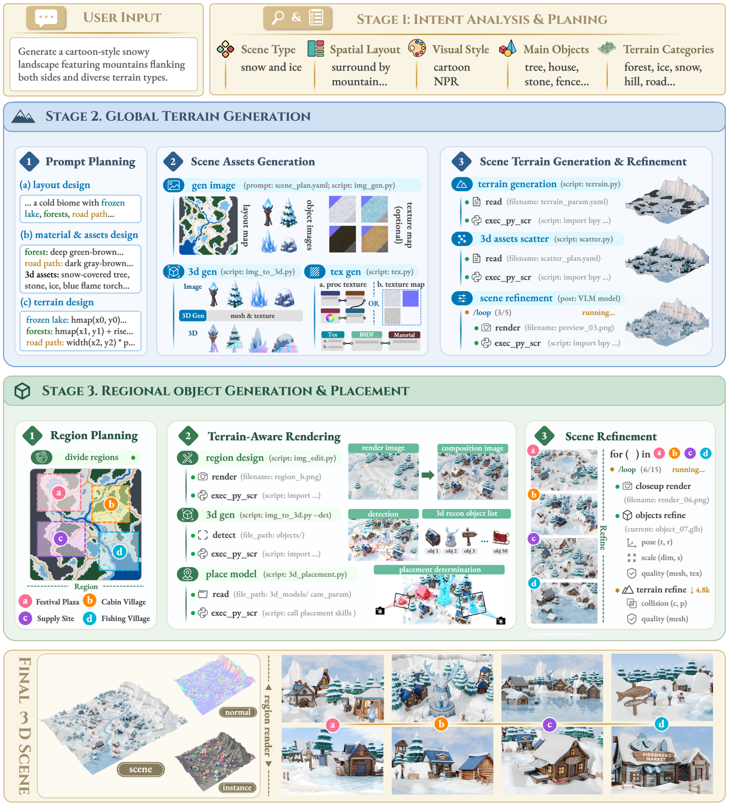
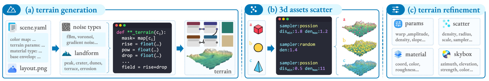

[← Back to Home](../../README.md)

<h1 align="center">WorldClaw: Agentic 3D Open-World Generation at Scale</h1>

---

## Paper Information

| Field | Value |
|---|---|
| Title | WorldClaw: Agentic 3D Open-World Generation at Scale |
| Authors | Chunchao Guo, Jinpeng Li, Yang Li, Zilong Huang |
| Venue | arXiv |
| Year | 2026 |
| Topic | Agentic coarse-to-fine generation of editable 3D open worlds |
| Paper Link | [2608.05248v1](https://arxiv.org/abs/2608.05248v1) |
| PDF | [Paper PDF](https://arxiv.org/pdf/2608.05248v1) |
| Project | [Official project](https://tencent-hunyuan.github.io/Hunyuan3D-WorldClaw) |
| Source Version | v1 |
| Method Figures PPT | [Editable method-figure deck](method_figures/method_figures_editable.pptx) |
| Original Asset License | [arXiv non-exclusive distribution license](https://arxiv.org/licenses/nonexclusive-distrib/1.0/license.html) — this distribution license does not establish general figure-redistribution permission. |

---

## Asset Preview Gallery

<table>
  <tr>
    <th>Method Figures</th>
    <th>Result Figures</th>
    <th>Table Figures</th>
  </tr>
  <tr>
    <td align="center">
       
      Global-to-Regional World Generation Framework
    </td>
    <td align="center">—</td>
    <td align="center">—</td>
  </tr>
  <tr>
    <td align="center">
       
      Terrain Generation, Asset Scattering and Refinement
    </td>
    <td align="center">—</td>
    <td align="center">—</td>
  </tr>
</table>

---

# 1. Method Figures

## Figure 1: Global-to-Regional World Generation Framework

  

| Asset | Link |
|---|---|
| Preview Image | [fig1_global_to_regional_framework.png](method_figures/fig1_global_to_regional_framework.png) |
| Source | Figure 1, PDF page 5 |
| PPT Source | [fig1_global_to_regional_framework.pptx](method_figures/fig1_global_to_regional_framework.pptx) — reconstructed, not author source |

### Color Palette

| Role | Swatch | Color | Hex |
|---|---|---|---|
| Intent planning and final scene panels |  | Yellow | `#FAF4E4` |
| Planning icons and divider accents |  | Brown | `#D5BE8C` |
| Global terrain stage |  | Blue | `#D0E1F3` |
| Regional objects stage |  | Green | `#CDE4D4` |
| Terrain tools and module strips |  | Cyan | `#DFF8FF` |
| Regional render/placement labels |  | Green | `#67BB9A` |
| Terrain-generation actions |  | Blue | `#0078B7` |

> Reconstructed PPTX, not author source. Stage/module labels, prompts, code text, frames and flow geometry are native editable objects; original 3D scenes, maps, texture samples, pictograms and some local illustrations remain independently movable images with non-editable pixels. Times New Roman/Consolas substitute unavailable raster-only source fonts; shadows and decorative details are approximate. Arrows are freeforms, not bound connectors. Final PPTX roundtrip render visually checked; PowerPoint application compatibility not tested.

---

## Figure 2: Terrain Generation, Asset Scattering and Refinement

  

| Asset | Link |
|---|---|
| Preview Image | [fig2_terrain_generation_and_refinement.png](method_figures/fig2_terrain_generation_and_refinement.png) |
| Source | Figure 2, PDF page 8 |
| PPT Source | [fig2_terrain_generation_and_refinement.pptx](method_figures/fig2_terrain_generation_and_refinement.pptx) — reconstructed, not author source |

### Color Palette

| Role | Swatch | Color | Hex |
|---|---|---|---|
| Terrain-module outlines and flow arrows |  | Blue | `#0078B7` |
| Stage-header pills |  | Cyan | `#DFF8FF` |
| Parameter and asset inputs |  | Cyan | `#E5F8FF` |
| Code / sampler panels |  | Gray | `#282A36` |
| Material node connections |  | Teal | `#27796D` |
| Material sample swatch |  | Brown | `#CDB88D` |

> Reconstructed PPTX, not author source. Stage/module labels, prompts, code text, frames and flow geometry are native editable objects; original 3D scenes, maps, texture samples, pictograms and some local illustrations remain independently movable images with non-editable pixels. Times New Roman/Consolas substitute unavailable raster-only source fonts; shadows and decorative details are approximate. Arrows are freeforms, not bound connectors. Final PPTX roundtrip render visually checked; PowerPoint application compatibility not tested.

---

# 2. Result Analysis Figures

# 3. Paper Tables
