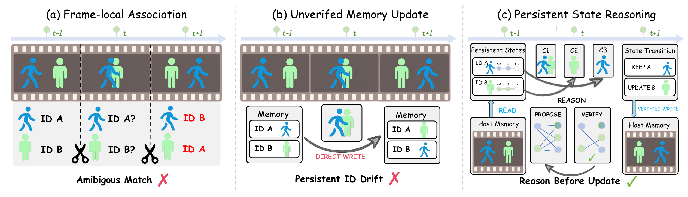
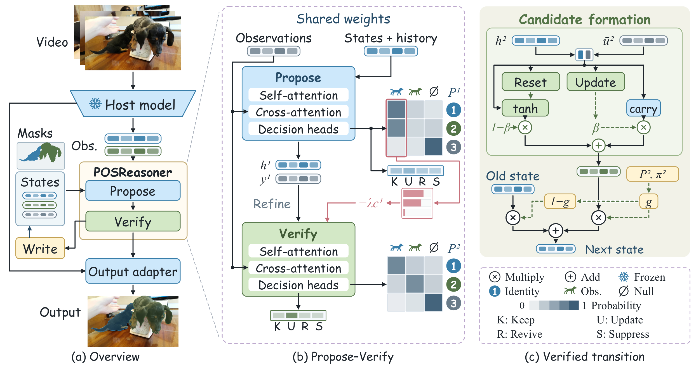

[← Back to Home](../../README.md)

<h1 align="center">Learning to Reason with Persistent Object States for Video Instance Segmentation</h1>

---

## Paper Information

| Field | Value |
|---|---|
| Title | Learning to Reason with Persistent Object States for Video Instance Segmentation |
| Authors | Yongxue Xu, Boxue Yang, Ziqian Liu, Shaoqiu Zhang, Haopeng Chen |
| Venue | Preprint |
| Year | 2026 |
| Topic | Persistent object-state reasoning for video instance segmentation |
| Paper Link | [POSReasoner project / preprint](https://github.com/IamJerryXu/POSReasoner) |
| PDF | [Paper PDF](https://raw.githubusercontent.com/IamJerryXu/POSReasoner/06f1dba649ab4142b650e95e4c9a63a1817c4646/assets/posreasoner-preprint.pdf) |
| Source Version | GitHub commit 06f1dba649ab4142b650e95e4c9a63a1817c4646 |
| Original Asset License | Paper / figure redistribution permission has not been established. |

---

## Asset Preview Gallery

<table>
  <tr>
    <th>Method Figures</th>
    <th>Result Figures</th>
    <th>Table Figures</th>
  </tr>
  <tr>
    <td align="center">
       
      From Association to Persistent-state Reasoning
    </td>
    <td align="center">—</td>
    <td align="center">—</td>
  </tr>
  <tr>
    <td align="center">
       
      Propose–Verify Reasoning and Verified State Transition
    </td>
    <td align="center">—</td>
    <td align="center">—</td>
  </tr>
</table>

---

# 1. Method Figures

## Figure 2: From Association to Persistent-state Reasoning

  

| Asset | Link |
|---|---|
| Preview Image | [fig2_association_to_persistent_state_reasoning.png](method_figures/fig2_association_to_persistent_state_reasoning.png) |
| Source | Figure 2, PDF page 4 |
| PPT Source | Not available — reconstruction skipped at the user’s request. |

### Color Palette

| Role | Swatch | Color | Hex |
|---|---|---|---|
| Object identity A |  | Blue | `#1196DB` |
| Object identity B |  | Green | `#ACF8B0` |
| Temporal direction arrow |  | Blue | `#DAE2F5` |
| Film-frame source surface |  | Brown | `#685D5B` |
| Unverified writes and association errors |  | Red | `#F14D68` |
| Verified reasoning success |  | Green | `#76BD3A` |

---

## Figure 3: Propose–Verify Reasoning and Verified State Transition

  

| Asset | Link |
|---|---|
| Preview Image | [fig3_propose_verify_method_overview.png](method_figures/fig3_propose_verify_method_overview.png) |
| Source | Figure 3, PDF page 5 |
| PPT Source | [fig3_propose_verify_method_overview.pptx](method_figures/fig3_propose_verify_method_overview.pptx) — supplied AstraDraw source, unchanged |

### Color Palette

| Role | Swatch | Color | Hex |
|---|---|---|---|
| Frozen host and Propose modules |  | Blue | `#CDE8FB` |
| Verify and candidate-state modules |  | Green | `#D3E8C6` |
| State-writing and transition gates |  | Yellow | `#FFF4D4` |
| Observation / identity A accents |  | Blue | `#387EAA` |
| Verification / identity B accents |  | Green | `#547548` |
| Rejected probability and refinement routes |  | Pink | `#C66E79` |
| Shared-weight / legend boundary |  | Purple | `#BCA8CD` |
| Probability and identity-history values |  | Gray | `#697B89` |

> User-supplied AstraDraw source, retained byte-identically. Its two slides cover the overview and reasoning detail corresponding to Figure 3. The source uses the name “State reasoner” and is a source-design variant, not a new agent reconstruction or an exact export of this paper crop. Source revision: `cc13467d3b5fe9404267e723327bf383664d96ab`.
>
> Attribution and reuse conditions: [AstraDraw SOURCES.md](https://github.com/IamJerryXu/AstraDraw/blob/cc13467d3b5fe9404267e723327bf383664d96ab/examples/paper-method/SOURCES.md). DAVIS `dogs-scale` frames `00000`, `00020`, `00040` and ground-truth mask overlays are illustrative inputs, not model predictions. Retain the original third-party notices, applicable noncommercial conditions and icon licenses when redistributing; no additional reuse grant is inferred here.

---

# 2. Result Analysis Figures

# 3. Paper Tables
